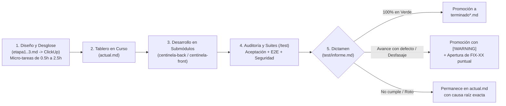

# El Centinela — Repositorio de Orquestación, Integración, Gestión y Auditoría

Este repositorio es el **centro de control, integración continua, gestión de ingeniería y verificación independiente** del proyecto **El Centinela** (plataforma web de orquestación y gestión segura de entornos virtualizados QEMU y contenedores LXC sobre **Proxmox VE**).

El código fuente de producto no vive directamente acá, sino en dos submódulos de Git acoplados en la raíz:
- **[`backend/`](./backend)** (`tayraag/centinela-back`): API REST, Server-Sent Events (SSE), WebSockets y workers asíncronos en **Go + Gin**, bajo Arquitectura Hexagonal, con **PostgreSQL 16** y **Redis 7**.
- **[`frontend/`](./frontend)** (`luzpacello/centinela-front`): Interfaz web reactiva en **React + TypeScript + Vite**.

---

## 1. Razón de Ser de este Repositorio

Cuando dos equipos desarrollan en paralelo un **Frontend** y un **Backend** que además dependen de un hipervisor físico (**Proxmox VE**), aparecen cuatro problemas clásicos de ingeniería:
1. **Falsos positivos de avance ("en mi máquina anda"):** Tareas marcadas como completadas en el gestor de proyectos (ClickUp) que tienen stubs, datos hardcodeados, casos de borde sin cubrir o regresiones colaterales.
2. **Desfasajes de contrato entre Frontend y Backend:** El backend cambia un DTO, un código de error o una ruta (por ejemplo, ocultar el `UPID` de Proxmox detrás de un UUID `tareaId` por seguridad o cambiar `/api/events/stream` a `/api/events`) y el frontend se rompe silenciosamente en producción.
3. **Bloqueos por dependencia de infraestructura física:** Si el servidor Proxmox real está en mantenimiento o aún no tiene configurados ciertos permisos/plantillas, los desarrolladores de Backend y Frontend quedan frenados.
4. **Brechas de seguridad e integridad entre capas:** Vulnerabilidades lógicas como permisos huérfanos cuando Proxmox recicla un `VMID`, falta de *rate limiting*, exposición de topología interna del host o *Account Takeover* al editar perfiles.

**Este repositorio resuelve esos cuatro problemas actuando como fuente única de verdad y árbitro técnico imparcial:**
- **Planifica y desglosa el proyecto en micro-tareas atómicas (0,5 h a 2,5 h)** listas para cargar en **ClickUp**, con estimación horaria, responsable, dependencias, archivos exactos a intervenir y criterio de éxito verificable.
- **Desacopla el desarrollo del hardware físico (*Local-First*)** proveyendo un entorno Dockerizado completo con stubs/simuladores de Proxmox VE, Redis, PostgreSQL, Mailpit con STARTTLS y Nginx con TLS.
- **Audita empíricamente cada entrega desde afuera (`test/back` y `test/front`)** sin tocar ni contaminar el código de los submódulos, ejecutando pruebas de aceptación, E2E y seguridad adversarial contra los commits reales de `main`.
- **Gobierna el ciclo de vida de las tareas y los `FIX` (`FIX-01` a `FIX-119`)**, promoviendo a `terminado*.md` únicamente lo que pasa las suites al 100% y abriendo correcciones quirúrgicas cuando detecta desfasajes de contrato, placeholders o vulnerabilidades.

---

## 2. Arquitectura del Repositorio

```text
centinela/
├── backend/                     # Submódulo Git: API Go + Gin (centinela-back)
├── frontend/                    # Submódulo Git: SPA React + TS + Vite (centinela-front)
├── docker/                      # Dockerfiles de integración y configuración Nginx (con TLS/WS/SSE)
├── scripts/
│   └── centinela.sh             # CLI operativa del stack integrado (up, down, logs, status, rebuild, reset)
├── documentacion/               # Centro neurálgico de planificación, ClickUp, auditorías y estado del proyecto
│   ├── flujo-gestion-y-progreso.md  # Historia completa de la metodología, línea de tiempo y gestión de submódulos
│   ├── etapa1.md / etapa2.md / etapa3.md  # Planificación detallada por Olas y Decisiones de Diseño (D1-D6)
│   ├── actual.md                # Tablero activo: tareas y FIX pendientes de resolución en ClickUp
│   ├── terminado.md / terminado-1.md / terminado2.md  # Historial auditado con SHA y fecha de verificación
│   ├── futuro.md / futuro-1.md / futuro2.md           # Backlog de correcciones y hardening de seguridad
│   └── archvios/                # Especificaciones maestras (centinela.md, requerimientos.md, casosdeuso.md, auditorías)
├── test/                        # Arnés de verificación independiente (Caja Negra / Integración / Adversarial)
│   ├── informe.md               # Dictamen vivo del último corte de verificación (métricas, causas raíz, promociones)
│   ├── back/                    # Suite en Go + Docker Compose multi-servicio (9 contenedores)
│   └── front/                   # Suite en Vitest + React Testing Library + jsdom (validada con Mutation Testing)
├── compose.yaml                 # Orquestación local integrada (PostgreSQL + Backend + Frontend/Nginx)
└── manejo-repo.md               # Guía operativa de submódulos y flujo de integración
```

---

## 3. Cómo Funciona el Ciclo de Gestión, Verificación y Control Centralizado

El flujo de trabajo diario entre la planificación en ClickUp y los submódulos sigue un circuito cerrado de **5 pasos** (detallado a fondo en [`documentacion/flujo-gestion-y-progreso.md`](./documentacion/flujo-gestion-y-progreso.md)):



### 3.1. Planificación por Olas y Bloques Puente (*Bridge Tasks*)
El desarrollo se dividió en **4 fases evolutivas** unidas por **Bloques Puente (`BRG-*`)** para que ningún equipo quede bloqueado al cambiar de etapa:
- **Fase Base:** Autenticación JWT + 2FA TOTP (AES-256-GCM), sesión única en Redis (`1 sesión = 1 fila`), usuarios/permisos (`FULL_ACCESS` / `READ_ONLY`), recuperación de contraseña por correo con OTP, auditoría inmutable *append-only*, Nginx TLS y cierre E2E **`LOGIN-04`**.
- **Etapa 1 (Visibilidad y Control Operativo):** Estado de salud del nodo (`/api/node/status`), inventario unificado QEMU/LXC con resolución de IPs en vivo, control de energía asíncrono (`start`, `stop`, `shutdown`, `reboot`, `delete`), worker pool de seguimiento de `UPID`, canal SSE con tickets de un solo uso e hitos **`INT-01`**, **`INT-02`** e **`INT-03`**.
- **Etapa 2 (Telemetría por Instancia, Wizard de Aprovisionamiento y Escalado):** Streaming de métricas cada 2 s por WebSocket + histórico RRDdata (`2h`/`24h`), validación de cuotas con reserva del 15% de RAM para el host y lock distribuido en Redis (`lock:instance:provisioning`), Wizard de creación de 4 pasos y modificación de vCPU/RAM con cálculo diferencial ($\Delta\text{RAM}$) y detección de *hot-plug*.
- **Etapa 3 (Snapshots, Exportación de Auditoría, Alertas Proactivas y Hardening):** CRUD asíncrono y rollback de snapshots con confirmación destructiva reforzada, exportación de auditoría CSV/JSON en streaming por cursor, worker evaluador de umbrales con **histéresis de 2 ciclos en Redis** y blindaje integral de seguridad (**`FIX-105` a `FIX-119`**).

### 3.2. Detección de Desfasajes entre Frontend y Backend
Cada vez que ambos equipos suben cambios a sus ramas `main`, este repositorio actualiza los punteros y ejecuta las suites cruzadas. Gracias a este control centralizado se detectaron y documentaron con línea exacta de código desfasajes críticos antes de llegar a producción, tales como:
- **Ruptura por ocultamiento del `UPID` (`FIX-104B` / `FIX-105`):** Cuando el backend (commit `bd22c3d`) ocultó el `UPID` nativo de Proxmox por seguridad y pasó a responder `202 Accepted` únicamente con `{ "tareaId": "<uuid>" }`, el servicio `instanceService.ts` del frontend seguía exigiendo `typeof response.upid === 'string'`, bloqueando todas las acciones en pantalla.
- **Desacople de rutas y escalas de telemetría (`FIX-45`, `FIX-97`, `FIX-103`):** Diferencias en la ruta del stream SSE (`/api/events`), en la escala porcentual de CPU ($0..100$ vs $0..1$) y en la transformación de series históricas cuando la API devuelve objetos no iterables.
- **Detección de Stubs y Placeholders (`FIX-87` a `FIX-91`):** Barridos estáticos sobre tareas declaradas terminadas que identificaron datos fijos en vistas de usuario, tarjetas sin conexión en el Dashboard y componentes de prueba (`InstanceTester.tsx`) mezclados en el árbol de producción.

### 3.3. Auditoría de Ciberseguridad y Blindaje de Infraestructura
Además de validar la funcionalidad, desde este repositorio se realizaron las auditorías de seguridad documentadas en:
- [`documentacion/archvios/analisis-cifrado-ids-vulnerabilidades-infraestructura.md`](./documentacion/archvios/analisis-cifrado-ids-vulnerabilidades-infraestructura.md)
- [`documentacion/archvios/analisis-seguridad-vulnerabilidades-permisos.md`](./documentacion/archvios/analisis-seguridad-vulnerabilidades-permisos.md)

De estas auditorías surgieron las suites adversariales (`adversarial_integrity_test.go` y `adversarial-security.test.ts`) y los planes de remediación atómica **`FIX-105` a `FIX-119`**:
1. **Air-Gap de Metadatos de Infraestructura (`FIX-105` a `FIX-110`):** Ocultamiento del `UPID` crudo tras `tareaId` (evitando filtrar hostnames, PIDs del kernel Linux y usuarios PVE), cifrado/ofuscación reversible de `VMID` secuenciales con `INSTANCE_ID_SALT` contra ataques IDOR, enmascaramiento de nombres de nodos y pools de almacenamiento, y saneamiento de trazas de error de Perl/Linux.
2. **Hardening de Autenticación, Sesiones y Permisos (`FIX-111` a `FIX-119`):** Reautenticación con contraseña + TOTP y confirmación por doble canal para cambio de email (anti-*Account Takeover*), *Rate Limiting* en Redis para Login/2FA/Recuperación y bloqueo pesimista `SELECT ... FOR UPDATE` en códigos OTP, purga transaccional de `permisos_instancia` al eliminar una VM (`BAC-24C` contra el reciclaje de `VMID` en Proxmox), revocación de sesiones activas al cambiar contraseña, soporte de contraseñas de hasta 128 caracteres (NIST SP 800-63B), sanitización por regex contra *Parameter Injection* en directivas `net0` de Proxmox, segregación de métricas globales del host para operadores y validación de existencia real y protección de los `VMID` `100..105` al asignar permisos.

---

## 4. Ejecución del Entorno y de las Suites de Verificación

### 4.1. Clonar y Sincronizar Submódulos

```bash
# Clonar el repositorio junto con backend y frontend
git clone --recurse-submodules <URL_DEL_REPO>
cd centinela

# Actualizar ambos submódulos al último commit de sus ramas main
git -C backend fetch origin --prune && git -C backend reset --hard origin/main
git -C frontend fetch origin --prune && git -C frontend reset --hard origin/main
```

### 4.2. Levantar el Entorno Integrado Local

```bash
cp .env.example .env
./scripts/centinela.sh up
```
- **Frontend (vía Nginx):** `http://localhost:8088`
- **Backend API:** `http://localhost:8080`
- Otros comandos útiles: `./scripts/centinela.sh status | logs | rebuild | down | reset`.

### 4.3. Ejecutar las Suites de Aceptación y Seguridad (`/test`)

Las pruebas viven en [`test/`](./test) y evalúan los submódulos de forma externa:

```bash
# 1. Suite de Aceptación, Integración, E2E y Seguridad Adversarial de Backend
# (Levanta automáticamente su propio stack aislado de 9 contenedores: Postgres, Redis,
#  Mailpit STARTTLS, Nginx Edge TLS, Proxmox Stub, Proxmox Simulador Go y 3 instancias del Backend)
cd test/back
go test -v -count=1 ./...

# 2. Suite de Aceptación y Seguridad Adversarial de Frontend (Vitest + RTL + jsdom)
pnpm --dir test/front test
```

Los resultados detallados de cada corrida, junto con las métricas de aprobación y el dictamen por tarea, se registran en [`test/informe.md`](./test/informe.md).

---

## 5. Mapa de Documentación Clave

| Documento | Propósito |
| :--- | :--- |
| **[`documentacion/flujo-gestion-y-progreso.md`](./documentacion/flujo-gestion-y-progreso.md)** | **Explicación completa del flujo de gestión, cronología de avances, metodología de ClickUp y validación sobre los submódulos.** |
| [`documentacion/archvios/centinela.md`](./documentacion/archvios/centinela.md) | Visión ejecutiva, problemática, alcance y arquitectura general de El Centinela. |
| [`documentacion/archvios/requerimientos.md`](./documentacion/archvios/requerimientos.md) | Especificación formal de Requerimientos Funcionales (`RF-01` a `RF-13`) y No Funcionales (`RNF-01` a `RNF-07`) con todas las salvaguardas y fixes. |
| [`documentacion/archvios/casosdeuso.md`](./documentacion/archvios/casosdeuso.md) | Especificación detallada de los 12 Casos de Uso (`CU-01` a `CU-12`), actores, flujos alternativos, códigos de error y matriz de trazabilidad. |
| [`documentacion/etapa1.md`](./documentacion/etapa1.md), [`etapa2.md`](./documentacion/etapa2.md), [`etapa3.md`](./documentacion/etapa3.md) | Planificación técnica por etapas, decisiones de arquitectura (`D1`–`D6`), bloques puente y desglose de tareas. |
| [`documentacion/actual.md`](./documentacion/actual.md) | Tablero vivo con las tareas y `FIX` actualmente pendientes de resolución por el equipo. |
| [`documentacion/terminado.md`](./documentacion/terminado.md), [`terminado-1.md`](./documentacion/terminado-1.md), [`terminado2.md`](./documentacion/terminado2.md) | Registro histórico inalterable de cada tarea completada y verificada con las suites en verde. |
| [`test/informe.md`](./test/informe.md) | Último informe técnico de ejecución de `test/back` y `test/front` contra los submódulos. |
| [`manejo-repo.md`](./manejo-repo.md) | Manual de uso de submódulos Git y comandos de Docker para el equipo. |