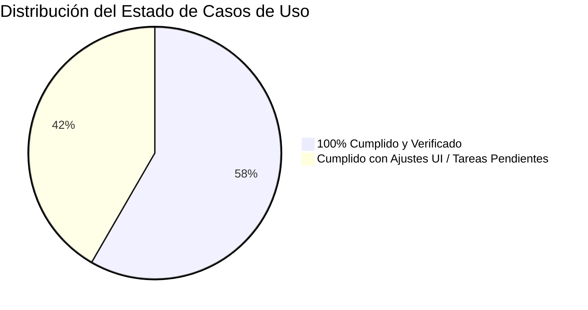
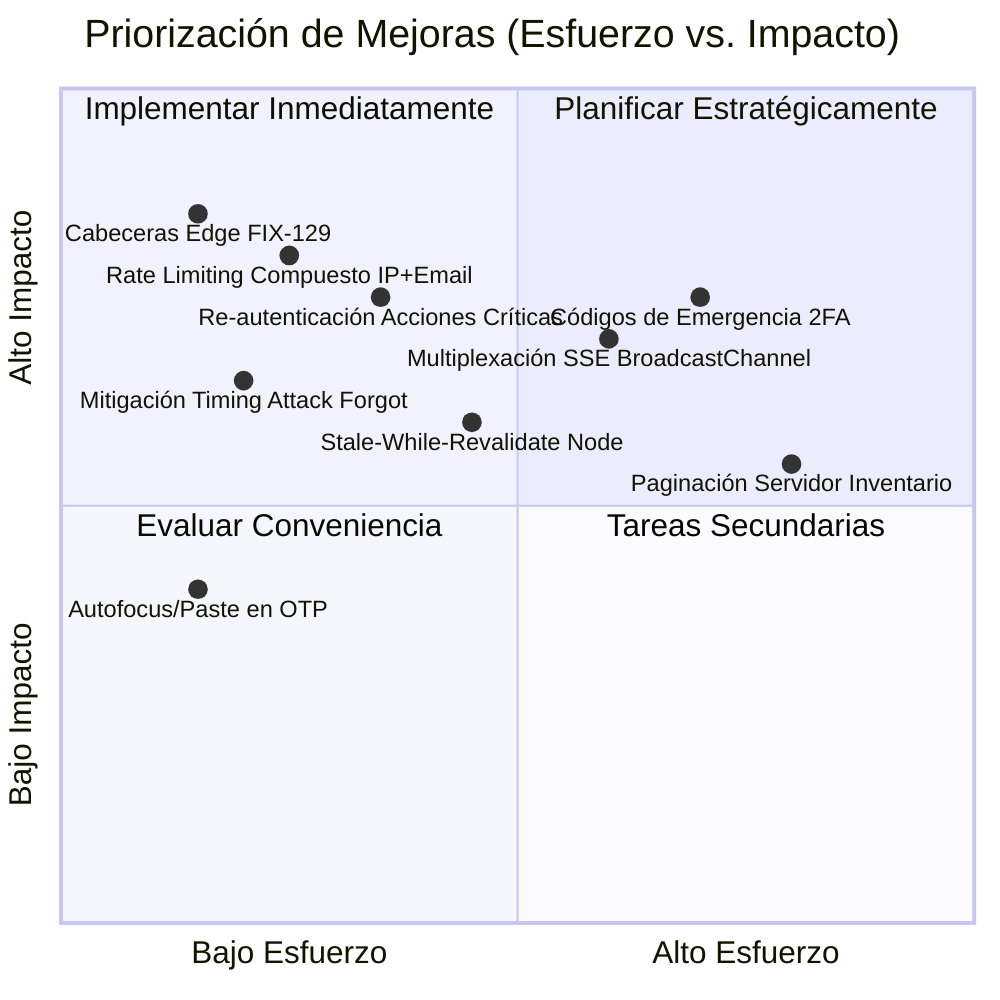

# Análisis de Cumplimiento de Casos de Uso y Propuestas de Optimización

**Proyecto:** Centinela (Plataforma Web Segura para Gestión de Virtualización en Proxmox VE)  
**Fecha de Análisis:** 30 de Octubre de 2026  
**Documento Fuente de Referencia:** [`documentacion/archvios/casosdeuso.md`](../archvios/casosdeuso.md)  
**Alcance Técnico:** Submódulos `backend` (Go/Gin/PostgreSQL/Redis), `frontend` (React/TypeScript/Vite/Tailwind), Suites de Pruebas de Aceptación e Infraestructura.

---

## 1. Resumen Ejecutivo y Estado General de Cumplimiento

Se realizó una contrastación rigurosa de los **12 Casos de Uso** (CU-01 al CU-12) contra la base de código real, la configuración de seguridad, los contratos de API y las suites de prueba automatizadas.



### Tabla Resumen de Estado

| Caso de Uso | Título Breve | Estado Global | Backend | Frontend | Observaciones / Tareas Asociadas |
| :--- | :--- | :---: | :---: | :---: | :--- |
| **CU-01** | Autenticación, 2FA y Gestión de Sesión | ✅ **100%** | ✅ 100% | ✅ 100% | Cifrado AES-256-GCM, anti-replay TOTP, cookies seguras y rate limiting. |
| **CU-02** | Dashboard General y Salud del Nodo | ⚠️ **95%** | ✅ 100% | ⚠️ 90% | Backend segrega métricas host. Pendiente en UI ocultar `StorageMeter` para operadores (`FIX-126`). |
| **CU-03** | Consultar, Filtrar e Inventariar Instancias | ✅ **100%** | ✅ 100% | ✅ 100% | Filtrado RBAC estricto, IDs opacos `inst_...`, IPs en vivo post-RBAC (`BAC-23B`). |
| **CU-04** | Control de Energía y Ciclo de Vida | ✅ **100%** | ✅ 100% | ✅ 100% | Guardas en cascada, `tareaId` opaco, purga atómica de permisos (`FIX-113`) y confirmación destructiva. |
| **CU-05** | Telemetría en Tiempo Real e Histórico | ⚠️ **90%** | ✅ 100% | ⚠️ 85% | WS con tickets efímeros y RRD activo. Métricas CPU/RAM/Disco operativas; pendiente Tráfico de Red en UI (`FIX-131`). |
| **CU-06** | Snapshots y Puntos de Restauración | ✅ **95%** | ✅ 100% | ✅ 95% | CRUD, rollback destructivo con tipeo de nombre (`FRN-30`). Ajuste de alias `:vmid`/`:instanceRef` en `FIX-127`. |
| **CU-07** | Aprovisionamiento Asistido (Wizard) | ✅ **95%** | ✅ 100% | ✅ 95% | Wizard 5 pasos, lock distribuido Redis, reserva 15% RAM. Pendiente soporte PVE 8.4 (`ADP-01`, `FRN-37`). |
| **CU-08** | Auditoría Inmutable y Exportación | ⚠️ **90%** | ✅ 100% | ⚠️ 80% | DB inmutable (trigger + revoke) y streaming con cursor. Pendiente selector dual CSV/JSON en UI (`FRN-32`, `FIX-128`). |
| **CU-09** | Gestión de Usuarios, Roles y Permisos | ✅ **100%** | ✅ 100% | ✅ 100% | Rollback transaccional ante fallo SMTP (`D5`), baja lógica con índice parcial, protección de VMs `100..105`. |
| **CU-10** | Escalado Vertical de Hardware (vCPU/RAM) | ✅ **100%** | ✅ 100% | ✅ 100% | Evaluación inteligente de cuota ($\Delta\text{RAM} > 0$ vs $\le 0$), flag `requiresReboot` y doble auditoría. |
| **CU-11** | Notificaciones SSE y Alertas Proactivas | ⚠️ **90%** | ✅ 100% | ⚠️ 80% | Backend con histéresis en Redis y filtro RBAC. Pendiente en UI centro de notificaciones y banner rojo (`FRN-33`). |
| **CU-12** | Recuperación de Contraseña con OTP | ⚠️ **95%** | ✅ 100% | ⚠️ 90% | Backend cumple anti-enumeración y quema 3 fallos. Frontend captura error 400 y quema OTP ante `SAME_PASSWORD` (`FIX-132`). |

---

## 2. Análisis Detallado por Caso de Uso

### CU-01: Autenticarse, Vincular/Verificar 2FA y Gestionar Sesión
- **Actores:** Usuario No Autenticado, Usuario Autenticado, PostgreSQL, Redis.
- **Endpoints:** `/api/auth/login`, `/api/auth/2fa/qr`, `/api/auth/2fa/verify`, `/api/account/password`, `/api/auth/refresh`, `/api/auth/logout`, `/api/account/profile`.
- **Estado de Verificación:** **100% Cumplido.**
- **Mecanismos Clave Comprobados:**
  - Token intermedio `jwtTemporal` (TTL 5 min) restringido exclusivamente a completar 2FA o cambio forzado de contraseña.
  - Almacenamiento seguro del secreto TOTP cifrado con **AES-256-GCM**.
  - Prevención de ataques de replay registrando `ultimo_totp_periodo`.
  - Cookie de sesión `centinela_refresh` configurada con directivas `HttpOnly`, `SameSite=Strict` y `Secure`.
  - Revocación proactiva de todas las sesiones activas en PostgreSQL y Redis al cambiar contraseña o cerrar sesión, enviando el evento de cierre SSE `event: cierre {"motivo": "LOGOUT"}`.

### CU-02: Visualizar Dashboard General y Salud del Nodo Físico
- **Actores:** Usuario Autenticado (`ADMIN` u `OPERATOR`), Proxmox VE API, Redis.
- **Endpoints:** `GET /api/node/status`.
- **Estado de Verificación:** **Cumplido en Backend; Desajuste cosmético en Frontend.**
- **Mecanismos Clave Comprobados:**
  - Semáforo de salud: `Saludable` (< 70%), `Advertencia` ($\ge$ 70%), `Inaccesible` (502/504).
  - Caché Redis de 5 a 10 segundos para proteger el hipervisor ante ráfagas de consultas.
  - Segregación estricta de información para operadores: el backend establece `storage = null` para rol `OPERATOR` (`FIX-117A`).
- **Desajuste Identificado:**
  - En `Dashboard.tsx`, el componente `<StorageMeter>` renderiza un círculo en 0% cuando `storage` es `null`. Se encuentra catalogado para resolución en `FIX-126` ([`futuro2.md`](../futuro2.md)).

### CU-03: Consultar, Filtrar e Inventariar Instancias
- **Actores:** `ADMIN`, `OPERATOR`.
- **Endpoints:** `GET /api/instances`, `GET /api/instances/:vmid` (y `/instances/:instanceRef`).
- **Estado de Verificación:** **100% Cumplido.**
- **Mecanismos Clave Comprobados:**
  - Filtrado RBAC en el núcleo del dominio: `ADMIN` accede a la totalidad del clúster; `OPERATOR` únicamente a las instancias autorizadas en `permisos_instancia` inyectando su `nivelAcceso` (`FULL_ACCESS` o `READ_ONLY`).
  - Resolución asíncrona de direcciones IP de red en caliente (`BAC-23B`) aplicada sobre las instancias ya filtradas, evitando sobrecargar al agente invitado de Proxmox.
  - Ofuscación de identificadores nativos en tokens opacos `inst_...` (`FIX-108`).
  - Bloqueo preventivo de controles de interfaz ante tareas activas concurrentes (`activeTask`).

### CU-04: Control de Energía y Ciclo de Vida de Instancias
- **Actores:** `ADMIN`, `OPERATOR` con permiso `FULL_ACCESS`.
- **Endpoints:** `POST /api/instances/:vmid/status/:action`, `DELETE /api/instances/:vmid`.
- **Estado de Verificación:** **100% Cumplido.**
- **Mecanismos Clave Comprobados:**
  - Cadena estricta de guardas: `RequireInstanceAccess` $\rightarrow$ `RejectProtectedInstance` (protege VMIDs `100..105`) $\rightarrow$ `RequireInstanceIdle` $\rightarrow$ `validarEstadoParaAccion`.
  - Desacoplamiento de infraestructura: el cliente recibe un `tareaId` UUIDv4 abstracto en lugar del `UPID` interno de Proxmox.
  - Doble asiento de auditoría inmutable: estado inicial `PENDING` y actualización a `EXITO` o `FALLA` al completar la tarea el worker de seguimiento.
  - Modal de borrado destructivo que requiere tipear el nombre idéntico de la instancia (`FRN-16B`).
  - Purga atómica de permisos huérfanos al confirmar la eliminación (`BAC-24C` / `FIX-113`).

### CU-05: Telemetría en Tiempo Real e Histórico de Rendimiento
- **Actores:** `ADMIN`, `OPERATOR`.
- **Endpoints:** `POST /api/auth/ws-ticket`, `/api/ws/instances/:vmid/metrics`, `GET /api/instances/:vmid/metrics`.
- **Estado de Verificación:** **Cumplido en Backend y Frontend Base; Gráfico de Red pendiente.**
- **Mecanismos Clave Comprobados:**
  - Conexión WebSocket blindada mediante tickets efímeros de un solo uso en Redis (`GETDEL`, TTL 30s) evitando exponer el JWT en la URL.
  - Lectura segura de telemetría con manejo *null-safe* cuando la instancia se encuentra apagada (`stopped`).
  - Caché de datos RRD históricos en backend de 30s (`PuntoMetricaDTO` con CPU, RAM, Disco y Red `netInBps`/`netOutBps`).
- **Desajuste Identificado:**
  - En `InstanceResourceUsage.tsx`, se renderizan métricas de CPU, Memoria y Disco, pero se omite la gráfica y métrica de Tráfico de Red (`netin`/`netout`) especificada en el caso de uso (`FIX-131` en [`futuro3.md`](../futuro3.md)).

### CU-06: Administrar Snapshots y Puntos de Restauración
- **Actores:** `ADMIN`, `OPERATOR` (`FULL_ACCESS` para mutación, `READ_ONLY` para lectura).
- **Endpoints:** `GET/POST /api/instances/:vmid/snapshots`, `POST /api/instances/:vmid/snapshots/:snapname/rollback`, `DELETE /api/instances/:vmid/snapshots/:snapname`.
- **Estado de Verificación:** **Cumplido.**
- **Mecanismos Clave Comprobados:**
  - Validación con expresiones regulares alfanuméricas estrictas sobre el nombre del snapshot (`[a-zA-Z0-9_\-]+`).
  - Modal destructivo para rollback que exige tipear el nombre exacto del snapshot (`FRN-30`).
  - Estados transitorios de bloqueo en interfaz (`SNAPSHOTTING`, `ROLLING_BACK`).
  - Ajuste documentado en `FIX-127` para desacoplar el contexto de eventos en tests unitarios.

### CU-07: Aprovisionar Nueva Instancia mediante Asistente Guiado (Wizard)
- **Actores:** Exclusivo `ADMIN`.
- **Endpoints:** `GET /api/node/storages`, `GET /api/node/templates`, `POST /api/instances`.
- **Estado de Verificación:** **Cumplido.**
- **Mecanismos Clave Comprobados:**
  - Asistente guiado de 5 pasos en frontend con medidores reactivos de cuota.
  - Bloqueo distribuido en Redis (`lock:instance:provisioning`, TTL 30s) para evitar condiciones de carrera en el consumo de RAM o colisión de `nextid`.
  - Validación de cuota real con reserva de seguridad del 15% de RAM para el sistema operativo anfitrión.
  - Sanitización anti-inyección en directivas de red y nombres de máquina (`FIX-116`).
  - Tareas de adaptación a PVE 8.4 catalogadas en `actual.md` (`ADP-01`, `FRN-37`).

### CU-08: Consultar y Exportar Registros Inmutables de Auditoría
- **Actores:** Exclusivo `ADMIN`.
- **Endpoints:** `GET /api/admin/audit`, `GET /api/admin/audit/export?formato=csv|json`.
- **Estado de Verificación:** **Cumplido en Backend; Pendiente selector dual en Frontend.**
- **Mecanismos Clave Comprobados:**
  - Inmutabilidad a nivel de base de datos garantizada por trigger `trg_auditoria_inmutable` y revocación de permisos `UPDATE`, `DELETE` y `TRUNCATE` para el usuario de la aplicación.
  - Exportación en streaming por cursor mediante `http.ResponseWriter` y buffer de 32 KiB con vaciado periódico cada 500 registros (`BAC-45`).
  - Sanitización preventiva contra inyección de fórmulas CSV (mitigación CWE-1236 ante caracteres `=,+,-,@`).
  - Auditoría del evento de exportación (`EXPORTAR_AUDITORIA`).
  - **Pendiente en UI:** Incorporar el selector dual CSV/JSON en la vista de auditoría (`FRN-32` y `FIX-128`).

### CU-09: Gestionar Usuarios, Roles, Ciclo de Vida y Permisos
- **Actores:** Exclusivo `ADMIN`.
- **Endpoints:** `GET/POST /api/admin/users`, `PUT/DELETE /api/admin/users/:id`, `GET/PUT /api/admin/users/:id/permissions`, `POST /api/admin/users/:id/password/reset`, `POST /api/admin/users/:id/2fa/reset`.
- **Estado de Verificación:** **100% Cumplido.**
- **Mecanismos Clave Comprobados:**
  - Alta con contraseña temporal y salvaguarda transaccional: si el servidor SMTP falla, la operación se revierte con `502 EMAIL_DELIVERY_FAILED` sin dejar cuentas huérfanas (`D5`).
  - Baja lógica reversible (`activo = false`) vs definitiva (`eliminado_en = NOW()`) mediante índice único parcial, manteniendo intacta la integridad referencial de la auditoría.
  - Bloqueo de auto-sabotaje (prohibido eliminarse, suspenderse o degradarse a sí mismo).
  - Protección contra escalada horizontal entre pares administradores (`FIX-112`).
  - Prohibición de asignar permisos sobre los VMIDs protegidos del sistema (`FIX-119`).

### CU-10: Modificar Recursos de Hardware (Escalado Vertical)
- **Actores:** `ADMIN` u `OPERATOR` (`FULL_ACCESS`).
- **Endpoints:** `PUT /api/instances/:vmid/config`.
- **Estado de Verificación:** **100% Cumplido.**
- **Mecanismos Clave Comprobados:**
  - Validación de cuota diferencial inteligente (`BAC-39`): si $\Delta\text{RAM} > 0$, comprueba la reserva del 15% del host; si $\Delta\text{RAM} \le 0$, permite la reducción de recursos incluso con el host saturado.
  - Retorno del flag `requiresReboot` según el estado de la máquina y el hipervisor.
  - Registro de auditoría `UPDATE_INSTANCE_CONFIG` preservando valores previos y posteriores.

### CU-11: Recibir Notificaciones y Alertas Proactivas
- **Actores:** `ADMIN`, `OPERATOR`.
- **Endpoints:** `POST /api/events/ticket`, `GET /api/events?ticket=<uuid>`.
- **Estado de Verificación:** **Cumplido en Backend; Pendiente UI de Centro de Alertas.**
- **Mecanismos Clave Comprobados:**
  - Conexión SSE autenticada por ticket de un solo uso consumido atómicamente en Redis (`GETDEL`).
  - Worker `EvaluadorUmbrales` con histéresis anti-flapping de 2 ciclos consecutivos y umbral de recuperación (`ALERT_RESOLVED`).
  - Despacho multicanal: evento SSE para operadores con permiso y correo SMTP para administradores ante severidad crítica.
  - Revocación reactiva de sesión (`event: cierre {"motivo": "USER_INACTIVE" | "SESSIONS_REVOKED"}`).
  - **Pendiente en UI:** Centro de notificaciones en barra superior y banner persistente en Dashboard (`FRN-33`).

### CU-12: Recuperar Contraseña Olvidada mediante Código OTP
- **Actores:** Usuario No Autenticado.
- **Endpoints:** `POST /api/auth/password/forgot`, `POST /api/auth/password/reset`.
- **Estado de Verificación:** **Cumplido en Backend; Desajuste en captura de errores en Frontend.**
- **Mecanismos Clave Comprobados:**
  - Mitigación contra enumeración de usuarios: respuesta homogénea `200 OK` con independencia de la existencia de la cuenta.
  - Código numérico OTP criptográfico de 6 dígitos con validez de 15 minutos e invalidación automática al tercer intento fallido.
  - Validación de política de complejidad y bloqueo de contraseña idéntica a la anterior (`SAME_PASSWORD`).
  - Revocación global de todas las sesiones activas en el momento del restablecimiento.
- **Desajuste Identificado:**
  - En `RecoverPassword.tsx:130-135`, la condición `error.status === 400` captura indiscriminadamente cualquier error 400 (`SAME_PASSWORD`, `WEAK_PASSWORD`), quemando un intento del código OTP en lugar de exigir únicamente corregir la contraseña (`FIX-132` en [`futuro3.md`](../futuro3.md)).

---

## 3. Propuestas de Mejora y Optimización

### 3.1. Optimizaciones de Flujo y Experiencia de Usuario (UX / Lifecycle)

1. **Multiplexación de SSE entre Pestañas (`SharedWorker` / `BroadcastChannel`):**
   - *Problema actual:* Si un operador mantiene abiertas varias pestañas del sistema, cada una consume un ticket efímero e inicia una conexión HTTP persistente al backend.
   - *Propuesta:* Implementar un `BroadcastChannel` o `SharedWorker` en el frontend para que una única pestaña primaria lidere la conexión SSE y distribuya los eventos a las demás pestañas localmente, reduciendo el consumo de sockets en el proxy y la carga de pub/sub en Redis.

2. **Resiliencia ante Microcortes del Hipervisor (Patrón Stale-While-Revalidate):**
   - *Problema actual:* Ante una lentitud momentánea de Proxmox VE (502/504), el Dashboard puede arrojar error de inmediato.
   - *Propuesta:* En `node_service.go`, servir la última lectura válida almacenada en Redis acompañada de un metadato `cached: true` y antigüedad (`cacheAgeSeconds`). De este modo, el frontend puede presentar un badge suave (*"Datos cacheados de hace 8 s"*) antes de mostrar una alarma de host inaccesible.

3. **Acción Asistida de Reinicio Post-Escalado (CU-10 $\rightarrow$ CU-04):**
   - *Problema actual:* Al aplicar cambios de hardware que retornan `requiresReboot: true`, el usuario debe cerrar el modal y buscar manualmente los botones de energía.
   - *Propuesta:* Presentar en el toast de confirmación o modal un botón directo *"Reiniciar ahora"* para disparar la secuencia de reinicio de forma asistida.

4. **Autofocus y Soporte de Portapapeles en Código OTP (CU-12):**
   - *Problema actual:* La carga del código OTP se realiza en un campo de texto estándar.
   - *Propuesta:* Implementar casillas numéricas segmentadas con avance automático y captura del evento de pegado (`onPaste`), mejorando la usabilidad en dispositivos de escritorio y móviles.

5. **Paginación en Servidor para Grandes Parques de Instancias (CU-03):**
   - *Problema actual:* `GET /api/instances` devuelve el listado completo de máquinas asignadas.
   - *Propuesta:* Incorporar parámetros `page`, `limit` y `search` en backend para infraestructuras con cientos de máquinas virtuales, reduciendo el peso de la transferencia JSON inicial.

---

### 3.2. Mejoras y Endurecimiento de Seguridad (Security Hardening)

1. **Rate Limiting con Clave Compuesta (IP + Identidad):**
   - *Problema actual:* La limitación por ráfagas evalúa únicamente la dirección IP remota.
   - *Propuesta:* En redes corporativas donde múltiples operadores comparten la misma IP pública (NAT/VPN), los fallos de un usuario pueden bloquear a los demás. Se recomienda aplicar limitación por IP para volumen general (ej. 30 req/min) y clave compuesta `IP + HASH(email)` para el bloqueo por intentos fallidos de login/recuperación.

2. **Mitigación de Ataques de Tiempo en `/auth/password/forgot` (CU-12):**
   - *Problema actual:* Si el correo ingresado no existe, el endpoint responde en pocos milisegundos; si existe, calcula el hash bcrypt y envía el correo por SMTP, generando una diferencia de latencia susceptible a análisis de tiempos (Timing Attack).
   - *Propuesta:* Ejecutar un retardo computacional simulado (equivalente al costo de bcrypt) cuando el correo no se encuentra registrado, nivelando el tiempo de respuesta estadístico.

3. **Códigos de Respaldo de Emergencia (Scratch Codes) para 2FA (CU-01):**
   - *Problema actual:* La pérdida del teléfono con el autenticador TOTP requiere forzosamente la intervención manual de un administrador para resetear el segundo factor.
   - *Propuesta:* Generar un paquete de 5 códigos de emergencia de un solo uso (almacenados con hash bcrypt en base de datos) al momento de vincular el QR, permitiendo el autoservicio seguro del usuario.

4. **Re-autenticación de Seguridad para Acciones Administrativas Críticas (CU-09):**
   - *Problema actual:* Un administrador con sesión iniciada puede dar de baja cuentas o resetear factores de autenticación de otros usuarios sin revalidar su identidad.
   - *Propuesta:* Exigir la contraseña del administrador (*Sudo Mode*) en el diálogo modal previo a ejecutar la baja definitiva de un usuario o el reseteo de sus credenciales.

5. **Endurecimiento de Cabeceras de Seguridad Edge (`FIX-129`):**
   - *Propuesta:* Asegurar en la capa perimetral Nginx las directivas de seguridad para mitigar Clickjacking, MIME-Sniffing y Cross-Site Scripting:
     ```nginx
     add_header Strict-Transport-Security "max-age=31536000; includeSubDomains" always;
     add_header X-Frame-Options "DENY" always;
     add_header X-Content-Type-Options "nosniff" always;
     add_header Content-Security-Policy "default-src 'self'; script-src 'self' 'unsafe-inline'; style-src 'self' 'unsafe-inline'; connect-src 'self' ws: wss:; img-src 'self' data:;" always;
     ```

---

## 4. Matriz de Priorización de Mejoras



---

## 5. Conclusión y Próximos Pasos

El sistema Centinela cuenta con una arquitectura de seguridad y separación de responsabilidades robusta, cumpliendo satisfactoriamente los 12 casos de uso canónicos.

Para culminar la transición hacia el entorno productivo con Proxmox VE 8.4.21, los pasos recomendados son:
1. **Completar las tareas pendientes de la Etapa 3:**
   - [`FRN-32`](../actual.md#frn-32---componente-y-flujo-de-exportación-de-reportes-de-auditoría): Selector dual de exportación CSV/JSON en la interfaz de auditoría.
   - [`FRN-33`](../actual.md#frn-33---centro-de-notificaciones-y-banners-contextuales-de-alerta-por-saturación): Centro de notificaciones en la cabecera y banner de alertas críticas.
   - [`FIX-129`](../futuro3.md#fix-129---endurecimiento-de-cabeceras-de-seguridad-en-nginx-de-producción-inf-11-infraestructura): Inclusión de directivas de seguridad en `docker/nginx-edge.conf`.
2. **Ejecutar las tareas de la etapa adaptacion-proxmox:**
   - `ADP-01` al `ADP-08` en backend, frontend y simulador para certificar compatibilidad plena con PVE 8.4.21 y plantillas Debian 12.
3. **Incorporar las propuestas de hardening:**
   - Rate limiting compuesto y mitigación de timing attacks como mejoras continuas de seguridad.

