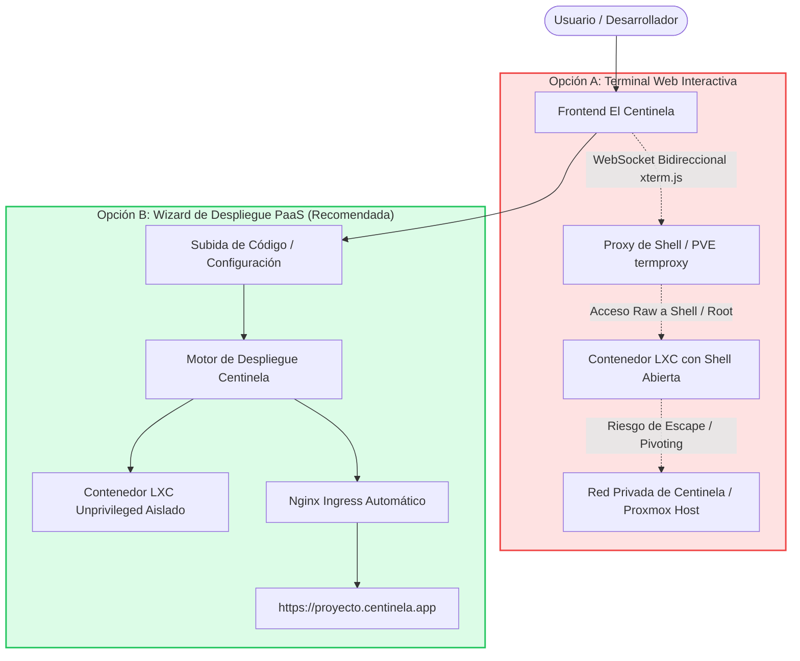
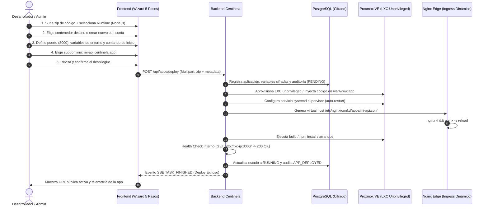
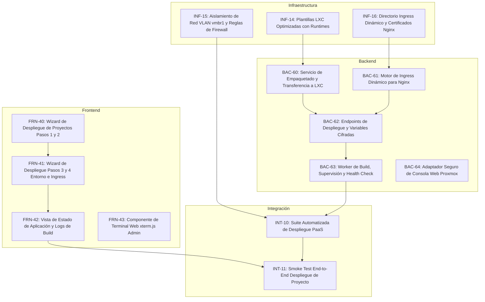

# Etapa 4: Despliegue de Aplicaciones (PaaS Ligero), Ingress Automático y Análisis de Terminal Web

> **Estado:** Propuesta de Diseño y Arquitectura de Alcance Extendido.  
> **Dependencia previa:** Cierre de la Etapa 1 ([`etapa1.md`](etapa1.md)), Etapa 2 ([`etapa2.md`](etapa2.md)) y Etapa 3 ([`etapa3.md`](etapa3.md)).  
> **Requerimientos asociados:** Evolución de `RF-07` (Aprovisionamiento), `RF-10` (Configuración de recursos) y `RNF-01` a `RNF-06` (Seguridad perimetral, auditoría inmutable, aislamiento de red y control de acceso).

---

## 1. Motivación y Análisis de Alcance: De IaaS a PaaS Ligero

### 1.1 El Techo del Alcance Actual (IaaS Puro)
Hasta la Etapa 3, **El Centinela** se desempeña como un orquestador de infraestructura (**IaaS - Infrastructure as a Service**):
- Permite crear, iniciar, apagar, reconfigurar recursos (CPU/RAM), monitorear métricas en tiempo real y gestionar puntos de restauración (Snapshots) de Máquinas Virtuales (KVM/QEMU) y Contenedores (LXC) sobre Proxmox VE.
- **Limitación práctica:** Una vez que el contenedor o máquina virtual está encendida en estado `running`, la plataforma se detiene. El usuario debe salir de Centinela, conectarse manualmente por SSH o la consola nativa de Proxmox, instalar un servidor web, configurar dependencias, transferir su código fuente y configurar cortafuegos o proxies externos para hacer accesible su proyecto.

### 1.2 La Necesidad de Evolución
Para convertir a **El Centinela** en una plataforma integral de auto-servicio, se presentan dos posibles vectores de evolución:
1. **Opción A (Terminal Web Interactiva):** Embeber una consola de comandos en una pestaña de la aplicación web conectada a la shell del contenedor o VM.
2. **Opción B (Wizard de Despliegue PaaS en Contenedores):** Diseñar un asistente guiado que reciba un proyecto de software, configure un contenedor LXC optimizado con su runtime correspondiente (Node.js, Python, PHP, Estático), inyecte variables de entorno y configure automáticamente un proxy inverso de borde (Ingress Nginx) con TLS y subdominio público.

---

## 2. Comparativa Crítica: Terminal Web (Opción A) vs. Wizard PaaS (Opción B)



### Tabla Comparativa de Decisión de Arquitectura

| Criterio | Opción A: Terminal Web Interactiva | Opción B: Wizard de Despliegue PaaS en Contenedores |
| :--- | :--- | :--- |
| **Valor de Producto** | Bajo / Medio (solo ahorra abrir un cliente SSH local). | **Muy Alto** (transforma la app en un Cloud propio estilo Coolify / Heroku / Dokku). |
| **Público Objetivo** | Sysadmins avanzados con conocimiento de Linux. | Desarrolladores, estudiantes, operadores y usuarios generales. |
| **Superficie de Ataque** | **Crítica y Extrema** (acceso a shell interactiva y binarios del sistema). | **Muy Reducida y Controlada** (solo expone puertos HTTP/HTTPS declarados). |
| **Riesgo de Pivoting en Red** | **Alto:** el usuario puede usar la terminal para escanear `100.81.49.19`, `101` (DB) o Proxmox API. | **Cero:** el contenedor corre en una VLAN/Bridge aislado sin acceso a la red de gestión. |
| **Auditabilidad (RF-08)** | **Muy Difícil:** auditar cada comando tipear en una terminal interactiva es trivial de eludir. | **Excelente:** cada build, variable de entorno y cambio de versión queda registrado en `auditoria`. |
| **Aislamiento Multi-Tenant** | Difícil de garantizar si el contenedor tiene privilegios o herramientas de red. | Sencillo mediante cuotas estrictas, LXC unprivileged y cgroups. |
| **Complejidad de Mantenimiento** | Media (mantener WebSockets de terminal de baja latencia sin cortes). | Media/Alta (orquestación de templates, Nginx dinámico y health checks). |

> [!IMPORTANT]
> **Dictamen Arquitectónico:**  
> La **Opción B (Wizard de Despliegue de Proyectos)** es abrumadoramente superior en valor de negocio y se alinea con la filosofía de seguridad de El Centinela (*Air-Gap*, defensa en profundidad y aislamiento estricto).  
> La **Opción A (Terminal Web)** puede considerarse únicamente como una característica secundaria de soporte de emergencia accesible de forma exclusiva para el rol `ADMIN` con doble autenticación obligatoria, pero **nunca** para usuarios con rol `OPERATOR`.

---

## 3. Modelo de Amenazas y Riesgos de Seguridad Detallados

Incorporar la capacidad de alojar código de usuario y exponerlo a la red implica vectores de ataque que deben ser mitigados formalmente:

### 3.1 Amenazas en el Alojamiento de Proyectos (Wizard PaaS)

1. **Subida de Archivos Arbitrarios y Webshells (CWE-434):**
   - *Riesgo:* Un atacante sube un archivo `.php` o script malicioso para ejecutar comandos en el servidor.
   - *Mitigación:* Los archivos de código se desempaquetan **exclusivamente dentro del espacio de usuario del contenedor LXC de destino**, nunca en el host Proxmox ni en el contenedor donde corre el backend de Centinela. El backend solo procesa el archivo como un flujo binario opaco (stream a disco temporal con cuota máxima de 50 MB) y valida su firma.

2. **Zip-Bombs y Agotamiento de Recursos (CWE-409 / CWE-400):**
   - *Riesgo:* Subida de un archivo comprimido de 5 MB que al descomprimirse ocupa 100 GB, llenando el almacenamiento del host (`local-lvm`).
   - *Mitigación:* Descompresión con límite de bytes leídos (reader acotado), comprobación previa de espacio en disco del contenedor y rechazo automático si excede la cuota asignada a la instancia.

3. **Inyección en la Configuración del Ingress Nginx (CWE-284 / CWE-89 equivalente en Nginx):**
   - *Riesgo:* El usuario ingresa un subdominio o variable maliciosa con saltos de línea (ej. `mi-app\nlocation /admin { proxy_pass http://backend-centinela; }`) para secuestrar el reverse proxy de Centinela.
   - *Mitigación:* Sanitización estricta por whitelist: el subdominio solo acepta caracteres alfanuméricos y guiones (`^[a-z0-9]([a-z0-9-]{1,30}[a-z0-9])?$`). La configuración de Nginx no se concatena con strings crudos, sino que se genera a través de plantillas estandarizadas en archivos `.conf` aislados dentro de `/etc/nginx/conf.d/apps/`.

4. **Escape de Contenedor (Container Breakout - CWE-250 / CWE-269):**
   - *Riesgo:* Un contenedor LXC con privilegios (`privileged: 1`) comparte el UID 0 (root) con el kernel del host físico Proxmox. Una vulnerabilidad en el kernel permitiría tomar control de todo el servidor físico.
   - *Mitigación:* **Obligatoriedad estricta de Contenedores Sin Privilegios (`unprivileged: 1`)** en todos los aprovisionamientos del Wizard. En un contenedor sin privilegios, el usuario `root` interno corresponde a un UID no privilegiado (ej. UID 100000) en el host. Desactivar explícitamente `nesting` y `keyctl` a menos que sea imprescindible.

5. **Ataques de Pivoteo y Movimiento Lateral de Red (SSRF / Network Sniffing):**
   - *Riesgo:* Una aplicación desplegada en un contenedor intenta conectarse a `http://100.81.49.19:8006` (API Proxmox), `http://127.0.0.1:18080` (Backend Centinela) o a la base de datos PostgreSQL (`centinela-db`).
   - *Mitigación:* **Segmentación de Red por Cortafuegos (Proxmox Firewall):**
     - Todos los contenedores de aplicaciones se conectan a un puente de red secundario (`vmbr1`) o subred aislada (ej. `10.99.0.0/24`).
     - Reglas de firewall a nivel de clúster Proxmox que aplican política de descarte (`DROP`) hacia la red de administración de Centinela (`100.81.49.0/24`) y los puertos de infraestructura `8006`, `5432` y `6379`.
     - El único tráfico entrante permitido al contenedor proviene de la IP interna del proxy Nginx Edge hacia el puerto configurado de la app.

6. **Exposición de Secretos y Variables de Entorno (CWE-522):**
   - *Riesgo:* Las variables de entorno de producción (`DATABASE_URL`, `API_KEYS`) se almacenan en texto plano en la base de datos de Centinela o se exponen en las respuestas de la API.
   - *Mitigación:* Cifrado en reposo en PostgreSQL (AES-256-GCM con clave maestra de aplicación). En las consultas de lectura del frontend, los valores de variables sensibles se devuelven enmascarados (`********`).

---

## 4. Arquitectura de la Solución: Wizard de Despliegue de Proyectos (5 Pasos)

El Wizard se integra como una opción natural dentro de la vista de instancias: **"Publicar Aplicación / Proyecto"**:



### Paso 1: Selección de Runtime y Carga de Código
- **Runtimes soportados (Catálogo base):**
  - `Node.js` (v18 / v20 LTS)
  - `Python` (v3.11 / v3.12 con Gunicorn/Uvicorn)
  - `PHP` (v8.2 con FPM + Nginx interno)
  - `Estático` (HTML, CSS, JS, Nginx puro)
- **Métodos de origen:**
  - Archivo comprimido (`.zip` o `.tar.gz`, máx. 50 MB).
  - Enlace a repositorio Git público (clonado en segundo plano por el worker).

### Paso 2: Alojamiento y Recursos (Contenedor LXC)
- Opciones:
  - **Crear nuevo contenedor dedicado (Recomendado):** Aprovisiona automáticamente un LXC ultra-liviano (base Alpine o Debian minimal) consumiendo cuota del host validada por `CuotasService` (`BAC-37`).
  - **Desplegar en contenedor existente:** Para usuarios con rol `FULL_ACCESS` sobre un contenedor previamente aprovisionado.

### Paso 3: Configuración de Entorno y Procesos
- **Puerto interno de escucha:** Detección automática (ej. 3000 en Node, 8000 en Python, 80 en PHP) o configurable por el usuario.
- **Comando de arranque:** Sugerido según el runtime (ej. `npm start`, `python main.py`), ejecutado bajo un daemon de sistema (`systemd` o `supervisord`) para garantizar reinicio automático tras fallos.
- **Editor de Variables de Entorno (Key-Value):** Permite cargar configuraciones de runtime con opción de ocultar valor sensible.

### Paso 4: Enrutamiento, Dominio y SSL
- Asignación de subdominio bajo el dominio de la organización:
  - Ejemplo: `https://mi-proyecto.centinela.local` o `https://app-inst_k8Pq2v.centinela.app`.
- El backend valida que el subdominio no colisione con rutas administrativas (`/api`, `/admin`, `/events`).
- Se genera un bloque de configuración de Nginx virtual host con directivas de seguridad preconfiguradas:
  - `proxy_pass http://<IP_PRIVADA_LXC>:<PUERTO>;`
  - Cabeceras `Host`, `X-Real-IP`, `X-Forwarded-For`, `X-Forwarded-Proto`.
  - Timeout de lectura y límites de buffer estandarizados.

### Paso 5: Despliegue Asíncrono, Logs en Vivo y Health Check
- Devuelve `HTTP 202 Accepted` con `tareaId` correlacionado.
- El worker de backend ejecuta la secuencia de despliegue:
  1. Transferencia y desempaquetado del código.
  2. Instalación de dependencias en un entorno aislado (`chroot` o `pct exec`).
  3. Inicio del servicio supervisor.
  4. Recarga segura de Nginx (`nginx -s reload`).
  5. **Health Check:** Realiza hasta 5 sondeos HTTP internos. Si la aplicación responde con código 2xx o 3xx, marca el estado como `HEALTHY`.
- Notificación al frontend en tiempo real vía SSE (`TASK_FINISHED`).

---

## 5. Módulo Complementario: Terminal Web Segura para Administradores (Opción A Restringida)

Si bien la terminal libre representa un riesgo inaceptable para operadores generales, contar con una consola interactiva es indispensable para el equipo de administración de infraestructura:

```mermaid
flowchart LR
    Admin[Navegador Admin] -- "WSS con Ticket Efímero (TTL 15s)" --> NginxEdge[Nginx Reverse Proxy]
    NginxEdge -- "Proxy TCP Seguro" --> CentinelaAPI[Backend Centinela (Guardia RBAC)]
    CentinelaAPI -- "PVE VNC Ticket / termproxy" --> ProxmoxHost[Proxmox VE (xterm.js API)]
    ProxmoxHost --> InstanceShell[Shell de la Instancia]
```

### Reglas de Blindaje para la Terminal Web
1. **Acceso Exclusivo `ADMIN`:** Bloqueo absoluto para el rol `OPERATOR` (`403 FORBIDDEN`).
2. **Reautenticación Previa Obligatoria:** Solicitar contraseña actual o código TOTP antes de emitir el ticket de consola (siguiendo el patrón `FIX-111A`/`FIX-111B`).
3. **Ticket Efímero de Consola (TTL 15 s):** El WebSocket de la terminal no acepta JWTs en URL; consume un ticket de un solo uso registrado en Redis.
4. **Auditoría de Sesión:** Se audita obligatoriamente el evento `INSTANCE_TERMINAL_OPENED` con IP del actor, usuario, timestamp y duración de la sesión.
5. **Cierre Automático por Inactividad:** Desconexión forzada a los 10 minutos de inactividad de teclado.

---

## 6. Desglose de Tareas para ClickUp (Etapa 4)

Para mantener la regla de granularidad ($\le 2.5$ h por tarea) y facilitar la carga balanceada entre áreas:



### 📋 Detalle de Tareas

| Código | Área | Título | Est. | Asignado | Dependencias |
| :--- | :--- | :--- | :---: | :--- | :--- |
| **`INF-14`** | Infraestructura | Preparación de plantillas LXC unprivileged con runtimes base (Node, Python, PHP) | 2.0 h | Nico | `INF-10` |
| **`INF-15`** | Infraestructura | Configuración de red aislada (`vmbr1`) y reglas Proxmox Firewall anti-pivoting | 2.0 h | Nico | — |
| **`INF-16`** | Infraestructura | Estructura `/etc/nginx/conf.d/apps/` y wildcard TLS para ingress dinámico | 1.5 h | Nico / Lucas | `INF-11` |
| **`BAC-60`** | Backend | Servicio de recepción de código, validación de cuotas de archivo y extracción segura | 2.5 h | Lisandro | `BAC-37` |
| **`BAC-61`** | Backend | Generador de configuraciones virtuales de Nginx Ingress con plantillas inmutables | 2.0 h | Tayra | `INF-16` |
| **`BAC-62`** | Backend | Endpoints `POST /api/apps/deploy` y gestión de variables de entorno cifradas | 2.5 h | Lisandro | `BAC-60`, `BAC-61` |
| **`BAC-63`** | Backend | Worker asíncrono de build, configuración de systemd y sondeo de Health Check | 2.5 h | Tayra | `BAC-62` |
| **`BAC-64`** | Backend | Proxy WebSocket para Proxmox termproxy con ticket efímero (solo `ADMIN`) | 2.0 h | Lisandro | `BAC-35` |
| **`FRN-40`** | Frontend | Wizard de Despliegue: Paso 1 (Carga de código/Runtime) y Paso 2 (LXC y Recursos) | 2.5 h | Luz | `FRN-24` |
| **`FRN-41`** | Frontend | Wizard de Despliegue: Paso 3 (Variables de entorno/Puerto) y Paso 4 (Ingress) | 2.5 h | Cristian | `FRN-40` |
| **`FRN-42`** | Frontend | Vista de Estado de Aplicación, Health Check y visor de logs de despliegue | 2.0 h | Belinda | `FRN-41`, `BAC-63` |
| **`FRN-43`** | Frontend | Pestaña "Terminal de Administrador" con `xterm.js` y reautenticación TOTP | 2.0 h | Cristian | `BAC-64`, `FIX-111B` |
| **`INT-10`** | Integración | Suite automatizada de despliegue PaaS, validación de ingress y salud HTTP | 2.5 h | Tayra / Lisandro | `BAC-63`, `INF-15` |
| **`INT-11`** | Integración | Smoke Test End-to-End: Despliegue de app Node.js real y acceso por dominio público | 2.0 h | Todo el equipo | `INT-10`, `FRN-42` |

---

## 7. Justificación Estratégica para la Defensa del Proyecto

Si el tribunal evaluador o stakeholders consultan sobre esta ampliación:

1. **Diferenciador Tecnológico Claro:**
   Un panel que solo enciende y apaga máquinas virtuales compite con herramientas básicas de administración. Un panel que toma un archivo de código y lo entrega en internet con HTTPS automático y aislamiento de recursos es un **Cloud Privado Autónomo**.
2. **Defensa Rigurosa de Seguridad:**
   La decisión deliberada de **no darle una terminal abierta a los operadores** y en su lugar canalizar las aplicaciones a través de un **Wizard PaaS estructurado** demuestra madurez en ingeniería de software: prioriza el principio de menor privilegio (*PoLP*), previene ataques de denegación de servicio internos y elimina la posibilidad de que un usuario secuestre la máquina anfitriona.
3. **Coherencia Arquitectónica:**
   Reutiliza exactamente los cimientos construidos en las Etapas 1, 2 y 3: el motor de tareas asíncronas (`UPID`/`tareaId`), las cuotas de recursos del host, la auditoría inmutable particionada y el canal de notificaciones en tiempo real.

