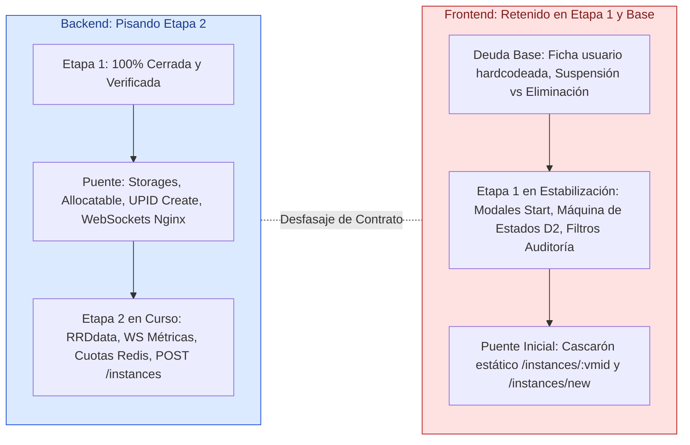

# El Centinela: Informe de Evolución del Sistema
## Cierre de Etapa 1, Desfasaje Frontend/Backend e Inicio de la Etapa 2

**Versión 3 · 15/10/2026**  
**Punto de partida:** [`resumenfasebasefaseuno.md`](resumenfasebasefaseuno.md) (Versión 2 · 06/10/2026).  
**Fuentes analizadas:** [`terminado.md`](terminado.md), [`terminado-1.md`](terminado-1.md), [`actual.md`](actual.md), [`etapa1.md`](etapa1.md), [`etapa2.md`](etapa2.md), [`siguientesetapas.md`](siguientesetapas.md), [`requerimientos.md`](requerimientos.md), [`centinela.md`](centinela.md), [`test/informe.md`](../test/informe.md) y suites de prueba automatizadas en `test/back` y `test/front`.

---

## 1. Resumen Ejecutivo

1. **Salto cualitativo del sistema en 9 días (06/10 $\rightarrow$ 15/10):**
   - El sistema superó la fase de prototipo inicial y consolidó el **Core Operativo del Hipervisor**.
   - En **Frontend**, las pruebas automatizadas pasaron de **95 en verde (de 139) a 152 en verde (de 183)**. Se incorporaron 44 pruebas nuevas y se cerraron 57 casos fallidos.
   - En **Backend**, se validaron más de **18 suites de aceptación de integración continua**, incluyendo la nueva suite de **seguridad adversarial** (`adversarial_integrity_test.go`), certificando inmunidad ante escalamiento de privilegios, manipulación de JWT, inyecciones SQL y colisiones de concurrencia.
2. **El fenómeno del Desfasaje (Asimetría de Olas entre Front y Back):**
   - **Backend se encuentra muy adelantado (pisando la Etapa 2):** Completó la casi totalidad de la Etapa 1, cruzó las tareas puente de infraestructura (`BAC-30`, `BAC-31`, `BAC-32`, `BAC-33`, `INF-09`, `INF-07C`) y ya está implementando la telemetría RRDdata (`BAC-34`), el canal WebSocket con tickets efímeros (`BAC-35`), el motor de cuotas con candado en Redis (`BAC-37`) y el endpoint de aprovisionamiento `POST /api/instances` (`BAC-38`).
   - **Frontend se encuentra rezagado (retenido en la Etapa 1 y cerrando baches de Base):** Está concentrado en resolver 15 pruebas fallidas de Vitest asociadas a la máquina de estados de ciclo de vida (`FRN-16` / `FIX-86`), modales antierror (`FRN-15` / `FIX-85`), filtros de auditoría (`FRN-14` / `FIX-74`), suspensión de usuarios (`FIX-56`) y apenas maquetando el contenedor estático de detalle de instancia (`FRN-21` / `FIX-95`).
   - **Consecuencia operativa:** El Backend ya expone contratos y servicios de la Etapa 2 que el Frontend aún no puede consumir porque no tiene listos los componentes visuales interactivos (el Wizard interactivo y los gráficos de rendimiento).
3. **Bloqueante técnico crítico en Backend:**
   - Se detectó un error en el orden de migraciones en `backend/internal/adapters/secondary/postgres/db.go` (`FIX-81`): `migrarUnicidadEmail` se invoca antes de `migrarAuditoriaParticionada`, lo que hace que un arranque en frío contra una base de datos nueva falle con `relation "auditoria" does not exist`. En el servidor pasa inadvertido porque la tabla ya existía, pero rompe cualquier despliegue limpio.
4. **Cierre de Brechas mediante Tareas Puente:**
   - Se formalizó el **Bloque 8 en [`etapa2.md`](etapa2.md)** (`BAC-50` a `BAC-53`, `FRN-36`, `INF-13`) para garantizar que el paso a los Snapshots (`RF-06`), Alertas (`RF-11`) y Auditoría Completa (`RF-08`) de la Etapa 3 no sufra una fricción similar.

---

## 2. Evolución Comparativa: Estado al 06/10 vs. Estado al 15/10

| Componente / Módulo | Estado en Informe v2 (06/10/2026) | Estado Actual (15/10/2026) | Avance Real Logrado |
|---|---|---|---|
| **Simulador Proxmox VE** | Soporte básico de ciclo de vida y lectura (`FIX-32`/`33`/`35`). | Soporte ampliado con storages, templates ISO/LXC y RRDdata mock (`BAC-30` / `FIX-84`). | ✅ El simulador local ya responde al 100% de las necesidades de aprovisionamiento de la Etapa 2. |
| **Telemetría del Nodo (`RF-02`)** | Proyectada en `BAC-22` (caché Redis pendiente). | **Verificada y cerrada (`BAC-22`).** Semáforo desduplicado y accesible (`FIX-78`). | ✅ Normalización completa, lectura stale y caché Redis funcionando. |
| **Inventario de Instancias (`RF-03`)** | Proyectado en `BAC-23A` y tabla preliminar `FRN-20A`. | **Verificado y cerrado (`BAC-23A`).** Resolución concurrente de IPs de QEMU Guest Agent. | ✅ Inventario unificado VM/LXC con IPs reales y filtrado RBAC. |
| **Worker UPID y Concurrencia (`RF-04`)** | Proyectado `BAC-25A` (pool acotado). | **Verificado y cerrado (`BAC-25A`).** Sincronización determinista de órdenes consecutivas (`FIX-73`). | ✅ `UPID_WORKERS` en pool acotado; control de `409 INSTANCE_BUSY`. |
| **Canal de Eventos SSE (`RF-11`)** | Proyectado `FRN-17A` (con problemas de deduplicación). | **Verificado y cerrado (`BAC-26`, `FRN-17A`).** Contrato `TASK_FINISHED` para las 5 acciones. | ✅ Emisión y recepción en tiempo real con ticket efímero y Pub/Sub. |
| **Auditoría de Acciones (`RF-08`)** | Solo registraba la orden despachada (`PENDING`). | **Verificado y cerrado (`BAC-27`).** Correlación de 2 entradas (`PENDING` y `SUCCESS`/`FAILED`). | ✅ Auditoría inmutable de inicio y fin de tarea con UPID enlazado. |
| **Nginx Edge y WebSockets (`RNF-06`)** | Solo configurado para SSE unidireccional (`INF-07B`). | **Verificado y cerrado (`INF-09`).** Handshake HTTP 101 y `Upgrade` para WebSockets. | ✅ Infraestructura lista para el streaming bidireccional de métricas. |
| **Branding y UX Copy (`RNF-03`)** | Placeholders informales ("imágenes y texto random"). | **Verificado y cerrado (`FIX-80`, `FIX-90`).** Textos institucionales y limpieza de botones muertos. | ✅ Layout de autenticación aprobado y Dashboard sin tarjetas simuladas. |
| **Servicio de Correo (`RF-13` / `RF-11`)** | Descarte previo en discusión; riesgo de fallback silencioso. | **Verificado y cerrado (`FIX-88`).** `EMAIL_PROVIDER=smtp` explícito; alerta visible si falta. | ✅ Puerto `EmailService` listo para operar con Mailpit/SMTP en prod. |

---

## 3. Radiografía del Desfasaje: Frontend vs. Backend

El sistema experimenta una asimetría de desarrollo donde el equipo de Backend avanzó hacia la siguiente etapa mientras el equipo de Frontend absorbió una importante carga de estabilización y corrección de pruebas:

### 3.1. Dónde está Backend hoy
1. **Tareas de Etapa 1 y Puente Cerradas:**
   - `BAC-22`, `BAC-23A`, `BAC-25A`, `BAC-26`, `BAC-27`, `BAC-29`, `BAC-30`, `BAC-31`, `BAC-32`, `BAC-33`, `INF-09`, `INF-07C`.
2. **Tareas de Etapa 2 en Desarrollo / Verificación:**
   - `BAC-34`: Adaptador RRDdata en el cliente Proxmox para consumir CPU, RAM, disco y red.
   - `BAC-35`: Servidor WebSocket `/api/ws/instances/:vmid/metrics` protegido por ticket efímero en Redis.
   - `BAC-37`: Servicio `CuotasService` que valida el 15% de memoria reservada para el host e implementa el lock distribuido `lock:instance:provisioning` en Redis.
   - `BAC-38`: Endpoint `POST /api/instances` para aprovisionar VMs (QEMU) y contenedores (LXC).
3. **Deuda pendiente de Backend (Corta pero crítica):**
   - `FIX-81`: Invertir el orden de migración en `db.go` para arrancar limpiamente en bases nuevas.
   - `BAC-24C`: Purga transaccional de filas en `permisos_instancia` cuando se elimina una instancia para evitar herencia de permisos por reutilización de VMID.

### 3.2. Dónde está Frontend hoy (Análisis de los 15 fallos de Vitest)
Frontend tiene 152 pruebas en verde, pero 15 pruebas fallan en 8 archivos, reteniendo al equipo en la Etapa 1:

1. **Máquina de estados y errores D2 (`instances-operation.test.tsx` — 5 fallos):**
   - *Causa (`FRN-16` / `FIX-86`):* Ante rechazos del servidor (`403 INSTANCE_PROTECTED`, `403 INSTANCE_ACCESS_DENIED`, `409 INSTANCE_BUSY`, `409 INSTANCE_INVALID_STATE`, `502`, `504`), la interfaz no despliega los textos canónicos acordados en el catálogo D2 y la fila queda bloqueada en spinner en lugar de recuperarse.
2. **Baja lógica vs. Suspensión de usuarios (`admin-users-deletion.test.tsx` — 4 fallos):**
   - *Causa (`FIX-56`):* En el panel de administración, la acción de desactivar/suspender se confunde con la eliminación definitiva de la cuenta.
3. **Placeholders y stubs de interfaz (`fixes-pending.test.tsx` — 3 fallos):**
   - *Causa:* Datos hardcodeados en la ficha de perfil (`FIX-87`), cascarón estático sin interacción en `/instances/new` (`FIX-89`), y archivo residual `InstanceTester.tsx` (`FIX-91`).
4. **Enlace al Detalle de Instancia (`instance-detail.test.tsx` — 2 fallos):**
   - *Causa (`FRN-21` / `FIX-95`):* Falta declarar la ruta reactiva `/instances/:vmid` en el router principal y enlazar el clic de las filas de la tabla de inventario.
5. **Filtros de Auditoría (`audit.test.tsx` — 2 fallos):**
   - *Causa (`FRN-14` / `FIX-74`):* Falta de atributos accesibles (`aria-label="Desde"`, `aria-label="Hasta"`) y actualización reactiva de la URL ante cambios de filtro.
6. **Modales de Ciclo de Vida e Inventario (`instances-modals.test.tsx`, `instances-ola2.test.tsx`, `dashboard-summary.test.tsx` — 3 fallos):**
   - *Causa:* Confirmación del modal de Start (`FIX-85`), exposición directa de pestañas VM/LXC (`FIX-79`) y refresco de contadores ante `TASK_FINISHED` (`FIX-83`).

---

## 4. Auditoría de Requerimientos del Sistema (`requerimientos.md` y `centinela.md`)

| Requerimiento | Estado al 06/10 | Estado Actual (15/10/2026) | Brecha Restante para el 100% |
|---|:---:|:---:|---|
| **RF-01** Autenticación y 2FA | ✅ Verificado | ✅ Verificado + Hardening | Ninguna (Cookies `HttpOnly` programadas para Etapa 3 en `BAC-48`). |
| **RF-02** Dashboard del Nodo | 🟡 Parcial | ✅ **100% Funcional** | Cerrado en Backend y Frontend (semáforo y métricas normalizadas). |
| **RF-03** Inventario de Instancias | 🟡 Parcial | ✅ **100% Funcional** | Cerrado con IPs de Guest Agent y RBAC estricto. |
| **RF-04** Ciclo de Vida con UPID | 🟡 Parcial | ✅ **Core Completo** | Backend resuelto. Frontend cerrando los mensajes D2 (`FIX-86`). |
| **RF-05** Telemetría por Instancia | ⏳ Planificado | 🔄 **En Desarrollo (Back)** | Backend desarrollando WebSockets y RRDdata (`BAC-34`/`BAC-35`). Frontend pendiente (`FRN-22`/`FRN-23`). |
| **RF-06** Snapshots y Puntos de Restauración | ⏳ Planificado | ⏳ **Planificado (Etapa 3)** | Cimientos preparados mediante Tarea Puente `BAC-50` (simulador). |
| **RF-07** Wizard de Creación y Cuotas | ⏳ Planificado | 🔄 **En Desarrollo (Back)** | Backend desarrollando cuotas y POST (`BAC-37`/`BAC-38`). Frontend tiene cascarón estático (`FIX-89`). |
| **RF-08** Auditoría Inmutable | 🟡 Parcial | ✅ **Etapa 1 Cerrada** | Correlación de órdenes completada (`BAC-27`). Particionado preventivo en `BAC-53`. |
| **RF-09** Gestión de Usuarios | ✅ Verificado | ✅ Verificado | Ajuste de suspensión vs eliminación en UI (`FIX-56`). |
| **RF-10** Edición de Recursos ($\Delta\text{RAM}$) | ⏳ Planificado | ⏳ **Planificado (Etapa 2)** | Especificado en `BAC-40` y `FRN-27`. |
| **RF-11** Notificaciones y Alertas | 🟡 Parcial | 🟡 **Parcial Avanzado** | `TASK_FINISHED` cerrado en SSE. Alertas por saturación e histéresis van a Etapa 3 (`BAC-46`/`BAC-47`). |
| **RF-12** Organizaciones (Multi-tenant) | ⛔ Descartado | ⛔ **Descartado del MVP** | Decisión ratificada por el equipo (mono-organización). |
| **RF-13** Recuperación de Contraseña | ✅ Verificado | ✅ Verificado | Cerrado con OTP de 6 dígitos al correo y expiración. |
| **RNF-01 a 06** Seguridad, Rendimiento, etc. | 🟡 Parcial | ✅ **Certificado Adversarial** | Suites adversariales en verde en ambos submódulos. |
| **RNF-07** Multi-nodo | ⛔ Postergado | ⛔ **Postergado post-MVP** | Operación sobre nodo fijo (`PROXMOX_NODE`). |

---

## 5. Riesgos Técnicos y Arquitectónicos Detectados

1. **Riesgo de Desacople en la Integración de Etapa 2 (Alto):**
   - Si Backend continúa avanzando en la lógica de aprovisionamiento (`BAC-39`) y edición (`BAC-40`) mientras Frontend no cierra la vista `/instances/:vmid` (`FRN-21`) ni implementa los pasos interactivos del Wizard (`FRN-24`), se generará un embudo masivo en las pruebas de integración `INT-04` e `INT-05`.
2. **Fragilidad de Despliegue Limpio (`FIX-81` - Crítico):**
   - El backend fallará en cualquier entorno que levante con volúmenes de base de datos vacíos debido a la inversión de llamadas en `db.go`. Requiere solución urgente en `centinela-back`.
3. **Falsa Sensación de Avance en UI por Cascarones Estáticos:**
   - La existencia de `/instances/new` como formulario puramente visual sin conexión al backend (`FIX-89`) puede inducir a error en la planificación. El Wizard interactivo formal corresponde a `FRN-24`, `FRN-25` y `FRN-26`.

---

## 6. Plan de Sincronización Inmediato (Próximos Pasos)

Para sincronizar ambos frentes y desbloquear el flujo conjunto en la Etapa 2, se establece el siguiente orden de prioridades:

### Paso 1: Backend - Destrabar Despliegues y Limpieza (1 día)
1. Aplicar en `centinela-back` el fix **`FIX-81`**: reordenar `migrarAuditoriaParticionada(db)` y `asegurarParticionesFuturas(db)` **antes** de `migrarUnicidadEmail(db)`.
2. Completar **`BAC-24C`**: purga atómica de `permisos_instancia` al borrar instancias para dejar la Etapa 1 al 100% libre de deudas.

### Paso 2: Frontend - Sprint de Estabilización y Cierre de Etapa 1 (2 días)
1. Resolver **`FIX-86`** en `InstanceAction.tsx`: implementar el diccionario de traducción D2 para que los errores 403, 409, 502 y 504 muestren sus textos requeridos y desbloqueen la fila.
2. Resolver **`FIX-95`** / **`FRN-21`**: declarar la ruta `/instances/:vmid`, renderizar el cascarón de tabs ("General", "Métricas", "Configuración") y enlazar el clic desde la tabla de inventario.
3. Resolver **`FIX-74`** (accesibilidad en auditoría) y **`FIX-56`** (separación de suspensión).

### Paso 3: Acople Conjunto en la Etapa 2 (A partir del día 3)
1. **Frente Telemetría:** Con `FRN-21` resuelto y `BAC-35` listo en Backend, Belinda y Luz integran el hook `useInstanceMetrics` y los gráficos Chart.js (`FRN-22`, `FRN-23`).
2. **Frente Aprovisionamiento:** Con `BAC-31`, `BAC-33`, `BAC-37` y `BAC-38` listos en Backend, Cristian y Belinda reemplazan el formulario estático de `FIX-89` por el Wizard formal de 4 pasos conectado a las cuotas en tiempo real (`FRN-24`, `FRN-25`, `FRN-26`).

---

## 7. Conclusión

El proyecto Centinela logró en los últimos días una **madurez técnica sustancial**: el backend opera con estabilidad sobre un simulador fiel de Proxmox VE, el canal de eventos en tiempo real está validado y la seguridad del sistema está blindada con pruebas adversariales.

El **desfasaje actual es natural en proyectos con desarrollo por capas desacopladas mediante contratos**, pero exige que el equipo de Frontend priorice la liquidación de sus 15 fallos de testing de la Etapa 1 y el maquetado funcional de `/instances/:vmid` antes de intentar abarcar las pantallas de la Etapa 2. Con este reordenamiento, ambos frentes convergerán ordenadamente en el hito del Wizard de aprovisionamiento y los gráficos de telemetría en tiempo real.

