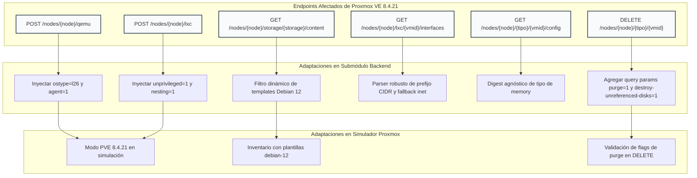
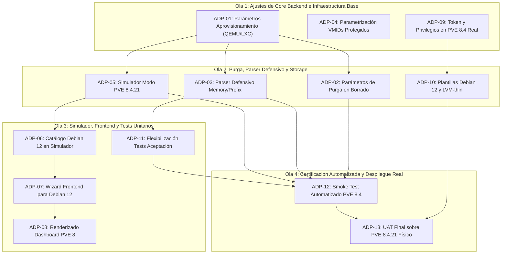

# Etapa de Adaptación: Compatibilidad con Proxmox VE 8.4.21

> **Estado:** Planificada (a ejecutarse inmediatamente tras el cierre de la [Etapa 3](etapa3.md) y sus tareas puente).  
> **Dependencia previa:** Cierre formal de la Etapa 3 ([`etapa3.md`](etapa3.md)), incluyendo sus tareas puente de infraestructura, parametrización y testing (`Bloque 6`: `BAC-54`, `BAC-55`, `INF-14`, `FRN-37` e `INT-10`), con sus suites de integración en verde (`INT-07`, `INT-08` e `INT-09`).  
> **Servidor de Desarrollo Base:** Proxmox VE 9.2.2 (`pve-manager/9.2.2/b9984c6d90a4bd80`, Kernel `7.0.2-6-pve`, Debian 13 Trixie / entorno de laboratorio inicial).  
> **Servidor Destino de Producción:** Proxmox VE 8.4.21 (`pve-manager/8.4-x`, Kernel Linux `6.8` / `6.5`, Debian 12 Bookworm / servidor productivo final).  
> **Documentos de Referencia:** [`documentacion/api-proxmox.md`](api-proxmox.md), [`backend/API proxmox respuestas/`](../backend/API%20proxmox%20respuestas/), [`backend/docs/simulador-proxmox.md`](../backend/docs/simulador-proxmox.md).

---

## 1. Justificación y Criterios de Planificación

### 1.1 Contexto del Problema
Todo el desarrollo de las Etapas 1, 2 y 3 (incluyendo el cliente HTTP en `backend/internal/adapters/secondary/proxmox/client.go`, las fixtures de respuestas en `backend/API proxmox respuestas/` y el simulador en memoria `backend/cmd/proxmox-simulador`) se construyó tomando como modelo una instancia de Proxmox VE reportada como versión `9.2.2`.

Sin embargo, el despliegue final se realizará sobre un servidor físico corporativo con **Proxmox VE 8.4.21**. Aunque la API REST de Proxmox mantiene una alta estabilidad entre versiones mayores, existen diferencias sutiles pero críticas en:
1. **Serialización de tipos JSON** (campos numéricos vs. cadenas de texto en interfaces y configuración).
2. **Parámetros obligatorios y por defecto al aprovisionar** (QEMU Guest Agent, tipos de SO y privilegios de contenedores LXC).
3. **Comportamiento en operaciones destructivas y tareas en HA** (parámetros de purga y limpieza de discos huérfanos).
4. **Catálogo de almacenamiento y plantillas base** (diferencias de nomenclatura de imágenes Debian 12 Bookworm vs. Debian 13 Trixie y flags de storage soportados).
5. **Configuración de red y agentes de máquinas virtuales** (formato de máscara de red y retorno de contenedores apagados).

### 1.2 Decisiones de Arquitectura para la Adaptación
1. **Principio de Dual-Compatibility (Retrocompatibilidad Activa):** El backend no debe bifurcarse ni romper la compatibilidad con PVE 9.2.2. Todo parser y constructor de peticiones debe ser tolerante y soportar de forma agnóstica tanto el comportamiento de Proxmox VE 8.4.x como el de 9.x.
2. **Regla de Granularidad ($\le$ 2.5 h):** Ninguna tarea de adaptación supera las 2.5 horas de estimación técnica. Cada ítem aísla responsabilidades entre el cliente HTTP Proxmox, el simulador de desarrollo, la parametrización de entorno y la verificación automatizada.
3. **Parametrización Dinámica sin Hardcoding:** Ningún VMID de infraestructura, nombre de nodo, template base ni storage pool quedará fijo en el código fuente. Todo se gobernará mediante variables de entorno en `.env`.
4. **Actualización Sincronizada del Simulador:** El simulador `proxmox-simulador` incorporará soporte nativo para comportarse exactamente como PVE 8.4.21 (configurable mediante `PROXMOX_SIM_TARGET_VERSION=8.4.21`), permitiendo que los tests sigan corriendo 100% offline y en CI/CD con fidelidad idéntica al servidor final.

---

## 2. Matriz Exhaustiva de Discrepancias Técnicas (PVE 9.2.2 vs. PVE 8.4.21)

| Área / Endpoint | Comportamiento PVE 9.2.2 (Referencia Actual) | Comportamiento PVE 8.4.21 (Servidor Final) | Nivel de Riesgo | Impacto en El Centinela |
|---|---|---|:---:|---|
| **Aprovisionamiento QEMU** `POST /nodes/{node}/qemu` | No exige `ostype`. Omitir `agent` crea la VM pero el simulador asume que puede configurarse luego. | Si no se envía `ostype=l26`, PVE 8 asigna `other` (desactiva optimizaciones VirtIO). Si no se envía `agent=1`, no se crea el bus virtio-serial y el Guest Agent **nunca** funcionará. | 🔴 **Crítico** | Las VMs creadas en PVE 8.4 no reportarán IP ni métricas de memoria reales por falta de socket virtio-serial. |
| **Aprovisionamiento LXC** `POST /nodes/{node}/lxc` | El contenedor se crea sin especificar `unprivileged` ni `features`. En PVE 9 defaults modernos aíslan el contenedor. | PVE 8 requiere explícitamente `unprivileged=1` para aislamiento seguro y `features=nesting=1` para que systemd de Debian 12 / Ubuntu 22+ arranque sin fallas de montaje. | 🔴 **Crítico** | Contenedores creados como privilegiados o fallos de booteo de systemd dentro del contenedor en PVE 8.4. |
| **Eliminación de Instancias** `DELETE /nodes/{node}/{tipo}/{vmid}` | `client.go` ejecuta `DELETE` sin parámetros de query. En el simulador borra directamente en memoria. | Si la VM/CT tiene volúmenes derivados o estuvo en HA, PVE 8.4 aborta con error 500 si no se incluye `purge=1`. Además, sin `destroy-unreferenced-disks=1` quedan discos huérfanos en LVM-thin. | 🟠 **Alto** | Fallos al eliminar instancias y fuga paulatina de almacenamiento en `local-lvm`. |
| **Interfaces de Red LXC** `GET /nodes/{node}/lxc/{vmid}/interfaces` | Retorna `ip-addresses` con `prefix` como string (`"24"`). Los tests de aceptación exigen estrictamente `string`. | En PVE 8.4, `prefix` puede presentarse como entero `24` o la respuesta puede contener solo `inet: "192.168.1.50/24"`. Un contenedor apagado devuelve `200 {"data": null}` o `[]`. | 🟠 **Alto** | `client.go` ya tiene fallback a `inet`, pero la suite de tests `simulador_proxmox_acceptance_test.go` se rompería si no se flexibiliza la aserción de tipo. |
| **Lectura de Config QEMU** `GET /nodes/{node}/qemu/{vmid}/config` | Devuelve `memory` como string (`"memory": "2048"`), permitiendo formatos extendidos tipo `current=2048`. | PVE 8.4 devuelve `memory` típicamente como entero (`"memory": 2048`), aunque admite strings al escribir por `PUT`. | 🟡 **Medio** | `client.go` ya utiliza `json.Number`, pero el simulador y las aserciones de fixtures deben tolerar ambos tipos sin romper hashes de `digest`. |
| **Catálogo de Storage y Content** `GET /nodes/{node}/storage` `GET .../content` | Reporta `content` con `"iso,import,vztmpl,backup"`. Plantilla de captura: `debian-13-standard_13.6-1_amd64.tar.zst`. | En PVE 8.4, `import` no existe en storages estándar de directorio (añadido en versiones posteriores). Las plantillas oficiales son Debian 12 (`debian-12-standard_12.7-1_amd64.tar.zst`). | 🟡 **Medio** | El wizard del frontend no debe romperse si falta `import`. Los selectores deben ofrecer plantillas Debian 12 Bookworm disponibles en PVE 8.4. |
| **Rango de VMIDs Protegidos** `INF-PROTECTED` | En `api-proxmox.md` los IDs 100-105 corresponden rígidamente a Centinela (`proxy`, `db`, `api`, `front`). | En el servidor nuevo con PVE 8.4.21, los IDs 100-105 podrían estar ocupados por otras VMs preexistentes del cliente. | 🟡 **Medio** | Riesgo de bloquear VMs ajenas o desproteger Centinela si sus IDs en producción son por ejemplo 200-205. Debe ser configurable en `.env`. |
| **Telemetría de Estado del Nodo** `GET /nodes/{node}/status` | Devuelve `pveversion: "pve-manager/9.2.2/..."` y `kversion: "Linux 7.0.2-6-pve"`. | PVE 8.4.21 reporta `pveversion: "pve-manager/8.4-..."` y kernel Linux `6.8` o `6.5`. | 🟢 **Bajo** | Informativo, pero debe actualizarse en stubs y simulador para evitar aserciones rígidas en tests. |
| **Snapshots y Formato de Disco** `POST .../snapshot` | El simulador acepta snapshots sobre cualquier instancia sin validar el formato subyacente. | PVE 8.4 solo permite snapshots sobre `lvmthin` (`local-lvm`), `zfspool` o discos `qcow2` en `dir`. Discos `raw` en LVM clásico fallan inmediatamente. | 🟠 **Alto** | Requiere asegurar que las instancias de Centinela se creen siempre sobre `local-lvm` o con discos `qcow2`. |

---

## 3. Endpoints Afectados y Cambios Requeridos en Submódulos

### 3.1. Adaptación de `POST /nodes/{node}/qemu` (Aprovisionamiento VM)
- **Archivo:** `backend/internal/adapters/secondary/proxmox/client.go:parametrosCreacion`
- **Cambio:**
  1. Forzar directiva `"ostype": "l26"` (Linux kernel 2.6/3.x/4.x/5.x/6.x).
  2. Forzar directiva `"agent": "1"` para habilitar el canal de comunicación virtio-serial con el guest agent.
  3. Asegurar que `"scsihw"` sea `"virtio-scsi-pci"` o `"virtio-scsi-single"`, plenamente compatible con el stack QEMU de PVE 8.4.
  4. Mantener `"ipconfig0"` solo si se requiere configuración estática, pero documentar que en instalaciones por ISO estándar requiere configuración durante el asistente del sistema operativo.

### 3.2. Adaptación de `POST /nodes/{node}/lxc` (Aprovisionamiento Contenedores)
- **Archivo:** `backend/internal/adapters/secondary/proxmox/client.go:parametrosCreacion`
- **Cambio:**
  1. Forzar directiva `"unprivileged": "1"` para cumplir con las directivas de seguridad corporativas en PVE 8.4.
  2. Inyectar directiva `"features": "nesting=1"` para permitir que systemd gestione servicios y sockets dentro del contenedor sin crasheos en Debian 12 Bookworm.
  3. Asegurar que el formato de template acepte paquetes estándar `tar.zst` o `tar.xz`.

### 3.3. Adaptación de `DELETE /nodes/{node}/{tipo}/{vmid}` (Destrucción Limpia)
- **Archivo:** `backend/internal/adapters/secondary/proxmox/client.go:EliminarInstancia`
- **Cambio:**
  1. Modificar la URL despachada para incorporar parámetros de limpieza profunda:  
     `DELETE /api2/json/nodes/{node}/{tipo}/{vmid}?purge=1&destroy-unreferenced-disks=1`.
  2. Evita errores de remoción de recursos asignados a HA en PVE 8.4 y garantiza que los volúmenes en `local-lvm` se liberen inmediatamente.

### 3.4. Adaptación de `GET /nodes/{node}/lxc/{vmid}/interfaces` (Telemetría de Red)
- **Archivo:** `backend/internal/adapters/secondary/proxmox/client.go:ObtenerInterfaces` y `test/back/simulador_proxmox_acceptance_test.go`
- **Cambio:**
  1. Mantener el tipo `prefijoFlexible` en `client.go` que deserializa tanto strings `"24"` como enteros `24`.
  2. En la suite de tests (`simulador_proxmox_acceptance_test.go`), flexibilizar la aserción de `prefix` para aceptar `string` o `float64/int`, evitando fallas artificiales en entornos PVE 8.4 nativos.

### 3.5. Adaptación del Catálogo de Almacenamiento y Plantillas
- **Archivo:** `frontend/centinela/src/components/features/instances/hooks/useCreateInstanceWizard.ts` y backend
- **Cambio:**
  1. El catálogo de templates debe mapear dinámicamente plantillas disponibles reportadas por PVE 8.4 (`debian-12-standard`, `ubuntu-22.04-standard`, `alpine-3.20`).
  2. Eliminar cualquier dependencia hardcodeada de Debian 13 en las opciones por defecto del wizard.

---

## 4. Desglose Detallado de Tareas de Adaptación (ClickUp)

Las siguientes tareas se encuentran divididas en bloques de trabajo de máximo 2.5 horas, con dependencias y criterios de aceptación verificables:

---

### Bloque A: Adaptación del Adaptador Proxmox Backend (`BAC`)

---

### Bloque B: Adaptación del Simulador Proxmox (`SIM`)

---

### Bloque C: Adaptación del Frontend (`FRN`)

---

### Bloque D: Infraestructura y Servidor Proxmox Real (`INF`)

---

### Bloque E: Testing y Certificación de Integración (`INT`)

#### `ADP-11` (`INT-PVE8-01`) - Ajuste de Aserciones de Tests de Aceptación para PVE 8 y PVE 9
- **Área:** Testing / QA
- **Asignado:** Tayra / Lisandro
- **Estimación:** 2.0 h
- **Depende de:** `ADP-03`, `ADP-05`.
- **Problema:** En `test/back/simulador_proxmox_acceptance_test.go:42`, la aserción `address["prefix"].(string)` falla si se corre contra PVE 8.4 donde el prefijo sea entero o se normalice numéricamente.
- **Entregables:**
  1. En `test/back/simulador_proxmox_acceptance_test.go`:
     - Flexibilizar la verificación de `prefix`: aceptar `string` ("24") o `float64/int` (24).
     - Asegurar que la prueba valide la IP resultante sin exigir representación rígida del prefijo en el JSON crudo.
  2. En `test/back/etapa3_acceptance_test.go`:
     - Garantizar que las verificaciones de storage admitan `lvmthin`, `zfspool` o `qcow2` según las definiciones de PVE 8.4.
- **Criterio de éxito:** `go test -v ./test/back -run TestEtapa1SimuladorProxmox` pasa en verde tanto con respuestas string como enteras.

#### `ADP-12` (`INT-PVE8-02`) - Smoke Test Automatizado contra Simulador en Modo PVE 8.4.21
- **Área:** Testing / Backend
- **Asignado:** Lisandro
- **Estimación:** 2.5 h
- **Depende de:** `ADP-01` a `ADP-11`.
- **Problema:** Se requiere certificar que todo el ciclo operativo (inventario, encendido, apagado, aprovisionamiento, edición de recursos y snapshots) funciona íntegramente con el simulador configurado en modo PVE 8.4.21.
- **Entregables:**
  1. Nueva suite de prueba `test/back/pve8_adaptation_acceptance_test.go`:
     - Levanta el simulador con `PROXMOX_SIM_TARGET_VERSION=8.4.21`.
     - Ejecuta:
       - Creación de VM QEMU con verificación de `agent=1` y `ostype=l26`.
       - Creación de LXC con verificación de `unprivileged=1` y `nesting=1`.
       - Consulta de interfaces y selección de IP.
       - Creación y reversión de snapshot.
       - Eliminación de instancia con parámetros `purge=1`.
- **Criterio de éxito:** La suite `pve8_adaptation_acceptance_test.go` pasa 100% en verde.

#### `ADP-13` (`INT-PVE8-03`) - UAT y Validación Final sobre Servidor Proxmox VE 8.4.21 Físico
- **Área:** Integración / Toda el área
- **Asignado:** Lisandro, Tayra, Nico, Belinda, Cristian
- **Estimación:** 2.5 h
- **Depende de:** `ADP-10`, `ADP-12`.
- **Problema:** Validación definitiva sobre hardware anfitrión real en la red corporativa para certificar la puesta en producción.
- **Entregables:**
  1. Configuración de variables de entorno productivas en el host de despliegue (`PROXMOX_URL=https://<HOST-PVE8>:8006/api2/json`, token real y `PROXMOX_NODE`).
  2. Ejecución de prueba de ciclo de vida completo:
     - Login administrativo con 2FA.
     - Visualización del dashboard de salud del nodo PVE 8.4.21.
     - Aprovisionamiento de 1 contenedor LXC Debian 12.
     - Aprovisionamiento de 1 VM QEMU Debian 12.
     - Toma de snapshot y rollback.
     - Eliminación limpia de las instancias de prueba.
- **Criterio de éxito:** Informe UAT firmado sin errores 500/502 en los logs de backend ni advertencias de infraestructura en Proxmox.

---

## 5. Orden de Carga en ClickUp (Olas de Trabajo)

| Ola | Tareas | Condición de Inicio | Objetivo |
|:---:|---|---|---|
| **Ola 1** | `ADP-01`, `ADP-04`, `ADP-09` | Cierre formal de Etapa 3 (`INT-07`/`INT-09`). | Inyectar flags de QEMU/LXC y configurar el host físico. |
| **Ola 2** | `ADP-02`, `ADP-03`, `ADP-05`, `ADP-10` | Ola 1 completada. | Purga profunda, tolerancia de tipos y modo PVE 8 en simulador. |
| **Ola 3** | `ADP-06`, `ADP-07`, `ADP-08`, `ADP-11` | Ola 2 completada. | Catálogos Debian 12, wizard front y flexibilización de tests. |
| **Ola 4** | `ADP-12`, `ADP-13` | Ola 3 completada. | Suite automatizada de regresión y prueba UAT final en hardware físico. |

---

## 6. Resumen de Carga Horaria por Integrante

| Integrante | Rol | Horas Asignadas | Tareas Responsables |
|---|---|:---:|---|
| **Lisandro** | Backend | 9.0 h | `ADP-01`, `ADP-03`, `ADP-05`, `ADP-12` (+ `ADP-13`) |
| **Tayra** | Backend / Testing | 7.0 h | `ADP-02`, `ADP-04`, `ADP-06`, `ADP-11` (+ `ADP-13`) |
| **Nico** | Infraestructura | 4.0 h | `ADP-09`, `ADP-10` (+ `ADP-13`) |
| **Belinda** | Frontend | 2.0 h | `ADP-07` (+ `ADP-13`) |
| **Cristian** | Frontend | 1.5 h | `ADP-08` (+ `ADP-13`) |
| **Equipo Completo** | Integración / UAT | 2.5 h | `ADP-13` |

> ⏱️ **Total Horas de Adaptación:** **26.0 horas hombre**.  
> Distribuido en un equipo de 5 personas, la etapa se completa en **3 a 4 días laborables**, asegurando una transición segura, documentada y sin riesgo de regresión al instalar sobre el Proxmox VE 8.4.21 final.

