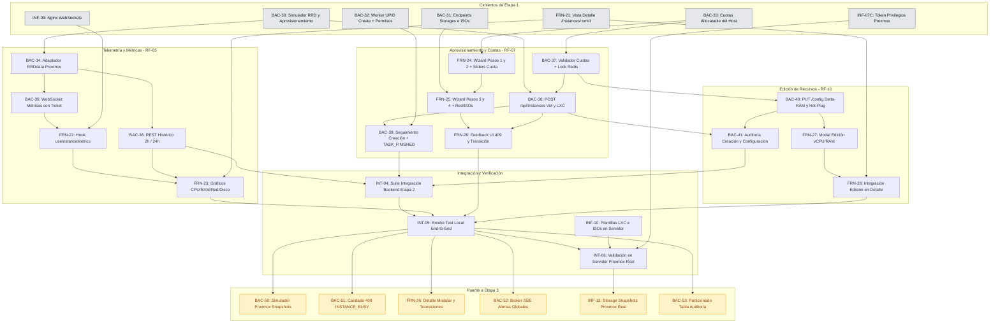

# Etapa 2: Telemetría Avanzada, Aprovisionamiento y Edición de Recursos

> **Estado:** Planificada.
> **Dependencia previa:** Cierre de la Etapa 1 ([`etapa1.md`](etapa1.md)), incluyendo sus tareas puente de infraestructura y simulador (`Bloque 7`: `BAC-30` a `BAC-33`, `FRN-21`, `INF-09` e `INF-07C`), con las pruebas de aceptación e integración de ciclo de vida en verde (`INT-01` e `INT-02`).
> **Requerimientos cubiertos:** `RF-05` (Métricas por instancia), `RF-07` (Wizard de creación con control de cuotas), `RF-10` (Edición de recursos con cálculo diferencial) y `RF-11` (Notificaciones de aprovisionamiento).

---

## 1. Criterios de Planificación y Decisiones de Arquitectura

1. **Regla de Granularidad ($\le$ 2.5 h):** Ninguna tarea supera las 2.5 horas de estimación. Cada ítem aísla una responsabilidad técnica concreta dividiendo la capa de datos, la lógica de negocio y la interfaz de usuario.
2. **Independencia del Servidor en Desarrollo:** Toda la etapa se programa y valida localmente contra el simulador `backend/cmd/proxmox-simulador` (extendido en `BAC-30`) y Redis local. La infraestructura física de Proxmox solo interviene en la validación final (`INT-06`).
3. **Exclusiones Explícitas del Alcance:**
   - `RF-12` (organizaciones / multi-tenant) permanece descartado. No se crean tablas ni campos `organization_id`.
   - Servidor SMTP real descartado del MVP: se utiliza `MockEmailService` para el registro estructurado de correos.
   - La plataforma continúa operando sobre un **único nodo Proxmox fijo** (`PROXMOX_NODE`).
   - La consola web remota (noVNC, xterm.js, SPICE) queda excluida por razones de seguridad operacional.
   - Snapshots (`RF-06`) y visor general de auditoría (`RF-08`) corresponden a la Etapa 3.
4. **Decisión de Retención y Streaming de Métricas (`RF-05`):**
   - **Streaming en Vivo:** Se utiliza un canal WebSocket (`/api/ws/instances/:vmid/metrics`) protegido por tickets efímeros en Redis (`POST /api/auth/ws-ticket`), reutilizando la arquitectura de seguridad establecida en `BAC-21C` para evitar la exposición de tokens en URLs.
   - **Histórico Corto sin Sobrecarga:** Se consumen directamente las series temporales RRDdata nativas de Proxmox (`/nodes/{node}/{tipo}/{vmid}/rrddata?timeframe=hour|day`). **Se descarta la incorporación de bases de series temporales externas (TimescaleDB / InfluxDB)** para no sobredimensionar la infraestructura del MVP; Proxmox ya calcula y consolida estos promedios de forma eficiente.
5. **Algoritmo de Validación de Cuotas y Prevención de Carreras (`RF-07`):**
   - **Headroom de Seguridad:** El backend valida que la RAM solicitada no comprometa el 15% de memoria física reservada para el sistema operativo base de Proxmox. Si la capacidad disponible no alcanza, responde `HTTP 409 Conflict` con el código estructurado `RESOURCE_QUOTA_EXCEEDED` detallando el faltante.
   - **Bloqueo Transaccional Distribuido:** Se implementa un candado en Redis (`lock:instance:provisioning`) con TTL de 30 s mediante `SETNX`. Esto evita condiciones de carrera cuando dos administradores intentan crear instancias en simultáneo sobre los mismos recursos libres restantes.
   - **Autoasignación Inmediata de Permisos:** Al completarse la tarea asíncrona de creación (`qmcreate`/`vzcreate`), el sistema asocia automáticamente la tupla `(usuario_id, vmid, FULL_ACCESS)` en `permisos_instancia`, garantizando que el creador visualice y opere de inmediato su máquina.
6. **Política de Configuración de Red en el Asistente:**
   - Se prioriza la asignación dinámica **DHCP** por defecto sobre el bridge de red virtual `vmbr1`.
   - Se ofrece la alternativa de configuración estática opcional (IP/CIDR y Gateway), validada en frontend y backend antes de enviar el payload a Proxmox.
7. **Cálculo Diferencial en Edición de Recursos (`RF-10`):**
   - Para modificaciones de memoria ($\Delta\text{RAM}$), solo se valida el incremento positivo contra la cuota libre del host. Si se reduce la asignación ($\Delta\text{RAM} < 0$), la operación se autoriza directamente.
   - Si la máquina está encendida (`running`) y Proxmox no soporta hot-plug para el recurso alterado (o el kernel huésped no lo admite), el backend persiste el cambio y devuelve `HTTP 200 OK` con `{ requiresReboot: true }`. El frontend muestra un aviso amarillo contextual indicando que el cambio surtirá efecto tras el próximo reinicio.
8. **Trazabilidad en Auditoría (`RF-08` / `BAC-18`):** Toda acción de aprovisionamiento (`CREATE_INSTANCE`) y edición (`CONFIG_INSTANCE`) se audita en la tabla inmutable `auditoria`, vinculando el usuario autenticado, el `vmid`, el `upid` de Proxmox y el resultado final.

---

## 2. Estado del Código al Inicio de la Etapa 2 (Punto de Partida)

| Componente | Estado que deja la Etapa 1 | Tarea de Etapa 2 que lo evoluciona |
|---|---|---|
| Simulador de Proxmox (`backend/cmd/proxmox-simulador`) | ✅ Soporta ciclo de vida, borrado, IP, storages, templates y RRDdata mock (`BAC-30`) | Se utiliza directamente para testing unitario e integración |
| Endpoints de Storages y Templates | ✅ `GET /api/node/storages` y `GET /api/node/templates` (`BAC-31`) | Consumidos por el Wizard de creación (`FRN-25`) |
| Cuotas asignables del Host | ✅ `GET /api/node/status` incluye `allocatable` (`BAC-33`) | Motor de validación de cuotas (`BAC-37`) y barras en UI (`FRN-24`) |
| Worker de UPIDs (`seguimiento_tareas.go`) | ✅ Soporta acciones `create` y autoasigna permisos (`BAC-32`) | Orquesta el fin de aprovisionamiento en `BAC-39` |
| Vista Detalle de Instancia (`/instances/:vmid`) | ✅ Layout base y navegación con pestañas vacías (`FRN-21`) | Aloja gráficos de métricas (`FRN-23`) y botón de edición (`FRN-28`) |
| Botón "Crear instancia" en frontend | ✅ Reubicado en cabecera de `/instances` con `PermissionGate` (`FIX-60`) | Dispara el Wizard de 4 pasos (`FRN-24`) |
| Nginx Reverse Proxy | ✅ Configurado para WebSockets con `Upgrade` y `Connection` (`INF-09`) | Canaliza el streaming en vivo sin cortes |
| Permisos de Proxmox Token | ✅ Incorpora `VM.Allocate`, `Datastore.AllocateSpace`, `VM.Config.*` (`INF-07C`) | Permite crear y reconfigurar instancias reales |

---

## 3. Mapa de Dependencias de la Etapa 2

---

## 4. Orden de Carga en ClickUp

| Ola | Se carga y se empieza | Condición para empezar |
|---|---|---|
| **1** | `BAC-34`, `BAC-37`, `FRN-24`, `INF-10` | Cierre de Etapa 1 (`Bloque 7`). No tienen bloqueantes internos en Etapa 2 |
| **2** | `BAC-35`, `BAC-36`, `BAC-38`, `FRN-22`, `FRN-25` | `BAC-34` (telemetría), `BAC-37` (cuotas) y `FRN-24` (primeros pasos wizard) |
| **3** | `BAC-39`, `BAC-40`, `FRN-23`, `FRN-26`, `FRN-27` | Ola 2. Requiere endpoints de creación, métricas y estructuras base del wizard |
| **4** | `BAC-41`, `FRN-28`, `INT-04` | Ola 3. Cierra la auditoría, la edición en frontend y la suite automática |
| **5** | `INT-05`, y después `INT-06` | Todo lo anterior implementado. `INT-06` requiere `INF-10` y Proxmox real |
| **6 (Puente a Etapa 3)** | `BAC-50`, `BAC-51`, `FRN-36`, `BAC-52`, `INF-13`, `BAC-53` | Olas 4 y 5 de Etapa 2. Cubren los baches operativos y de entorno para habilitar la Etapa 3 |

**Camino crítico:** `BAC-37` $\rightarrow$ `BAC-38` $\rightarrow$ `BAC-39` $\rightarrow$ `FRN-26` $\rightarrow$ `INT-04` $\rightarrow$ `INT-05` $\rightarrow$ `INT-06`.

---

## 5. Desglose Detallado de Tareas (ClickUp)

### Bloque 1: Backend - Telemetría Avanzada y Streaming de Métricas (`RF-05`)

---

### Bloque 2: Backend - Motor de Aprovisionamiento y Validación de Cuotas (`RF-07`)

---

### Bloque 3: Backend - Edición Dinámica de Recursos y Auditoría (`RF-10`, `RF-08`)

---

### Bloque 4: Frontend - Gráficos de Telemetría en Detalle de Instancia (`RF-05`)

---

### Bloque 5: Frontend - Asistente de Creación de Instancias (Wizard de 4 Pasos) (`RF-07`)

---

### Bloque 6: Frontend - Modal de Edición de Recursos (`RF-10`)

---

### Bloque 7: Infraestructura y Pruebas de Integración de la Etapa 2

#### `INT-04` - Suite automatizada de pruebas de integración de la Etapa 2

- **Área:** Backend / Testing
- **Asignados:** Tayra y Lisandro
- **Estimación:** 2.5 h
- **Depende de:** `BAC-36`, `BAC-39`, `BAC-41`.
- **Problema:** Se requiere una suite de aceptación automatizada que valide en CI/local todo el flujo de cuotas, creación, telemetría y edición contra el simulador.
- **Entregable:**
  - Suite `test/back/etapa2_acceptance_test.go`:
    1. Consumo de métricas históricas RRD y conexión WebSocket con ticket.
    2. Creación exitosa de instancia con autoasignación de permisos en `permisos_instancia`.
    3. Rechazo estricto por cuota insuficiente (`409 RESOURCE_QUOTA_EXCEEDED`) y prueba de concurrencia con candado Redis.
    4. Modificación de configuración con cálculo diferencial y verificación de auditoría.
- **Criterio de éxito:** `go test ./test/back/etapa2_acceptance_test.go` pasa 100% en verde sin dependencias externas.

#### `INT-05` - Smoke Test End-to-End local de la Etapa 2

- **Área:** Integración / Todo el equipo
- **Asignados:** Equipo completo
- **Estimación:** 2.0 h
- **Depende de:** `INT-04`, `FRN-23`, `FRN-26`, `FRN-28`.
- **Problema:** Verificación manual integral de experiencia de usuario y coherencia funcional antes de pasar al servidor físico.
- **Entregable:** Recorrido interactivo en entorno local con backend, frontend, Redis y simulador:
  1. Admin accede a `/instances`, pulsa "Crear instancia", completa el Wizard de 4 pasos para un contenedor LXC y confirma.
  2. Ve la fila en estado "Creando...", recibe notificación de tarea finalizada y la máquina aparece lista.
  3. Abre `/instances/:vmid`, verifica los gráficos de métricas actualizándose en vivo por WebSocket y prueba el selector de 2h/24h.
  4. Abre el modal de edición, amplía la memoria RAM, comprueba el cálculo diferencial y confirma.
  5. Verifica en `/admin/audit` que la creación y la edición quedaron registradas inmutablemente.
- **Criterio de éxito:** Flujo completo ejecutado sin errores en la consola del navegador ni inconsistencias en la base de datos.

#### `INT-06` - Validación en servidor de la Etapa 2 contra Proxmox real

- **Área:** Integración / Infraestructura
- **Asignados:** Nico y un integrante de backend
- **Estimación:** 2.0 h
- **Depende de:** `INT-05`, `INF-10`.
- **Problema:** Validación definitiva sobre el hipervisor real y a través del proxy inverso de producción antes de cerrar la etapa.
- **Entregable:**
  - Ejecutar los pasos del Smoke Test (`INT-05`) en el entorno de pruebas contra el Proxmox real:
    1. Crear un contenedor LXC real con la plantilla de prueba en un VMID libre ($\ge 106$).
    2. Comprobar que Nginx enruta el WebSocket de métricas sin cortes.
    3. Modificar la memoria del contenedor.
    4. Destruir el contenedor de prueba con `DELETE /api/instances/:vmid` (`BAC-24B`/`BAC-24C`) para dejar el entorno limpio.
- **Criterio de éxito:** El aprovisionamiento, telemetría y edición funcionan idénticamente en el servidor físico, registrando auditoría y respetando los VMIDs protegidos.

### Bloque 8: Tareas Puente (Bridge) y Cierre de Baches para el Paso a la Etapa 3

> [!IMPORTANT]
> **Cierre de Brechas Operativas y de Entorno Local (Etapa 2 $\rightarrow$ Etapa 3):**
> Estas tareas cubren los baches técnicos y arquitectónicos detectados en la verificación de la Etapa 2 que destraban directamente el inicio sin fricciones de los Snapshots (`RF-06`), la Auditoría Completa (`RF-08`), las Alertas por Saturación (`RF-11`) y el Hardening Final:
> 1. El simulador de Proxmox en local debe responder endpoints de snapshots (`create`, `list`, `rollback`, `delete`) y emitir UPIDs simulados para que el equipo desarrolle la Etapa 3 sin depender del hardware físico.
> 2. Debe existir una guarda centralizada de concurrencia operativa a nivel de instancia que rechace con `409 INSTANCE_BUSY` cualquier acción mutante concurrente mientras una tarea asíncrona (como snapshot o rollback) está en curso.
> 3. La vista de Detalle de Instancia (`/instances/:vmid`) debe modularizarse para admitir la nueva pestaña de Snapshots, badges de estados transitorios (`SNAPSHOTTING`, `ROLLING_BACK`) y propagación de bloqueo a la botonera de la cabecera.
> 4. El broker de eventos SSE (`/api/events`) debe generalizarse para emitir alertas globales del host (`ALERT_TRIGGERED`, `ALERT_RESOLVED`) sin requerir un VMID obligatorio.
> 5. El almacenamiento del Proxmox real debe auditarse para verificar que el pool de discos admita snapshots nativos (LVM-thin, ZFS o qcow2) y no falle en la validación de hardware.
> 6. La tabla `auditoria` debe contar preventivamente con particiones trimestrales creadas e índices compuestos para soportar el partition pruning y streaming masivo de la Etapa 3.

---

---

## 6. Resumen de Distribución y Carga de Trabajo

| Ola | Tarea | Área | Responsable(s) | Estimación | Empieza con | Cierra con (bloqueantes) |
|---|---|---|---|---|---|---|
| 1 | `BAC-34` | Backend | Lisandro | 2.0 h | — | — (`BAC-30` de Etapa 1) |
| 1 | `BAC-37` | Backend | Tayra | 2.0 h | — | — (`BAC-33` de Etapa 1) |
| 1 | `FRN-24` | Frontend | Belinda | 2.5 h | — | — (`BAC-33` de Etapa 1) |
| 1 | `INF-10` | Infraestructura | Nico / Lucas | 1.5 h | — | — (`INF-07C` de Etapa 1) |
| 2 | `BAC-35` | Backend | Tayra | 2.5 h | `BAC-34` | `BAC-34` |
| 2 | `BAC-36` | Backend | Tayra | 1.5 h | `BAC-34` | `BAC-34` |
| 2 | `BAC-38` | Backend | Lisandro | 2.5 h | `BAC-37` | `BAC-37` |
| 2 | `FRN-22` | Frontend | Belinda | 2.0 h | `BAC-35` | `BAC-35`, `INF-09` |
| 2 | `FRN-25` | Frontend | Luz | 2.0 h | `FRN-24` | `FRN-24`, `BAC-31` |
| 3 | `BAC-39` | Backend | Lisandro | 2.0 h | `BAC-38` | `BAC-38`, `BAC-32` |
| 3 | `BAC-40` | Backend | Tayra | 2.0 h | `BAC-37` | `BAC-37` |
| 3 | `FRN-23` | Frontend | Luz | 2.5 h | `FRN-22`, `BAC-36` | `FRN-22`, `BAC-36` |
| 3 | `FRN-26` | Frontend | Cristian | 2.0 h | `FRN-25` | `FRN-25`, `BAC-38` |
| 3 | `FRN-27` | Frontend | Cristian | 2.0 h | `BAC-40` | `BAC-40` |
| 4 | `BAC-41` | Backend | Tayra | 1.5 h | `BAC-38`, `BAC-40` | `BAC-38`, `BAC-40` |
| 4 | `FRN-28` | Frontend | Cristian | 1.5 h | `FRN-27` | `FRN-27` |
| 4 | `INT-04` | Testing | Tayra, Lisandro | 2.5 h | — | `BAC-36`, `BAC-39`, `BAC-41` |
| 5 | `INT-05` | Integración | Equipo completo | 2.0 h | — | `INT-04`, `FRN-23`, `FRN-26`, `FRN-28` |
| 5 | `INT-06` | Integración / Infra | Nico + backend | 2.0 h | — | `INT-05`, `INF-10` |
| 6 | `BAC-50` (BRG-10) | Testing / Back | Lisandro | 2.0 h | `BAC-30` | — |
| 6 | `BAC-51` (BRG-11) | Backend | Tayra | 2.0 h | `BAC-29`, `BAC-37` | — |
| 6 | `FRN-36` (BRG-10) | Frontend | Cristian | 2.0 h | `FRN-21`, `FRN-28` | — |
| 6 | `BAC-52` (BRG-12) | Backend | Tayra | 1.5 h | `BAC-21C`, `BAC-26` | — |
| 6 | `INF-13` (BRG-11) | Infraestructura | Nico | 1.5 h | `INF-10` | — |
| 6 | `BAC-53` (BRG-13) | Backend / DB | Lisandro | 1.5 h | `BAC-18`, `BAC-41` | — |
| | **Total** | | | **48.5 h** | | **25 tareas, promedio 1.94 h** |

---

### Carga Horaria por Integrante en la Etapa 2

| Integrante | Rol | Horas Asignadas | Tareas |
|---|---|---:|---|
| **Lisandro** | Backend | 12.5 h + `INT-04` | `BAC-34`, `BAC-38`, `BAC-39`, `BAC-50`, `BAC-53` |
| **Tayra** | Backend | 13.0 h + `INT-04` | `BAC-37`, `BAC-35`, `BAC-36`, `BAC-40`, `BAC-41`, `BAC-51`, `BAC-52` |
| **Belinda** | Frontend | 4.5 h | `FRN-24`, `FRN-22` |
| **Luz** | Frontend | 4.5 h | `FRN-25`, `FRN-23` |
| **Cristian** | Frontend | 7.5 h | `FRN-26`, `FRN-27`, `FRN-28`, `FRN-36` |
| **Nico** | Infraestructura | 4.0 h + `INT-06` | `INF-10` (compartida), `INT-06`, `INF-13` |
| **Lucas** | Infraestructura | 0.75 h | `INF-10` (compartida) |
| **Equipo Completo** | Integración | 2.0 h | `INT-05` (Smoke test end-to-end) |

