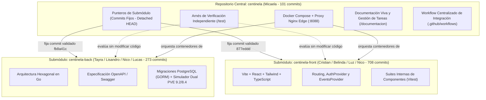

# 1. Estructura del Repositorio, README, Submódulos y Topología de Despliegue

**Contexto en el Artículo:** Sección II (*"De la tarea administrativa a la ingeniería de contexto"*) y Sección III (*"El paradigma del AI Manager en el ciclo de entrega"*).

---

## 1.1. Justificación Arquitectónica: Repositorio Orquestador vs. Monorrepo Tradicional

Uno de los principales desafíos identificados en la gestión de proyectos asistida por IA es la delimitación del contexto de trabajo. En proyectos desacoplados donde múltiples desarrolladores y agentes de IA trabajan en paralelo sobre distintas tecnologías (Go con arquitectura hexagonal en backend y React/TypeScript/Vite en frontend), una estructura monolítica tradicional o repositorios completamente inconexos generan problemas severos:
*   **En repositorios inconexos:** se pierde la visibilidad del estado de integración; el backend avanza asumiendo un contrato mientras el frontend implementa otro distinto, generándose "islas de desarrollo".
*   **En un monorrepo directo con ramas móviles compartidas:** dos desarrolladores o procesos automáticos empujando cambios simultáneamente provocan colisiones en `main`, carreras en la integración continua y commits cruzados con código a medio terminar.

Para resolver esta tensión sociotécnica, en **El Centinela** se adoptó una arquitectura de **Repositorio Orquestador Centralizado con Submódulos Git Validados**:



---

## 1.2. Configuración de Submódulos y Reglas Operativas

El archivo [`.gitmodules`](file:///home/micaela/centinela/.gitmodules) vincula formalmente los componentes:

```ini
[submodule "frontend"]
	path = frontend
	url = https://github.com/luzpacello/centinela-front.git
	branch = main
[submodule "backend"]
	path = backend
	url = https://github.com/tayraag/centinela-back.git
	branch = main
```

### Reglas de Operación y Punteros Inmutables
Como se documentó exhaustivamente en [`manejo-repo.md`](file:///home/micaela/centinela/manejo-repo.md), el repositorio orquestador **nunca sigue ramas flotantes ni hace checkout automático de la punta de `main` sin validación**. En su lugar, opera bajo la regla de **Commits Específicos Verificados (`detached HEAD`)**:

1.  **Aislamiento de la autoría:** Los desarrolladores confirman, abren PRs y mezclan en sus respectivos repositorios (`centinela-front` y `centinela-back`). El repositorio orquestador no interfiere con el flujo de trabajo diario de cada equipo.
2.  **Punteros a commits exactos:** El orquestador almacena el identificador criptográfico (`SHA`) exacto de cada submódulo (al 03/11/2026: backend en `fb8a41c` y frontend en `877eddd`) para ejecutar las suites de aceptación e integración:
    ```bash
    git -C frontend checkout --detach <SHA_FRONTEND>
    git -C backend checkout --detach <SHA_BACKEND>
    git add frontend backend
    git commit -m "chore: fijar versiones de integración verificadas"
    ```
3.  **Prohibición de `git add .` indiscriminado:** La gestión humana prohíbe el uso de comandos globales de adición para evitar publicar punteros de componentes que se encuentren en un estado inestable o con tests fallidos.

---

## 1.3. La Filosofía *Local-First*, el Simulador Dual de Proxmox y la Topología Docker

Uno de los aportes estratégicos del Project Manager documentados en el artículo es la **desarticulación de dependencias externas bloqueantes**. En proyectos que interactúan con hipervisores físicos (como Proxmox VE), el avance suele quedar paralizado si el servidor físico de laboratorio no está configurado, si falla la red del centro de cómputos o si cambia la versión del hipervisor entre el entorno de desarrollo y el de producción.

Para blindar la velocidad de desarrollo frente a estas contingencias, se implementó una filosofía **Local-First** soportada por un entorno Docker multicontenedor ([`README.md`](file:///home/micaela/centinela/README.md) y [`compose.yaml`](file:///home/micaela/centinela/compose.yaml)):

```mermaid
flowchart LR
    User[Navegador / Pruebas E2E] -->|HTTP :8088| Nginx[Proxy Nginx Edge]
    Nginx -->|/api/* (reescribe ruta)| GoBackend[API Backend Go :8080]
    Nginx -->|/*| ViteFrontend[Frontend Vite + Nginx]
    GoBackend --> DB[(PostgreSQL 16 :5432)]
    GoBackend --> Redis[(Redis Cache/Locks :6379)]
    GoBackend --> Mailpit[Mailpit SMTP :1025]
    GoBackend --> ProxmoxStub[Simulador Proxmox VE Dual 9.2.2 / 8.4.21]
```

### Componentes de la Automatización Local:
1.  **Proxy Reverso Nginx Edge ([`docker/nginx-edge.conf`](file:///home/micaela/centinela/docker/nginx-edge.conf)):** Expone un único puerto (`8088`) hacia el exterior en desarrollo (y `80`/`443` con TLS 1.2/1.3 en producción). Todas las peticiones a `/api/*` son reescritas y despachadas internamente al backend en el puerto `8080` (incluyendo soporte de `Upgrade` para WebSockets en `/api/ws/` y streaming SSE sin buffering en `/api/events`), mientras que el resto de las rutas son servidas por el frontend compilado. Esto **elimina completamente los problemas de CORS** en desarrollo local e integración continua.
2.  **Simulador Proxmox VE con Modo Dual de Versión (`backend/cmd/proxmox-simulador` y `test/back/proxmox-stub`):**
    *   Soporta el ciclo de vida completo de VMs QEMU y contenedores LXC (`start`, `stop`, `shutdown`, `reboot`, `destroy`, snapshots, rollback, clonado y métricas RRDdata).
    *   **Adaptación Multi-Versión (`BAC-55` / `ADP-05` / `ADP-06`):** Tras detectarse que las capturas iniciales correspondían a **Proxmox VE 9.2.2** (Debian 13 Trixie) mientras que el servidor final de la universidad ejecuta **Proxmox VE 8.4.21** (Debian 12 Bookworm), el simulador se actualizó en los commits `61b973d`, `ec5922c` y `aee232a` para soportar `PROXMOX_SIM_TARGET_VERSION=8.4.21|9.2.2`, exponiendo el catálogo oficial de plantillas Debian 12 (`debian-12-standard_12.7-1_amd64.tar.zst`), exigiendo `ostype=l26` y `agent=1` en QEMU, y validando `?purge=1&destroy-unreferenced-disks=1` en eliminaciones.
    *   Simulación de caídas de red y respuestas lentas con el contenedor `proxmox-lento` para verificar timeouts de 2 s y rechazos controlados `504 PROXMOX_TIMEOUT` (`FIX-40`).
3.  **Aislamiento de Estado y Trazabilidad de Correo (`Mailpit` + `FIX-140`):** Contenedor de Mailpit con servidor SMTP local (`1025`) y panel web (`8025`), permitiendo verificar tokens OTP y altas de usuario sin depender de Brevo. Además, mediante `FIX-140` (commit `4e4d2c4`), el backend expone `"emailProvider": "smtp"|"mock"` en `GET /api/version` y añade la cabecera `X-Centinela-Email-Provider: mock` cuando corre sin SMTP, evitando falsos éxitos silenciosos de entrega.
4.  **Script de Control Operativo ([`scripts/centinela.sh`](file:///home/micaela/centinela/scripts/centinela.sh)):** Automatiza las rutinas de inicialización, reconstrucción forzada y purga de volúmenes con comandos estándar (`./scripts/centinela.sh {up|down|rebuild|reset}`).

---

## 1.4. Del Entorno Local al Servidor Físico Final (`pve-is3-g1`): Topología Multi-Contenedor LXC

A fines de octubre de 2026 se documentó en [`documentacion/servidorfinal/`](file:///home/micaela/centinela/documentacion/servidorfinal/analisis-estado-servidor.md) y [`documentacion/SMTP-y-Brevo.md`](file:///home/micaela/centinela/documentacion/SMTP-y-Brevo.md) la transición desde el entorno Docker y el servidor de pruebas (`100.93.128.111`) hacia el **Servidor Final del Grupo 1 (`pve-is3-g1`, IP Tailscale `100.116.49.111`)** sobre Proxmox VE 8.4.21, donde la arquitectura se despliega sobre **7 contenedores LXC** segmentados en 3 bridges virtuales (`vmbr1` lógica/app, `vmbr2` DMZ/clientes, `vmbr3` datos):

| VMID (LXC) | Nombre del Contenedor | IPs Internas | Rol en la Arquitectura |
|:---:|---|---|---|
| **100** | `centinela-proxy` | `10.10.1.10`, `10.10.2.10` | Proxy reverso Nginx perimetral (`/` $\rightarrow$ front, `/api/` $\rightarrow$ API). |
| **101** | `centinela-bd` | `10.10.3.60` | Base de datos PostgreSQL 16 aislada en la red de datos (`vmbr3`). |
| **102** | `centinela-api` | `10.10.1.30`, `10.10.3.30` | Binario compilado del Backend Go (`:8080`) con doble interfaz (`vmbr1` y `vmbr3`). |
| **103** | `centinela-front` | `10.10.1.20` | Servidor Nginx interno que sirve el bundle estático de React/Vite. |
| **104** | `centinela-redis` | `10.10.1.15` *(a migrar a `10.10.3.15`)* | Almacén en memoria Redis 7 (sesiones, tickets WS/SSE, locks y rate limiting). |
| **105** | `centinela-smtp-brevo` | `10.10.1.60` | Relay Postfix dedicado para despacho de correos hacia `smtp-relay.brevo.com` (`:587/:465`). |
| **106** | `centi-mica` | `10.10.1.250`, `10.10.2.250`, `10.10.3.250` | **Jump Host y Gateway Tailscale (`100.114.44.18`)** desplegado para auditar la red interna y publicar el proxy mediante `tailscale serve`. |

---

## 1.5. Valor para el Artículo: La Ingeniería de Contexto en Acción

En la Sección II del artículo se afirma que el Project Manager en la era de la IA no programa todos los algoritmos de negocio, sino que construye el **contexto arquitectónico y operativo** que permite a los asistentes de IA y desarrolladores trabajar con autonomía y sin colisiones.

La organización del repositorio de *El Centinela* constituye un ejemplo empírico directo de este principio:
*   Al fijar contratos OpenAPI estrictos y empaquetar un simulador dual de Proxmox VE en Docker, los asistentes de IA utilizados por los desarrolladores contaban con especificaciones deterministas y reproducibles para ambas versiones del hipervisor (PVE 9.2.2 y PVE 8.4.21).
*   Al fijar punteros inmutables en los submódulos y auditar directamente la topología LXC del servidor final mediante el bastión `centi-mica`, la gestora evitó que las divergencias de código o los aislamientos de red del laboratorio paralizaran la integración del equipo.
