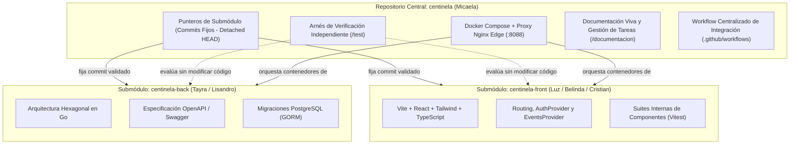

# 1. Estructura del Repositorio, README y Gestión de Submódulos

**Contexto en el Artículo:** Sección II (*"De la tarea administrativa a la ingeniería de contexto"*) y Sección III (*"El paradigma del AI Manager en el ciclo de entrega"*).

---

## 1.1. Justificación Arquitectónica: Repositorio Orquestador vs. Monorrepo Tradicional

Uno de los principales desafíos identificados en la gestión de proyectos asistida por IA es la delimitación del contexto de trabajo. En proyectos desacoplados donde múltiples desarrolladores y agentes de IA trabajan en paralelo sobre distintas tecnologías (en este caso, Go en backend y React/TypeScript en frontend), una estructura monolítica tradicional o repositorios completamente inconexos generan problemas severos:
*   **En repositorios inconexos:** se pierde la visibilidad del estado de integración; el backend avanza asumiendo un contrato mientras el frontend implementa otro distinto, generándose "islas de desarrollo".
*   **En un monorrepo directo con ramas móviles compartidas:** dos desarrolladores o procesos automáticos empujando cambios simultáneamente provocan colisiones en `main`, carreras en la integración continua y commits cruzados con código a medio terminar.

Para resolver esta tensión sociotécnica, en **El Centinela** se adoptó una arquitectura de **Repositorio Orquestador Centralizado con Submódulos Git Validados**:



---

## 1.2. Configuración de Submódulos y Reglas Operativas

El archivo [`.gitmodules`](file:///home/micaela/centinela/.gitmodules) vincula formalmente los componentes:

```ini
[submodule "frontend"]
	path = frontend
	url = https://github.com/luzpacello/centinela-front.git
	branch = main
[submodule "backend"]
	path = backend
	url = https://github.com/tayraag/centinela-back.git
	branch = main
```

### Reglas de Operación y Punteros Inmutables
Como se documentó exhaustivamente en [`manejo-repo.md`](file:///home/micaela/centinela/manejo-repo.md), el repositorio orquestador **nunca sigue ramas flotantes ni hace checkout automático de la punta de `main`**. En su lugar, opera bajo la regla de **Commits Específicos Verificados (`detached HEAD`)**:

1.  **Aislamiento de la autoría:** Los desarrolladores confirman, abren PRs y mezclan en sus respectivos repositorios (`centinela-front` y `centinela-back`). El repositorio orquestador no interfiere con el flujo de trabajo diario de cada equipo.
2.  **Punteros a commits exactos:** El orquestador almacena el identificador criptográfico (`SHA`) exacto de cada submódulo que ha superado las pruebas de integración. 
    ```bash
    git -C frontend checkout --detach <SHA_FRONTEND>
    git -C backend checkout --detach <SHA_BACKEND>
    git add frontend backend
    git commit -m "chore: fijar versiones de integración verificadas"
    ```
3.  **Prohibición de `git add .` indiscriminado:** La gestión humana prohíbe el uso de comandos globales de adición para evitar publicar punteros de componentes que se encuentren en un estado inestable o con tests fallidos.

---

## 1.3. La Filosofía *Local-First* y la Topología Docker

Uno de los aportes estratégicos del Project Manager documentados en el artículo es la **desarticulación de dependencias externas bloqueantes**. En proyectos que interactúan con hipervisores físicos (como Proxmox VE), el avance suele quedar paralizado si el servidor físico de laboratorio no está configurado, si falla la red del centro de cómputos o si se carece de permisos de administración.

Para blindar la velocidad de desarrollo frente a estas contingencias, se implementó una filosofía **Local-First** soportada por un entorno Docker multicontenedor:

```mermaid
flowchart LR
    User[Navegador / Pruebas E2E] -->|HTTP :8088| Nginx[Proxy Nginx Edge]
    Nginx -->|/api/* (reescribe ruta)| GoBackend[API Backend Go :8080]
    Nginx -->|/*| ViteFrontend[Frontend Vite + Nginx]
    GoBackend --> DB[(PostgreSQL 16 :5432)]
    GoBackend --> Redis[(Redis Cache/Locks :6379)]
    GoBackend --> Mailpit[Mailpit SMTP :1025]
    GoBackend --> ProxmoxStub[Simulador Proxmox VE / Stub]
```

### Componentes de la Automatización Local:
1.  **Proxy Reverso Nginx Edge (`docker/nginx-edge.conf`):** Expone un único puerto (`8088`) hacia el exterior. Todas las peticiones a `/api/*` son reescritas y despachadas internamente al backend en el puerto `8080`, mientras que el resto de las rutas son servidas por el frontend compilado. Esto **elimina completamente los problemas de CORS** (Cross-Origin Resource Sharing) en desarrollo local e integración continua, asegurando paridad exacta con el entorno de despliegue en producción.
2.  **Simuladores Proxmox VE (`test/back/proxmox-stub` y `proxmox-sim.Dockerfile`):** El backend Go interactúa contra un servidor mock que replica con fidelidad los endpoints de la API REST de Proxmox VE 8.x:
    *   Soporte de ciclo de vida de VMs y contenedores LXC (`start`, `stop`, `shutdown`, `reboot`, `destroy`).
    *   Generación y sondeo de tareas asíncronas con formato oficial UPID (`UPID:node:0000ABCD:...:OK`).
    *   Simulación de caídas de red y respuestas lentas con el contenedor `proxmox-lento` para verificar timeouts de 2 s y rechazos controlados `504 PROXMOX_TIMEOUT` (`FIX-40`).
    *   Simulación de métricas RRDdata para graficación en tiempo real.
3.  **Aislamiento de Estado y Servidor de Correo:** Contenedor de Mailpit con servidor SMTP local (`1025`) y panel web (`8025`), permitiendo a las suites verificar de forma determinista el despacho de tokens OTP de un solo uso para recuperación de contraseña sin depender de servicios de terceros como Brevo o SendGrid.
4.  **Script de Control Operativo ([`scripts/centinela.sh`](file:///home/micaela/centinela/scripts/centinela.sh)):** Automatiza las rutinas de inicialización, reconstrucción forzada y purga de volúmenes con comandos estándar (`./scripts/centinela.sh {up|down|rebuild|reset}`).

---

## 1.4. Valor para el Artículo: La Ingeniería de Contexto en Acción

En la Sección II del artículo se afirma que el Project Manager en la era de la IA no programa algoritmos, sino que construye el **contexto arquitectónico** que permite a los asistentes y desarrolladores operar con autonomía. 

La organización del repositorio de *El Centinela* constituye un ejemplo tangible de este principio:
*   Al fijar contratos OpenAPI estrictos y empaquetar simuladores locales en Docker, los asistentes de IA utilizados por los desarrolladores contaban con especificaciones deterministas y reproducibles.
*   Al fijar punteros inmutables en los submódulos, el gestor evitó la propagación descontrolada de alucinaciones o refactorizaciones cruzadas de código que suelen ocurrir cuando una IA modifica archivos simultáneamente en frontend y backend.
