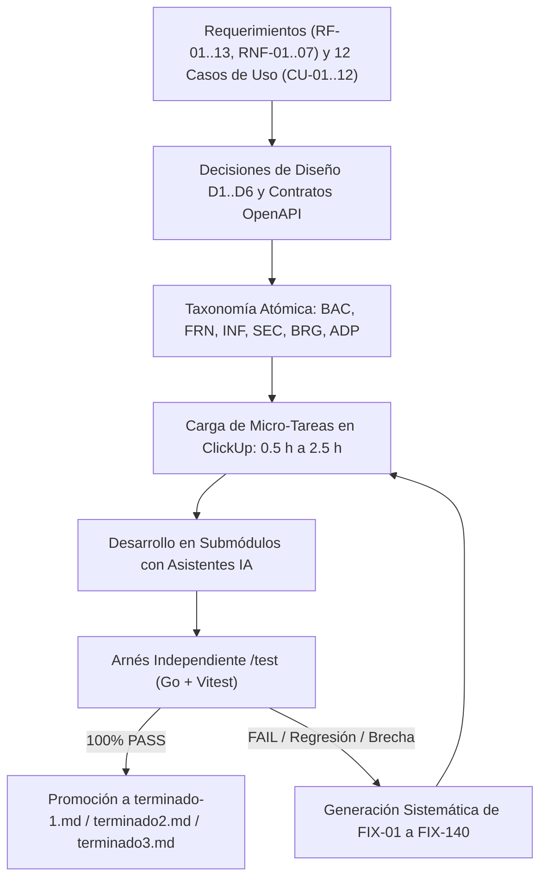

# 2. Pipeline de CI, Generación de Tareas y Creación Sistemática de Fixes

**Contexto en el Artículo:** Sección III (*"El paradigma del AI Manager en el ciclo de entrega"*) y Sección V.A (*"Identificación de cuellos de botella"*).

---

## 2.1. El Pipeline de Integración Continua (GitHub Actions)

La integración continua en *El Centinela* fue diseñada para actuar como un tribunal objetivo de validación de contratos, impidiendo que el código defectuoso o las divergencias de integración alcancen la rama principal (`main`).

### El Workflow de Smoke Tests ([`.github/workflows/integration-tests.yml`](file:///home/micaela/centinela/.github/workflows/integration-tests.yml))
Cada push a la rama `main` y cada Pull Request activa automáticamente un flujo de integración en un entorno limpio de Ubuntu:

```yaml
name: Integration smoke tests

on:
  push:
    branches: [main]
  pull_request:
  workflow_dispatch:

permissions:
  contents: read

jobs:
  smoke-test:
    runs-on: ubuntu-latest
    steps:
      - name: Checkout integration repository
        uses: actions/checkout@v4
        with:
          submodules: recursive

      - name: Build and start services
        run: docker compose up --build --detach --wait

      - name: Check frontend
        run: curl --fail --silent --show-error http://localhost:8088/ > /dev/null

      - name: Check API through frontend proxy
        run: |
          status="$(curl --silent --show-error \
            --output /tmp/centinela-api-response.json \
            --write-out "%{http_code}" \
            --header "Content-Type: application/json" \
            --data '{}' \
            http://localhost:8088/api/auth/login)"
          test "$status" -ge 400
          test "$status" -lt 500

      - name: Show service logs on failure
        if: failure()
        run: docker compose logs --no-color

      - name: Stop services
        if: always()
        run: docker compose down --volumes
```

### Características Críticas del Pipeline:
1.  **Validación de Submódulos Recursivos:** Asegura que los punteros fijados en el commit existan en los repositorios remotos (`centinela-back` y `centinela-front`) y se puedan clonar sin inconsistencias (como se reforzó en el PR #4, commit `6a0e033`, que restauró el clon limpio del submódulo y el arranque del stack integrado).
2.  **Verificación de Salud de Contenedores (`--wait`):** Docker Compose no avanza hasta que los servicios pasen sus respectivos *healthchecks* (PostgreSQL aceptando conexiones, backend respondiendo y Nginx en línea).
3.  **Smoke Test Transversal de Red:** Comprueba que Nginx sirva la SPA compilada en la raíz (`/`) y que la regla de reescritura de proxy despache correctamente a `/api/auth/login`, devolviendo un código 4xx canónico ante una petición vacía (validando que el backend está vivo y validando esquemas JSON).
4.  **Extracción de Trazas Forenses:** En caso de falla, el paso condicional `Show service logs on failure` vuelca la totalidad de los logs de los contenedores a la consola de CI sin coloreado ANSI, permitiendo diagnosticar la causa raíz inmediatamente.

### Arquitectura de Automatización de Submódulos por `repository_dispatch`:
Para evitar que dos pushes simultáneos de frontend y backend provoquen condiciones de carrera sobre el repositorio central, en [`manejo-repo.md`](file:///home/micaela/centinela/manejo-repo.md) se formalizó el flujo de disparo asíncrono con control de concurrencia:
1.  Frontend o Backend valida sus pruebas locales en su repositorio.
2.  Envía un evento `repository_dispatch` autenticado con un token restringido (`INTEGRATION_PAT`).
3.  El repositorio orquestador encola la petición mediante la directiva `concurrency: update-submodules`, realiza el checkout en modo `detached` del SHA exacto, levanta el stack en Docker y, solo si los tests de integración pasan en verde, confirma y empuja el nuevo puntero.

---

## 2.2. Metodología de Planificación y Generación de Tareas en ClickUp

Para mitigar la ambigüedad que suele inducir a las herramientas de IA generativa a inventar funcionalidades innecesarias o implementar soluciones incompletas, se diseñó una metodología de descomposición estricta respaldada por la documentación viva del repositorio ([`actual.md`](file:///home/micaela/centinela/documentacion/actual.md), [`terminado-1.md`](file:///home/micaela/centinela/documentacion/terminado-1.md), [`terminado2.md`](file:///home/micaela/centinela/documentacion/terminado2.md), [`terminado3.md`](file:///home/micaela/centinela/documentacion/terminado3.md)):



### 1. Taxonomía Estricta de Tareas (Estado al 03/11/2026):
*   `BAC-01` a `BAC-55`: Lógica de negocio hexagonal, controladores, puertos, adaptadores de Go, base de datos y simulador Proxmox.
*   `FRN-01` a `FRN-37`: Componentes visuales React, hooks de estado, clientes API, WebSockets, wizard de aprovisionamiento y routing.
*   `INF-01` a `INF-14`: Dockerfiles, Nginx Edge, TLS, Mailpit, redes LXC y auditoría sobre servidor Proxmox VE físico.
*   `SEC-01` a `SEC-04`: Mecanismos de seguridad transversal (JWT, 2FA TOTP con AES-256-GCM, cookies HttpOnly y rate limiting).
*   `LOGIN-01..04` e `INT-01..10`: Hitos de integración y smoke tests de punta a punta.
*   `BRG-*` (Bloques Puente): Tareas de desacople diseñadas para que un equipo prepare la infraestructura de la etapa siguiente mientras el otro estabiliza la actual.
*   `ADP-01` a `ADP-13` ([`etapa-adaptacion-proxmox-8.md`](file:///home/micaela/centinela/documentacion/archvios/etapa-adaptacion-proxmox-8.md)): Tareas de compatibilidad dual entre el entorno de desarrollo inicial (Proxmox VE 9.2.2 / Debian 13) y el servidor físico final de producción (Proxmox VE 8.4.21 / Debian 12 Bookworm).
*   `FIX-01` a `FIX-140`: Correcciones quirúrgicas generadas por el arnés de pruebas, la auditoría de seguridad y la contrastación de los 12 Casos de Uso.

### 2. Anatomía de la Micro-Tarea:
Cada tarea cargada en el tablero ClickUp debía cumplir cinco restricciones innegociables:
1.  **Cota temporal máxima de 2.5 horas:** Si una tarea superaba las 2.5 h de estimación, era rechazada y subdividida (ej. `BAC-23A` para inventario y `BAC-23B` para resolución de IPs con QEMU Guest Agent).
2.  **Asignación nominal unívoca:** Un único responsable principal por tarea (o par explícito en tareas cross-layer), evitando la dilución de responsabilidades.
3.  **Dependencias explícitas discriminadas:** Distinción clara entre *dependencia para empezar a codificar* (desacoplada mediante contratos OpenAPI y simulador local) y *dependencia para cerrar e integrar*.
4.  **Archivos exactos a modificar:** Delimitación física de los módulos y líneas del código fuente para evitar colisiones en Git.
5.  **Criterio de éxito ejecutable:** Enlace directo con la función o suite de prueba en `test/back` o `test/front` que certificaría el cierre.

---

## 2.3. El Algoritmo de Creación Sistemática de Fixes (`FIX-01` a `FIX-140`)

El mayor aporte metodológico del AI Manager en *El Centinela* radicó en **incorporar la verificación automatizada en la *Definition of Done* (DoD)**, no aceptando nunca la declaración subjetiva de *"tarea completada"* proveniente del tablero ClickUp o de los reportes de los asistentes de IA.

Cada vez que un desarrollador movía una tarjeta a *"Terminada"* en ClickUp, la PM ejecutaba el arnés de pruebas independiente contra el commit publicado. Ante cualquier falla, se aplicaba un **protocolo de remediación estructurada**:

```
┌────────────────────────────────────────────────────────────────────────┐
│                      PROTOCOLO DE CREACIÓN DE FIX                      │
├────────────────────────────────────────────────────────────────────────┤
│ 1. Identificador: FIX-XX secuencial con asignación nominal inmediata.  │
│ 2. Tarea origen: BAC-XX / FRN-XX / CU-XX de la que deriva el defecto.  │
│ 3. Diagnóstico de Causa Raíz: archivo exacto, función y línea del bug. │
│ 4. Evidencia empírica: traza exacta del test fallido en /test.        │
│ 5. Contrato violado: discrepancia entre OpenAPI / Caso de Uso y código.│
│ 6. Estimación: micro-tarea acotada de 0.5 h a 2.0 h.                   │
└────────────────────────────────────────────────────────────────────────┘
```

A lo largo de las etapas del proyecto (hasta el 03/11/2026), este mecanismo produjo **140 tareas de corrección (`FIX-01` a `FIX-140`)**, organizadas en olas sucesivas de remediación:
*   **`FIX-01` a `FIX-16` (Fase Base):** Correcciones de alineación de contratos de autenticación, 2FA y errores HTTP.
*   **`FIX-17` a `FIX-40` (Cierre Fase Base / Inicio Etapa 1):** Purga de sesiones, manejo de tokens en headers vs. cookies, fidelidad del simulador Proxmox (`FIX-32`, `FIX-35`), mapeo de bloqueos `409 INSTANCE_BUSY` (`FIX-33`) y timeouts de Proxmox (`FIX-40`).
*   **`FIX-41` a `FIX-70` (Etapa 1):** Rediseño arquitectónico ante colisión de borrado físico de usuarios y foreign keys inmutables en auditoría (`FIX-54` a `FIX-57`), deduplicación de eventos SSE (`FIX-47`, `FIX-64`) y semáforo de salud del nodo.
*   **`FIX-71` a `FIX-104` (Transición Etapa 1 $\rightarrow$ Etapa 2):** Barrido estático contra stubs olvidados, eliminación de código muerto (`FIX-91`), orden de migraciones en arranque en frío (`FIX-81`) y curvas reales de telemetría sin datos inventados (`FIX-103`).
*   **`FIX-105` a `FIX-110` (Air-Gap de Metadatos y Anti-IDOR):** Reemplazo de `UPID` crudos por `tareaId` UUIDv4, sustitución de `VMID` secuenciales por tokens criptográficos opacos (`inst_...`) y enmascaramiento de topología de nodos/storages.
*   **`FIX-111` a `FIX-119` (Auditoría de Seguridad CWE):** Plan de blindaje contra las 9 vulnerabilidades críticas de seguridad (CWE-287, CWE-307, CWE-284, CWE-613, CWE-521, CWE-88, CWE-200, CWE-798, CWE-285).
*   **`FIX-120` a `FIX-130` (Cierre Etapa 2 y Etapa 3):** Sanitización estricta anti-traversal de `InstanceRef` (`FIX-124`), resiliencia de `SnapshotsTabContent` y alias `:vmid`/`:instanceRef` (`FIX-127`), admisión de tráfico nativo *untagged* `vlan: 0` (`FIX-128` Back), opciones completas y exportación dual CSV/JSON en `Auditoria.tsx` (`FIX-128` Front), cabeceras HSTS/CSP en Nginx (`FIX-129`) y documentación de storages aptos para snapshots (`FIX-130`).
*   **`FIX-131` a `FIX-140` (Auditoría de los 12 Casos de Uso y Refinamiento Operativo de Etapa 3):**
    *   `FIX-131`: Incorporación del gráfico de Tráfico de Red (`netInBps`/`netOutBps`) en el detalle de instancia (`CU-05`).
    *   `FIX-132`: Discriminación de errores `400 SAME_PASSWORD` / `WEAK_PASSWORD` en recuperación de clave para no quemar intentos del código OTP (`CU-12`, resuelto en `3d06236`).
    *   `FIX-133`: Corrección de validación diferencial de cuota para permitir *CPU Overcommit* en escalado vertical y validar margen del nodo solo cuando $\Delta\text{RAM} > 0$ (`CU-10`, resuelto en `fb8a41c`).
    *   `FIX-134`: Soporte para instancias en estado `paused` y acción `resume` para prevenir deadlocks operativos (`CU-04`).
    *   `FIX-135`: Reconciliación con tareas externas de Proxmox (`qmstop`, `vzdump`) en el evaluador de alertas para evitar falsos positivos de `instance_down` (`CU-11`).
    *   `FIX-136`: Parametrización por variables de entorno (`ConfigAlertas`) de los umbrales de saturación e histéresis (`RF-11`).
    *   `FIX-137`: Eliminación de stub inerte `PausarInstancia` y corrección de filtro SQL en auditoría para no ocultar eventos de sistema con `organizacion_id IS NULL`.
    *   `FIX-138`: Ampliación de caracteres especiales admitidos en contraseñas conforme a NIST SP 800-63B para soportar gestores de contraseñas (`RF-01`, resuelto en `3fe055b`).
    *   `FIX-139`: Reconciliación síncrona de tareas `RUNNING` al arranque del backend (`RecuperarYReconciliarAlArranque`) para evitar falsos bloqueos `409 INSTANCE_BUSY` tras reinicios.
    *   `FIX-140`: Exposición del proveedor de correo (`emailProvider: "smtp"|"mock"`) en `/api/version` y cabecera `X-Centinela-Email-Provider: mock` para prevenir falsos éxitos de entrega en desarrollo (`RF-09`, resuelto en `4e4d2c4`).

Este ciclo continuo garantizó que ninguna tarea se cerrara por complacencia, convirtiendo cada discrepancia detectada en una especificación verificable por código.
