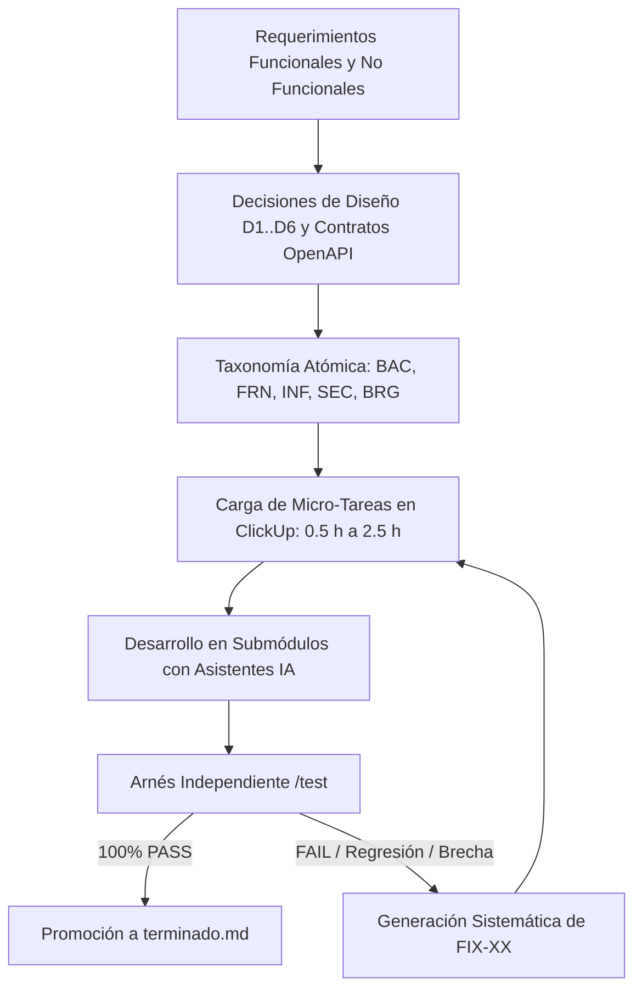

# 2. Pipeline de CI, Generación de Tareas y Creación Sistemática de Fixes

**Contexto en el Artículo:** Sección III (*"El paradigma del AI Manager en el ciclo de entrega"*) y Sección V.A (*"Identificación de cuellos de botella"*).

---

## 2.1. El Pipeline de Integración Continua (GitHub Actions)

La integración continua en *El Centinela* fue diseñada para actuar como un tribunal objetivo de validación de contratos, impidiendo que el código defectuoso o las divergencias de integración alcancen la rama principal (`main`).

### El Workflow de Smoke Tests ([`.github/workflows/integration-tests.yml`](file:///home/micaela/centinela/.github/workflows/integration-tests.yml))
Cada push a la rama `main` y cada Pull Request activa automáticamente un flujo de integración en un entorno limpio de Ubuntu:

```yaml
name: Integration smoke tests

on:
  push:
    branches: [main]
  pull_request:
  workflow_dispatch:

permissions:
  contents: read

jobs:
  smoke-test:
    runs-on: ubuntu-latest
    steps:
      - name: Checkout integration repository
        uses: actions/checkout@v4
        with:
          submodules: recursive

      - name: Build and start services
        run: docker compose up --build --detach --wait

      - name: Check frontend
        run: curl --fail --silent --show-error http://localhost:8088/ > /dev/null

      - name: Check API through frontend proxy
        run: |
          status="$(curl --silent --show-error \
            --output /tmp/centinela-api-response.json \
            --write-out "%{http_code}" \
            --header "Content-Type: application/json" \
            --data '{}' \
            http://localhost:8088/api/auth/login)"
          test "$status" -ge 400
          test "$status" -lt 500

      - name: Show service logs on failure
        if: failure()
        run: docker compose logs --no-color

      - name: Stop services
        if: always()
        run: docker compose down --volumes
```

### Características Críticas del Pipeline:
1.  **Validación de Submódulos Recursivos:** Asegura que los punteros fijados en el commit existan y se puedan clonar sin inconsistencias.
2.  **Verificación de Salud de Contenedores (`--wait`):** Docker Compose no avanza hasta que los servicios pasen sus respectivos *healthchecks* (PostgreSQL aceptando conexiones, backend respondiendo y Nginx en línea).
3.  **Smoke Test Transversal de Red:** Comprueba que Nginx sirva la SPA compilada en la raíz (`/`) y que la regla de reescritura de proxy despache correctamente a `/api/auth/login`, devolviendo un código 4xx canónico ante una petición vacía (validando que el backend está vivo y validando esquemas JSON).
4.  **Extracción de Trazas Forenses:** En caso de falla, el paso condicional `Show service logs on failure` vuelca la totalidad de los logs de los contenedores a la consola de CI sin coloreado ANSI, permitiendo diagnosticar la causa raíz inmediatamente.

### Arquitectura de Automatización de Submódulos por `repository_dispatch`:
Para evitar que dos pushes simultáneos de frontend y backend provoquen condiciones de carrera sobre el repositorio central, en [`manejo-repo.md`](file:///home/micaela/centinela/manejo-repo.md) se formalizó el flujo de disparo asíncrono con control de concurrencia:
1.  Frontend o Backend valida sus pruebas locales en su repositorio.
2.  Envía un evento `repository_dispatch` autenticado con un token restringido (`INTEGRATION_PAT`).
3.  El repositorio orquestador encola la petición mediante la directiva `concurrency: update-submodules`, realiza el checkout en modo `detached` del SHA exacto, levanta el stack en Docker y, solo si los tests de integración pasan en verde, confirma y empuja el nuevo puntero.

---

## 2.2. Metodología de Planificación y Generación de Tareas en ClickUp

Para mitigar la ambigüedad que suele inducir a las herramientas de IA generativa a inventar funcionalidades innecesarias o implementar soluciones incompletas, se diseñó una metodología de descomposición estricta:



### 1. Taxonomía Estricta de Tareas:
*   `BAC-01` a `BAC-54`: Lógica de negocio, controladores, puertos y adaptadores de Go.
*   `FRN-01` a `FRN-37`: Componentes visuales React, hooks de estado, clientes API y routing.
*   `INF-01` a `INF-13`: Dockerfiles, Nginx Edge, TLS, Mailpit, redes y Proxmox VE físico.
*   `SEC-01` a `SEC-04`: Mecanismos de seguridad transversal (JWT, 2FA, rate limiting).
*   `LOGIN-01..04` e `INT-01..09`: Hitos de integración y smoke tests de punta a punta.
*   `BRG-*` (Bloques Puente): Tareas de desacople diseñadas para que un equipo prepare la infraestructura de la etapa siguiente mientras el otro estabiliza la actual.
*   `FIX-01` a `FIX-130`: Correcciones quirúrgicas generadas por el arnés de pruebas.

### 2. Anatomía de la Micro-Tarea:
Cada tarea cargada en el tablero ClickUp debía cumplir cinco restricciones innegociables:
1.  **Cota temporal máxima de 2.5 horas:** Si una tarea superaba las 2.5 h de estimación, era rechazada y subdividida (ej. `BAC-23A` para inventario y `BAC-23B` para resolución de IPs con QEMU Guest Agent).
2.  **Asignación nominal unívoca:** Un único responsable directo por tarea (evitando dilución de responsabilidades entre pares).
3.  **Dependencias explícitas discriminadas:** Distinción clara entre *dependencia para empezar a codificar* (desacoplada mediante contratos OpenAPI y mocks) y *dependencia para cerrar e integrar*.
4.  **Archivos exactos a modificar:** Delimitación física de los módulos para evitar colisiones en Git.
5.  **Criterio de éxito ejecutable:** Enlace directo con la función o suite de prueba en `test/` que certificaría el cierre.

---

## 2.3. El Algoritmo de Creación Sistemática de Fixes (`FIX-01` a `FIX-130`)

El mayor aporte metodológico del AI Manager en *El Centinela* radicó en no aceptar nunca la declaración de *"tarea completada"* proveniente de los desarrolladores o de los reportes de los asistentes de IA. 

Cada vez que un desarrollador movía una tarjeta a *"Terminada"* en ClickUp, el gestor ejecutaba el arnés de pruebas independiente contra el commit publicado. Ante cualquier falla, se aplicaba un **protocolo de remediación estructurada**:

```
┌────────────────────────────────────────────────────────────────────────┐
│                      PROTOCOLO DE CREACIÓN DE FIX                      │
├────────────────────────────────────────────────────────────────────────┤
│ 1. Identificador: FIX-XX secuencial con asignación nominal inmediata.  │
│ 2. Tarea origen: BAC-XX / FRN-XX de la que deriva el defecto.         │
│ 3. Diagnóstico de Causa Raíz: archivo exacto, función y línea del bug. │
│ 4. Evidencia empírica: traza exacta del test fallido en /test.        │
│ 5. Contrato violado: discrepancia entre OpenAPI / DTO y código real.  │
│ 6. Estimación: micro-tarea de 0.5 h a 1.5 h.                          │
└────────────────────────────────────────────────────────────────────────┘
```

A lo largo de las etapas del proyecto, este mecanismo produjo **130 tareas de corrección (`FIX-01` a `FIX-130`)**, organizadas en olas críticas de remediación:
*   `FIX-01` a `FIX-16`: Correcciones de alineación de contratos de autenticación, 2FA y errores HTTP.
*   `FIX-17` a `FIX-40`: Purga de sesiones, manejo de tokens en headers vs cookies, y timeouts de Proxmox.
*   `FIX-54` a `FIX-57`: Rediseño arquitectónico ante colisión de borrado físico de usuarios y foreign keys inmutables en auditoría.
*   `FIX-71` a `FIX-95`: Barrido estático contra stubs olvidados, datos hardcodeados y botones decorativos.
*   `FIX-105` a `FIX-110`: Reemplazo de VMIDs secuenciales por tokens criptográficos opacos para erradicar vulnerabilidades IDOR.
*   `FIX-111` a `FIX-119`: Plan de blindaje contra 9 vulnerabilidades críticas de seguridad (CWE-287, CWE-307, CWE-284, CWE-613, CWE-88, etc.).
*   `FIX-124` a `FIX-130`: Hardening de validaciones de ruta, saneamiento de almacenamiento y encabezados de seguridad HTTP (HSTS, CSP, X-Frame-Options).

Este ciclo continuo garantizó que ninguna tarea se cerrara por complacencia, eliminando la deuda técnica acumulativa antes de que pudiera propagarse a etapas posteriores.
