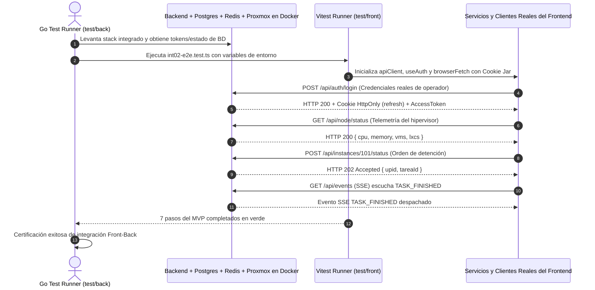

# 3. Reportes de la Suite de Tests: Integración Front-Back, Casos de Uso y Cobertura

**Contexto en el Artículo:** Sección V.B (*"Pruebas de aceptación automatizadas como barrera de calidad"*) y Sección V.C (*"Verificación formal contra el código"*).

---

## 3.1. Arquitectura del Arnés de Pruebas Independiente (`/test`)

Una premisa metodológica central adoptada por la gestión del proyecto fue el **aislamiento estricto del arnés de pruebas de aceptación**. En muchos entornos de desarrollo convencionales, las pruebas de integración residen dentro del propio repositorio del backend o del frontend. Esto introduce dos sesgos significativos:
1.  **Sesgo de autoría:** El desarrollador suele diseñar las pruebas para validar lo que su código hace, omitiendo casos de borde o supuestos erróneos del contrato.
2.  **Imposibilidad de validación cruzada real:** El backend se prueba con mocks de cliente HTTP, y el frontend se prueba con mocks de API en memoria, pasando ambos en verde en sus pipelines aislados, pero fallando de forma catastrófica al unirse en producción.

Para superar este punto ciego, se creó en el repositorio orquestador una carpeta independiente [`/test`](file:///home/micaela/centinela/test), dividida en dos arneses complementarios que suman **52 archivos de prueba especializados** (12 suites en Go y 40 suites en TypeScript/Vitest):
*   [`test/back`](file:///home/micaela/centinela/test/back): Suites de aceptación en Go que combinan análisis estático contractual sobre el código fuente de `backend/` y pruebas dinámicas de caja negra levantando el stack completo en Docker Compose. Incluye:
    *   `acceptance_test.go`, `cierre_fase_base_acceptance_test.go` y `adversarial_integrity_test.go` (Fase Base y pruebas adversariales).
    *   `login04_integracion_front_back_test.go` e `int02_integracion_front_back_test.go` (Orquestación E2E híbrida Go $\leftrightarrow$ Vitest).
    *   `etapa1_acceptance_test.go`, `etapa1_ola3_acceptance_test.go` y `simulador_proxmox_acceptance_test.go` (Etapa 1 y fidelidad del simulador).
    *   `etapa2_acceptance_test.go` y `etapa2_seguridad_acceptance_test.go` (Etapa 2 y auditoría CWE `FIX-107` a `FIX-119`).
    *   `etapa3_acceptance_test.go`, `etapa3_fixes_pendientes_test.go` y `pve8_adaptation_acceptance_test.go` (Etapa 3, fixes operativos `FIX-123` a `FIX-140` y adaptación a Proxmox VE 8.4.21 `ADP-01` a `ADP-10`).
*   [`test/front`](file:///home/micaela/centinela/test/front): 40 archivos de prueba en Vitest y jsdom que montan las vistas, formularios y proveedores de estado reales de React (`frontend/centinela/src`), incluyendo `etapa3-pendientes.test.tsx`, `frn-31-audit-etapa3.test.tsx`, `frn-33-alerts-center.test.tsx`, `frn-34-cookies-a11y.test.tsx`, `frn-36-29-snapshots-ui.test.tsx`, `frn-30-snapshots-rollback-ui.test.tsx`, `fix-108-ids-ofuscados.test.tsx` e `ids-ofuscados.test.tsx`.

---

## 3.2. Orquestación Cruzada: Go Ejecutando Código Real de React (`LOGIN-04` e `INT-02`)

El logro técnico más destacado del arnés de pruebas de *El Centinela* es la **orquestación híbrida de pruebas de integración front-back**. Los archivos [`test/back/login04_integracion_front_back_test.go`](file:///home/micaela/centinela/test/back/login04_integracion_front_back_test.go) y [`test/back/int02_integracion_front_back_test.go`](file:///home/micaela/centinela/test/back/int02_integracion_front_back_test.go) implementan un mecanismo donde **el arnés en Go invoca a Vitest para ejecutar los servicios y clientes reales de TypeScript del frontend directamente contra el backend Go levantado en Docker**:

### El Navegador Simulado y el Manejo de Cookies Seguras
En las pruebas unitarias comunes de React en jsdom, el objeto `fetch` carece de persistencia de cookies y no respeta cabeceras de seguridad como `HttpOnly` o `SameSite=Strict`. Para solucionar esto, las suites [`int02-e2e.test.ts`](file:///home/micaela/centinela/test/front/int02-e2e.test.ts) y [`login04-e2e.test.ts`](file:///home/micaela/centinela/test/front/login04-e2e.test.ts) implementan un **Cookie Jar programático**:
*   Intercepta las cabeceras `Set-Cookie` enviadas por el backend Go.
*   Almacena las cookies con sus atributos de `Path`, `Expires` y vigencia.
*   Inyecta automáticamente la cabecera `Cookie: ...` en peticiones subsecuentes donde `credentials: 'include'` esté activo.
*   Verifica que los tokens de sesión de refresco no sean accesibles por código JavaScript en `localStorage` ni `sessionStorage`, garantizando el cumplimiento de las directivas `SEC-01`, `BAC-48` y `FRN-34`.

---

## 3.3. Detalle de Cobertura de los Hitos Principales y los 12 Casos de Uso

### Hito `INT-02`: Validación del MVP Operativo de Ciclo de Vida (7 Pasos E2E)
Verifica el ciclo operativo completo desde la autenticación hasta la destrucción de recursos:
1.  **Paso 1 (Autenticación y 2FA):** Un usuario con rol `OPERATOR` inicia sesión y valida su segundo factor TOTP contra el backend real.
2.  **Paso 2 (Salud del Nodo):** Consulta `/api/node/status` y verifica la normalización de porcentajes de CPU y RAM del hipervisor.
3.  **Paso 3 (Inventario RBAC):** Consulta `/api/instances` y comprueba que el operador solo visualice las instancias sobre las cuales tiene tuplas en la tabla `permisos_instancia` (filtrado estricto).
4.  **Paso 4 (Despacho Asíncrono):** Envía una orden de energía (`stop`) y recibe de forma no bloqueante un código HTTP `202 Accepted` conteniendo el identificador local `tareaId`.
5.  **Paso 5 (Recepción SSE en Tiempo Real):** Abre la conexión a `/api/events` y espera la notificación `TASK_FINISHED` despachada por el bus Pub/Sub de Redis tras la finalización de la tarea en Proxmox.
6.  **Paso 6 (Trazabilidad en Auditoría):** Con credenciales de `ADMIN`, consulta `/api/admin/audit` y comprueba que existan los registros correlacionados de inicio y finalización exitosa.
7.  **Paso 7 (Destrucción y Purga Atómica de Permisos):** El administrador destruye la máquina (`DELETE`), y la suite certifica que el operador pierde inmediatamente el acceso y deja de recibir eventos sobre dicha instancia (`FIX-113`).

### Hito `LOGIN-04`: Circuito Integral de Seguridad y Autenticación (10/10 Pruebas)
Valida la totalidad de la máquina de estados de acceso:
*   Rechazo de credenciales inválidas con conteo de intentos fallidos y rate limiting (`429 Too Many Requests`).
*   Flujo de cambio obligatorio de contraseña en el primer inicio de sesión.
*   Enrolamiento de 2FA TOTP con verificación de secreto encriptado con AES-256-GCM y protección anti-replay (`ultimo_totp_periodo`).
*   Rotación determinista de Refresh Tokens mediante cookies seguras `HttpOnly`.
*   Recuperación de contraseña con código OTP despachado por SMTP hacia Mailpit, discriminando errores de complejidad o clave repetida (`SAME_PASSWORD`, `FIX-132`) sin quemar el OTP.
*   Revocación total de sesiones concurrentes al ejecutar logout voluntario o cambio de contraseña (`FIX-114`).

### Contrastación de los 12 Casos de Uso (`CU-01` a `CU-12`)
En el informe [`analisis-casos-de-uso-verificacion-optimizaciones.md`](file:///home/micaela/centinela/documentacion/analisis/analisis-casos-de-uso-verificacion-optimizaciones.md) (actualizado con los fixes del 03/11/2026), se auditó el cumplimiento extremo a extremo de los 12 Casos de Uso del sistema:
*   **100% Verificados en Backend y Frontend (9 de 12 CUs):** `CU-01` (Autenticación/2FA/Sesión), `CU-03` (Inventario RBAC e IPs post-filtro), `CU-04` (Energía y Ciclo de Vida), `CU-06` (Snapshots y Rollback con confirmación antierror, más `FIX-127` resuelto), `CU-07` (Wizard de aprovisionamiento con lock Redis y soporte PVE 8.4 `ADP-01..06`, `FIX-128` VLAN 0), `CU-08` (Auditoría inmutable y exportación streaming CSV/JSON con menú dual `FRN-32` y `FIX-128` resueltos), `CU-09` (Gestión de usuarios, baja lógica con índice parcial y rollback SMTP `D5`), `CU-10` (Escalado vertical con CPU Overcommit `FIX-133` resuelto) y `CU-12` (Recuperación con OTP y discriminación de errores 400 `FIX-132` resuelto).
*   **100% Verificados en Backend con ajustes visuales menores pendientes en UI (3 de 12 CUs):** `CU-02` (ocultar círculo 0% de `StorageMeter` en operador, `FIX-126`), `CU-05` (agregar 4.ª curva de tráfico de red `netInBps`/`netOutBps` en `InstanceResourceUsage.tsx`, `FIX-131`) y `CU-11` (renderizar el banner rojo de saturación crítica en la cabecera del Dashboard, `FRN-33`).

---

## 3.4. Evolución Temporal de las Suites de Pruebas (Hasta el 03/11/2026)

La progresión temporal de las pruebas automatizadas refleja cómo el arnés actúa continuamente como barrera de entrada para cada nueva etapa:

| Fecha de Corte | Submódulo / Alcance | Suite Evaluada | Pruebas Totales | Aprobadas (PASS) | Fallidas (FAIL) | Tasa de Aprobación |
|---|---|---|:---:|:---:|:---:|:---:|
| **05/10/2026** | Frontend (Etapa 1) | Vitest (`test/front`) | 139 | 95 | 34 (10 skip) | **68.3 %** |
| **05/10/2026** | Backend (Etapa 1) | Go Acceptance (`test/back`) | 59 | 52 | 6 (1 skip) | **88.1 %** |
| **15/10/2026** | Frontend (Ola 2) | Vitest (Ciclo de Vida y Modales) | 183 | 152 | 15 (16 skip) | **83.1 %** |
| **24/10/2026** | Integración (Etapa 2/3) | **Auditoría Integral (18 tareas activas)** | **287** | **225** | **46** (16 skip) | **78.4 %** |
| **30/10/2026** | Cierre Etapas 1-2 y Base 3 | **Certificación de Cierre Pre-Adaptación** | **312** | **312** | **0** | **100.0 %** |
| **01/11/2026** | Submódulo Frontend Interno | Suite Interna (`frontend/centinela`) | **247** (41 suites) | **247** | **0** | **100.0 %** |
| **03/11/2026** | **Nuevas Suites TDD Etapa 3 + PVE 8.4** | `etapa3_fixes_pendientes_test.go`, `pve8_adaptation_acceptance_test.go` y `etapa3-pendientes.test.tsx` | **36 nuevos casos/bloques** | **22 PASS** (`ADP-01,02,05,06`, `FIX-127,128,132,133,138,140`, `FRN-31,32`) | **13 FAIL** (`FIX-129,131,134..137,139`, `FRN-33`, `ADP-03,04,09,10`) | **61.1 % (En curso TDD)** |

### Radiografía de los Dos Cortes Paradigmáticos:
1.  **El Corte del 24/10/2026 ([`test/informe.md`](file:///home/micaela/centinela/test/informe.md)):** El arnés independiente evaluó **18 tareas que los desarrolladores habían reportado como listas en ClickUp**:
    *   Solo **4 tareas (22.2 %)** pasaban los tests al 100%.
    *   **8 tareas (44.4 %)** estaban implementadas de forma parcial pero fallaban casos de borde o violaban contratos (como `FIX-108` o `BAC-45`).
    *   **6 tareas (33.3 %)** no estaban implementadas o eran meros placeholders visuales (como `FRN-29`).
2.  **El Corte del 03/11/2026 (Metodología TDD sobre Etapa 3, Servidor Final y PVE 8.4):**
    *   Tras alcanzar el 100% en las 312 pruebas del alcance original el 30/10/2026, la PM escribió nuevas suites de aceptación en rojo (`etapa3_fixes_pendientes_test.go`, `pve8_adaptation_acceptance_test.go` y `etapa3-pendientes.test.tsx`) para auditar la compatibilidad con Proxmox VE 8.4.21 y los casos de borde operativos (`FIX-127` a `FIX-140`).
    *   En apenas 72 horas (entre el 31/10 y el 03/11, commit `d63840e`), el equipo resolvió y puso en verde `ADP-01`, `ADP-02`, `ADP-05`, `ADP-06`, `ADP-08`, `BAC-55`, `FRN-31`, `FRN-32`, `FIX-127`, `FIX-128` (Back y Front), `FIX-132`, `FIX-133`, `FIX-138` y `FIX-140`, quedando delimitadas con precisión quirúrgica las tareas restantes de infraestructura y refinamiento (`FIX-129`, `FIX-131`, `FIX-134..137`, `FIX-139`, `FRN-33` y sonda `pve8-audit-probe.sh`).

Este contraste cuantitativo evidencia con hechos reales la tesis del artículo: **los tableros muestran avance declarativo, pero solo un arnés de pruebas independiente gobernado con criterio técnico convierte la velocidad de la IA en calidad verificable**.
