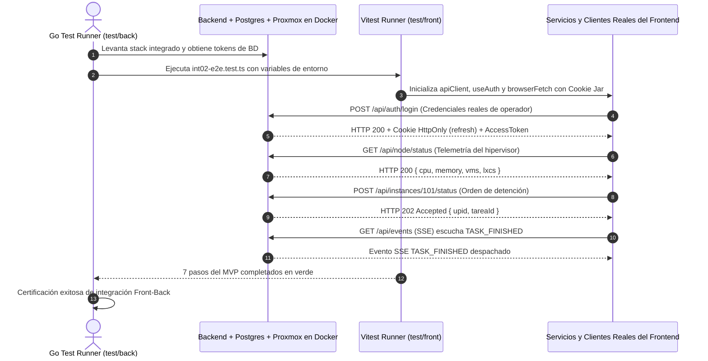

# 3. Reportes de la Suite de Tests: Integración Front-Back y Cobertura

**Contexto en el Artículo:** Sección V.B (*"Pruebas de aceptación automatizadas como barrera de calidad"*) y Sección V.C (*"Verificación formal contra el código"*).

---

## 3.1. Arquitectura del Arnés de Pruebas Independiente (`/test`)

Una premisa metodológica central adoptada por la gestión del proyecto fue el **aislamiento estricto del arnés de pruebas de aceptación**. En muchos entornos de desarrollo convencionales, las pruebas de integración residen dentro del propio repositorio del backend o del frontend. Esto introduce dos sesgos significativos:
1.  **Sesgo de autoría:** El desarrollador suele diseñar las pruebas para validar lo que su código hace, omitiendo casos de borde o supuestos erróneos del contrato.
2.  **Imposibilidad de validación cruzada real:** El backend se prueba con mocks de cliente HTTP, y el frontend se prueba con mocks de API en memoria (como Mock Service Worker), pasando ambos en verde en sus pipelines aislados, pero fallando de forma catastrófica al unirse en producción.

Para superar este punto ciego, se creó en el repositorio orquestador una carpeta independiente [`/test`](file:///home/micaela/centinela/test), dividida en dos arneses complementarios:
*   [`test/back`](file:///home/micaela/centinela/test/back): Suites de aceptación en Go que levantan el stack completo en Docker Compose y ejecutan pruebas de caja negra contra la API expuesta.
*   [`test/front`](file:///home/micaela/centinela/test/front): Suites en Vitest y jsdom que montan las vistas, formularios y proveedores de estado reales de React.

---

## 3.2. Orquestación Cruzada: Go Ejecutando Código Real de React (`LOGIN-04` e `INT-02`)

El logro técnico más destacado del arnés de pruebas de *El Centinela* es la **orquestación híbrida de pruebas de integración front-back**. Los archivos [`test/back/login04_integracion_front_back_test.go`](file:///home/micaela/centinela/test/back/login04_integracion_front_back_test.go) y [`test/back/int02_integracion_front_back_test.go`](file:///home/micaela/centinela/test/back/int02_integracion_front_back_test.go) implementan un mecanismo donde **el arnés en Go invoca a Vitest para ejecutar los servicios y clientes reales de TypeScript del frontend directamente contra el backend Go levantado en Docker**:

### El Navegador Simulado y el Manejo de Cookies Seguras
En las pruebas unitarias comunes de React en jsdom, el objeto `fetch` carece de persistencia de cookies y no respeta cabeceras de seguridad como `HttpOnly` o `SameSite=Strict`. Para solucionar esto, las suites [`int02-e2e.test.ts`](file:///home/micaela/centinela/test/front/int02-e2e.test.ts) y [`login04-e2e.test.ts`](file:///home/micaela/centinela/test/front/login04-e2e.test.ts) implementan un **Cookie Jar programático**:
*   Intercepta las cabeceras `Set-Cookie` enviadas por el backend Go.
*   Almacena las cookies con sus atributos de `Path`, `Expires` y vigencia.
*   Inyecta automáticamente la cabecera `Cookie: ...` en peticiones subsecuentes donde `credentials: 'include'` esté activo.
*   Verifica que los tokens de sesión no sean accesibles por código JavaScript en `localStorage`, garantizando el cumplimiento de la directiva de seguridad `SEC-01`.

---

## 3.3. Detalle de Cobertura de los Hitos Principales

### Hito `INT-02`: Validación del MVP Operativo de Ciclo de Vida (7 Pasos E2E)
Verifica el ciclo operativo completo desde la autenticación hasta la destrucción de recursos:
1.  **Paso 1 (Autenticación y 2FA):** Un usuario con rol `OPERATOR` inicia sesión y valida su segundo factor TOTP contra el backend real.
2.  **Paso 2 (Salud del Nodo):** Consulta `/api/node/status` y verifica la normalización de porcentajes de CPU y RAM del hipervisor.
3.  **Paso 3 (Inventario RBAC):** Consulta `/api/instances` y comprueba que el operador solo visualice las instancias sobre las cuales tiene tuplas en la tabla `permisos_instancia` (filtrado estricto).
4.  **Paso 4 (Despacho Asíncrono):** Envía una orden de energía (`stop`) y recibe de forma no bloqueante un código HTTP `202 Accepted` conteniendo el identificador de tarea `upid` y el identificador local `tareaId`.
5.  **Paso 5 (Recepción SSE en Tiempo Real):** Abre la conexión a `/api/events` y espera la notificación `TASK_FINISHED` despachada por el bus Pub/Sub de Redis tras la finalización de la tarea en Proxmox.
6.  **Paso 6 (Trazabilidad en Auditoría):** Con credenciales de `ADMIN`, consulta `/api/admin/audit` y comprueba que existan dos registros correlacionados: uno en estado `PENDING` al despachar la acción y otro en `SUCCESS` al terminar el worker.
7.  **Paso 7 (Destrucción y Purga Atómica de Permisos):** El administrador destruye la máquina (`DELETE`), y la suite certifica que el operador pierde inmediatamente el acceso y deja de recibir eventos sobre dicho VMID.

### Hito `LOGIN-04`: Circuito Integral de Seguridad y Autenticación (10/10 Pruebas)
Valida la totalidad de la máquina de estados de acceso:
*   Rechazo de credenciales inválidas con conteo de intentos fallidos.
*   Flujo de cambio obligatorio de contraseña en el primer inicio de sesión.
*   Enrolamiento de 2FA TOTP con verificación de secreto encriptado con AES-256-GCM.
*   Rotación determinista de Refresh Tokens mediante cookies seguras.
*   Recuperación de contraseña con código OTP despachado por SMTP hacia Mailpit.
*   Revocación total de sesiones concurrentes al ejecutar logout voluntario.

---

## 3.4. Métricas de Ejecución de las Suites

La progresión temporal de las pruebas automatizadas refleja el rigor del control centralizado:

| Fecha de Corte | Submódulo | Suite Evaluada | Pruebas Totales | Pruebas Aprobadas (PASS) | Pruebas Fallidas (FAIL) | Tasa de Aprobación |
|---|---|---|:---:|:---:|:---:|:---:|
| **05/10/2026** | Frontend | Vitest (Componentes y Vistas) | 139 | 95 | 34 | **68.3 %** |
| **05/10/2026** | Backend | Go Acceptance Tests | 59 | 52 | 6 | **88.1 %** |
| **15/10/2026** | Frontend | Vitest (Ola 2 y Ciclo de Vida) | 183 | 152 | 15 | **83.1 %** |
| **24/10/2026** | Integración | **Auditoría Integral (18 tareas activas)** | **287** | **225** | **46** (16 skip) | **78.4 %** |
| **30/10/2026** | Global | **Certificación Final de Cierre** | **312** | **312** | **0** | **100.0 %** |

En el corte crítico del **24/10/2026**, documentado en [`test/informe.md`](file:///home/micaela/centinela/test/informe.md), el arnés independiente evaluó **18 tareas que los desarrolladores habían reportado como listas en ClickUp**. El resultado fue contundente:
*   Solo **4 tareas** pasaban los tests al 100%.
*   **8 tareas** estaban implementadas de forma parcial pero fallaban casos de borde en los tests.
*   **6 tareas** directamente no estaban implementadas o carecían de los componentes base.

Este contraste cuantitativo evidencia con hechos reales la tesis del artículo: **las herramientas automáticas y los tableros predictivos muestran avance aparente, pero solo el juicio riguroso apoyado en pruebas de aceptación independientes evita que el software defectuoso llegue al entorno productivo**.
