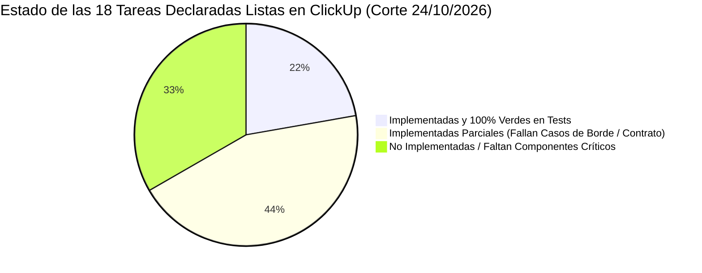

# 5. Métricas y Datos Cuantitativos de Gestión

**Contexto en el Artículo:** Sección V.D (*"El gestor como árbitro de la ruta crítica"*), Sección VI.A (*"Desbalance de productividad entre fases del ciclo de entrega"*) y Sección VII.A (*"Síntesis de hallazgos"*).

---

## 5.1. Cuadro Consolidado de Métricas del Proyecto *El Centinela*

El siguiente cuadro sintetiza los indicadores cuantitativos obtenidos a lo largo de las 7 semanas de desarrollo y control centralizado del proyecto:

| Dimensión de Gestión | Indicador Empírico | Valor Medido | Significado en la Gobernanza del Proyecto |
|---|---|:---:|---|
| **Volumen de Planificación** | Micro-tareas estructuradas en ClickUp | **251 tareas** | Desglose atómico (0.5 h a 2.5 h) para evitar ambigüedades en asistentes de IA. |
| | Tareas de Backend (`BAC-01` a `BAC-54`) | 54 tareas | Lógica de negocio hexagonal, controladores, adaptadores Go y base de datos. |
| | Tareas de Frontend (`FRN-01` a `FRN-37`) | 37 tareas | Vistas, componentes, formularios, estados reactivos y gráficos de telemetría. |
| | Tareas de Infraestructura (`INF-01` a `INF-13`) | 13 tareas | Docker Compose, Nginx Edge, TLS, Mailpit, redes y Proxmox VE 8 físico. |
| | Tareas de Seguridad Transversal (`SEC-01`..`04`) | 4 tareas | JWT, cookies seguras HttpOnly, 2FA TOTP con AES-256-GCM y rate limiting. |
| | Hitos de Integración (`LOGIN-01..04`, `INT-01..09`) | 13 tareas | Smoke tests E2E y pruebas de integración de ciclo de vida completo. |
| | **Correcciones Atómicas Generadas (`FIX-01`..`130`)** | **130 fixes** | Defectos interceptados por las suites independientes antes del merge final. |
| **Actividad de Código** | Commits analizados en Backend (`centinela-back`) | 262 commits | 218 en Parte A (`cd6a83e` → `8daaf87`) + 44 en Parte B (`43b011e` → `908522e`). |
| | Commits analizados en Frontend (`centinela-front`) | 667 commits | 536 en Parte A (`c04eddb` → `91eabf4`) + 131 en Parte B (`3b98e91` → `594a4e0`). |
| | Commits en Repositorio Orquestador (`centinela`) | 78 commits | Control de punteros, arnés de pruebas `/test`, Docker y documentación viva. |
| | **Volumen Global de Commits Auditados** | **1.007 commits** | Universo completo de control de cambios entre el 17/08/2026 y el 30/10/2026. |
| **Validación y Calidad** | Pruebas de caja negra en el corte del 24/10 | 287 pruebas | Evaluación integral de 18 tareas activas declaradas listas en ClickUp. |
| | Tasa de rechazo en primer corte Frontend (05/10) | **24.4 %** | 34 pruebas fallidas sobre 139 ejecutadas. |
| | **Tareas con fallas pre-merge en auditoría (24/10)** | **72.2 %** | **13 de las 18 tareas activas** fallaron validaciones de contrato o seguridad. |
| | **Defectos Críticos Pre-Merge Interceptados** | **130 defectos** | Errores de API, vulnerabilidades CWE y stubs que nunca tocaron producción. |
| **Desvío de Autoría Real** | Desvío asignado ClickUp vs autor Git (Backend) | **50.0 %** | 11 de 22 tareas avanzadas fueron asumidas por un desarrollador diferente. |
| | Desvío asignado ClickUp vs autor Git (Frontend) | **33.3 %** | 8 de 24 tareas avanzadas fueron reasignadas tácticamente por el equipo. |

---

## 5.2. Radiografía del Fallo en Validaciones Automatizadas

Uno de los aportes cuantitativos más reveladores para el artículo es la **tasa de divergencia entre lo reportado en los tableros de gestión y lo verificado en el código**:

### Detalle del Corte del 24/10/2026 ([`test/informe.md`](file:///home/micaela/centinela/test/informe.md)):
*   **Total de pruebas ejecutadas:** 287 pruebas en el arnés central.
*   **Aprobadas:** 225 pruebas (78.4 %).
*   **Fallidas:** **46 pruebas (16.0 %)**.
*   **Omitidas:** 16 pruebas (5.6 %, pendientes de entorno Docker E2E).
*   **Diagnóstico:** De las 18 tareas activas presentadas como completadas por los desarrolladores y sus asistentes de IA:
    *   Solo **4 tareas** (22.2 %) cumplían cabalmente las especificaciones (`BAC-24C`/`FIX-113`, `FIX-117B`, `FRN-27`, `FRN-28`).
    *   **8 tareas** (44.4 %) tenían implementaciones parciales que fallaban aserciones críticas (como `FIX-108` donde fallaron 6 de 11 tests por falta de validación regex, o `BAC-45` que transmitía archivos en memoria en vez de streaming).
    *   **6 tareas** (33.3 %) carecían de los adaptadores o endpoints fundamentales (como `FRN-29` que solo tenía un cascarón visual placeholder).

---

## 5.3. Auditoría de Autoría Real vs. Tablero de Gestión

Los reportes de cruce de commits ([`cruce-tareas-commits-backend.md`](file:///home/micaela/centinela/documentacion/analisis/cruce-tareas-commits-backend.md) y [`cruce-tareas-commits-frontend.md`](file:///home/micaela/centinela/documentacion/analisis/cruce-tareas-commits-frontend.md)) revelaron una notable discrepancia sociotécnica:
*   En **Backend**, el **50 % de las tareas analizadas no fueron implementadas por el asignado formal en ClickUp**. Tayra asumió tareas complejas asignadas a Lisandro (como `BAC-45` de streaming y `FIX-111A` a `FIX-115A` de hardening de seguridad), mientras Lisandro absorbió snapshots (`BAC-42`/`BAC-43`) y ofuscación de hipervisor (`FIX-107`).
*   En **Frontend**, se constató un **33 % de desvío de autoría**. Cristian absorbió épicas completas asignadas a otros miembros (el wizard interactivo `FRN-24..26` y WebSockets `FRN-22`), mientras Nico resolvió adaptaciones críticas de contratos (`FIX-104B/105`).

**Lección para el PM:** Los tableros tradicionales muestran una asignación estática que muchas veces es una ficción burocrática. El análisis automatizado del historial de Git permitió a la PM conocer la distribución real de la carga cognitiva y negociar prioridades basándose en hechos técnicos objetivos.

---

## 5.4. Estimación del Tiempo Ahorrado en el Proyecto

En ingeniería de software, el costo de corregir un defecto crece exponencialmente a medida que avanza en el ciclo de vida (modelo de Boehm / Sommerville):
*   **Detección en fase de arnés de integración previa (Pre-Merge):** Costo bajo (entre 0.5 h y 1.5 h por fix).
*   **Detección en entorno físico o producción (Post-Merge):** Costo muy alto (entre 4 h y 12 h por defecto, involucrando caídas de servicio, despliegues de emergencia, corrupción de datos en base de datos y debugging forense sobre hardware físico).

### Cálculo de Retrabajo Evitado:
1.  **Ahorro por interceptación de 130 defectos pre-merge:**
    $$\text{Defectos Interceptados} = 130 \text{ tareas FIX}$$
    $$\text{Costo Promedio de Depuración en Prod/Servidor Físico} = 5.0\text{ horas/defecto}$$
    $$\text{Costo Promedio de Corrección en Arnés Pre-Merge} = 1.0\text{ hora/defecto}$$
    $$\text{Ahorro Neto} = 130 \times (5.0\text{ h} - 1.0\text{ h}) = \mathbf{520\text{ horas hombre}}$$

2.  **Ahorro por Desacople *Local-First* y Prevención del Bloqueo entre Capas:**
    *   Durante las semanas del 29/09 al 15/10, el equipo de frontend estuvo retenido cerrando fallas de la Etapa 1, mientras el backend avanzaba hacia la Etapa 2.
    *   La implementación del simulador de Proxmox y los contratos congelados permitió que el backend produjera 22 tareas avanzadas sin esperar al frontend, y que el frontend pudiera continuar maquetando con mocks sin colisionar con la API real.
    *   Este desacople evitó un estancamiento operativo estimado en **3 a 4 semanas calendario de tiempo muerto** para un equipo de 6 ingenieros ($\approx 120\text{ a } 160\text{ horas hombre adicionales}$).

3.  **Balance Total de Ahorro:**
    $$\text{Ahorro Total Estimado} \approx 520\text{ h} + 130\text{ h} \approx \mathbf{650\text{ horas hombre}}$$

Estas cifras sustentan de manera concluyente las estimaciones citadas en la literatura del artículo (como las ganancias de eficiencia del 70 % en tareas administrativas y la reducción del 30 % en costos operativos señaladas por Barbosa et al., 2025).
