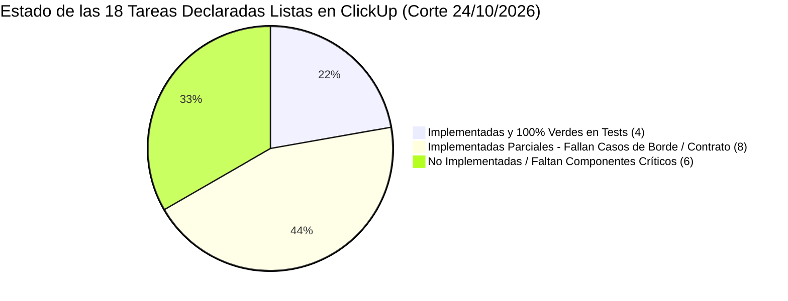

# 5. Métricas y Datos Cuantitativos de Gestión

**Contexto en el Artículo:** Sección V.D (*"El gestor como árbitro de la ruta crítica"*), Sección VI.A (*"Desbalance de productividad entre fases del ciclo de entrega"*) y Sección VII.A (*"Síntesis de hallazgos"*).

---

## 5.1. Cuadro Consolidado de Métricas del Proyecto *El Centinela* (Actualizado al 03/11/2026)

El siguiente cuadro sintetiza los indicadores cuantitativos obtenidos a lo largo del desarrollo, control centralizado y adaptación a producción del proyecto (del **17/08/2026 al 03/11/2026**):

| Dimensión de Gestión | Indicador Empírico | Corte al 30/10/2026 | Estado Actual al 03/11/2026 | Significado en la Gobernanza del Proyecto |
|---|---|:---:|:---:|---|
| **Volumen de Planificación** | **Micro-tareas totales estructuradas** | 251 tareas | **276 tareas** | Desglose atómico (0.5 h a 2.5 h) en ClickUp y documentación viva para eliminar ambigüedades en asistentes de IA. |
| | Tareas de Backend (`BAC-01` a `BAC-55`) | 54 tareas | **55 tareas** | Lógica de negocio hexagonal, controladores, adaptadores Go, PostgreSQL, Redis y modo dual del simulador (`BAC-55`). |
| | Tareas de Frontend (`FRN-01` a `FRN-37`) | 37 tareas | **37 tareas** | Vistas, componentes, formularios, estados reactivos, gráficos de telemetría, exportación de auditoría y wizard. |
| | Tareas de Infraestructura (`INF-01` a `INF-14`) | 13 tareas | **14 tareas** | Docker Compose, Nginx Edge, TLS, Mailpit, redes LXC y sonda de auditoría en Proxmox físico (`INF-14`). |
| | Tareas de Seguridad Transversal (`SEC-01`..`04`) | 4 tareas | **4 tareas** | JWT, cookies seguras HttpOnly, 2FA TOTP con AES-256-GCM y rate limiting. |
| | Hitos de Integración (`LOGIN-01..04`, `INT-01..09`) | 13 tareas | **13 tareas** | Smoke tests E2E y pruebas de integración de ciclo de vida completo. |
| | **Etapa Adaptación Proxmox VE 8.4 (`ADP-01`..`13`)** | — | **13 tareas** | Adaptación técnica del cliente Go, simulador, wizard React e infraestructura entre PVE 9.2.2 y PVE 8.4.21 (26 h estimadas). |
| | **Correcciones Atómicas Generadas (`FIX-01`..`140`)** | 130 fixes | **140 fixes** | Defectos de contrato, vulnerabilidades CWE y desajustes de casos de uso interceptados por el arnés antes del cierre productivo. |
| **Actividad de Código** | Commits en Backend (`centinela-back`) | 262 commits (`908522e`) | **273 commits (`fb8a41c`)** | 218 en Parte A + 44 en Parte B + 11 de adaptación PVE 8.4 y fixes de Etapa 3 (`ADP-01..06`, `FIX-128,133,138,140`). |
| | Commits en Frontend (`centinela-front`) | 667 commits (`594a4e0`) | **708 commits (`877eddd`)** | 536 en Parte A + 131 en Parte B + 41 de cierre Etapa 3 y adaptación PVE 8.4 (`ADP-08`, `FRN-32`, `FIX-127,128,132`). |
| | Commits en Repositorio Orquestador (`centinela`) | 78 commits | **101 commits (`d63840e`)** | Control de punteros, 52 archivos de prueba en `/test`, Docker, runbooks del servidor final y documentación viva. |
| | **Volumen Global de Commits Auditados** | 1.007 commits | **1.082 commits** | Universo completo de control de cambios entre el 17/08/2026 y el 03/11/2026. |
| **Validación y Calidad** | Archivos de prueba en el arnés independiente `/test` | 49 archivos | **52 archivos** | 12 suites en Go (`test/back`) + 40 suites en Vitest/Testing Library (`test/front`). |
| | Tasa de rechazo en primer corte Frontend (05/10) | **24.4 %** | **24.4 %** | 34 pruebas fallidas sobre 139 ejecutadas en la primera ola. |
| | **Tareas con fallas pre-merge en auditoría (24/10)** | **72.2 %** | **72.2 %** | **14 de las 18 tareas activas** declaradas listas en ClickUp no pasaban el 100% de las pruebas (8 parciales + 6 no implementadas). |
| | Certificación de cierre Etapas 1-2 y Base 3 (30/10) | **312 / 312 (100%)** | **312 / 312 (100%)** | 100% de pruebas en verde tras resolver la ola de fixes `FIX-100` a `FIX-124`. |
| | Nuevas suites TDD Etapa 3 / PVE 8.4 (03/11) | — | **22 / 35 PASS (1 SKIP)** | En 72 h se resolvieron 22 nuevos casos de adaptación PVE 8.4 y fixes de casos de uso; restan 13 casos en rojo guiando el cierre final. |
| **Desvío de Autoría Real** | Desvío asignado ClickUp vs. autor Git (Backend) | **50.0 %** | **50.0 %** | 11 de 22 tareas avanzadas auditadas en Parte B fueron implementadas parcial o totalmente por un desarrollador distinto al asignado. |
| | Desvío asignado ClickUp vs. autor Git (Frontend) | **33.3 %** | **33.3 %** | 8 de 24 tareas avanzadas en Parte B fueron absorbidas tácticamente por otros integrantes del equipo. |

---

## 5.2. Radiografía del Fallo en Validaciones Automatizadas

Uno de los aportes cuantitativos más reveladores para el artículo es la **tasa de divergencia entre lo reportado en los tableros de gestión y lo verificado en el código**:

### Detalle del Corte del 24/10/2026 ([`test/informe.md`](file:///home/micaela/centinela/test/informe.md)):
*   **Total de pruebas ejecutadas:** 287 pruebas en el arnés central.
*   **Aprobadas:** 225 pruebas (78.4 %).
*   **Fallidas:** **46 pruebas (16.0 %)**.
*   **Omitidas:** 16 pruebas (5.6 %, pendientes de entorno Docker E2E).
*   **Diagnóstico:** De las 18 tareas activas presentadas como completadas por los desarrolladores y sus asistentes de IA:
    *   Solo **4 tareas** (22.2 %) cumplían cabalmente las especificaciones (`BAC-24C`/`FIX-113`, `FIX-117B`, `FRN-27`, `FRN-28`).
    *   **8 tareas** (44.4 %) tenían implementaciones parciales que fallaban aserciones críticas (como `FIX-108` donde fallaron 6 de 11 tests por falta de validación regex, o `BAC-45` que cargaba 100.000 registros en memoria con `.Find()` en vez de transmitir con cursor `.Rows()`).
    *   **6 tareas** (33.3 %) carecían de los adaptadores o endpoints fundamentales (como `FRN-29` que solo tenía un cascarón visual con el texto estático *"La consulta de snapshots todavía no está disponible"*).

### Evolución Posterior al Corte (30/10/2026 al 03/11/2026):
*   El **30/10/2026** se completaron y verificaron en verde las tareas de ese corte (`BAC-42..48`, `BAC-54`, `FRN-22,23,26,29,30,34,36`, `FIX-91,108,124`), alcanzando **312/312 pruebas en verde**.
*   Entre el **30/10/2026 y el 03/11/2026**, al auditar los **12 Casos de Uso** ([`analisis-casos-de-uso-verificacion-optimizaciones.md`](file:///home/micaela/centinela/documentacion/analisis/analisis-casos-de-uso-verificacion-optimizaciones.md)) y el **Servidor Final PVE 8.4.21** ([`etapa-adaptacion-proxmox-8.md`](file:///home/micaela/centinela/documentacion/archvios/etapa-adaptacion-proxmox-8.md)), se generaron las tareas `ADP-01` a `ADP-13` y los fixes `FIX-126` a `FIX-140`, junto con dos nuevas suites TDD (`etapa3_fixes_pendientes_test.go` y `etapa3-pendientes.test.tsx`).
*   En el commit `d63840e` (**03/11/2026**), ya pasan al 100% en verde las verificaciones de `ADP-01`, `ADP-02`, `ADP-05`, `ADP-06`, `ADP-08`, `BAC-55`, `FRN-31`, `FRN-32`, `FIX-127`, `FIX-128` (VLAN 0 en Back y etiquetas en Front), `FIX-132` (OTP sin quemar ante error 400 de clave), `FIX-133` (CPU Overcommit), `FIX-138` (caracteres NIST SP 800-63B) y `FIX-140` (visibilidad de `emailProvider`).

---

## 5.3. Auditoría de Autoría Real vs. Tablero de Gestión

Los cuatro reportes de cruce de commits ([`cruce-tareas-commits-backend.md`](file:///home/micaela/centinela/documentacion/analisis/cruce-tareas-commits-backend.md), [`cruce-tareas-commits-backend-parte-b.md`](file:///home/micaela/centinela/documentacion/analisis/cruce-tareas-commits-backend-parte-b.md), [`cruce-tareas-commits-frontend.md`](file:///home/micaela/centinela/documentacion/analisis/cruce-tareas-commits-frontend.md) y [`cruce-tareas-commits-frontend-parte-b.md`](file:///home/micaela/centinela/documentacion/analisis/cruce-tareas-commits-frontend-parte-b.md)) revelaron una importante dinámica sociotécnica:

| Submódulo | Período Auditado | Commits Analizados | Distribución de Autoría Real | Desvío Asignado ClickUp vs. Autor Git (Parte B) |
|---|---|:---:|---|:---:|
| **Backend (`centinela-back`)** | Parte A (218) + Parte B (44) + Cierre PVE8 (11) = **273 commits** | 262 en informes + 11 nuevos | Parte A+B: **Tayra** (99 commits, 37.8%), **Lisandro** (88 commits, 33.6%), **Nico** (52 commits, 19.8%), **Lucas** (23 commits, 8.8%). | **50.0 %** (11 de 22 tareas avanzadas con cambio total o parcial de ejecutor) |
| **Frontend (`centinela-front`)** | Parte A (536) + Parte B (131) + Cierre Etapa 3 (41) = **708 commits** | 667 en informes + 41 nuevos | Parte A+B (480 commits de código sin merges): **Cristian** (348 commits de código, 72.5%), **Nico** (59, 12.3%), **Belinda** (44, 9.2%), **Luz** (29, 6.0%). | **33.3 %** (8 de 24 tareas avanzadas reasignadas tácticamente en la práctica) |

*   En **Backend**, Tayra asumió tareas complejas asignadas a Lisandro (como `BAC-45` de streaming y el bloque `FIX-111A` a `FIX-115A`), mientras Lisandro absorbió la reversión de snapshots (`BAC-43`), el endurecimiento de cookies/rate-limit (`BAC-48`) y la ofuscación de hipervisor (`FIX-107`).
*   En **Frontend**, Cristian absorbió épicas completas asignadas a otros miembros (como `FRN-22`, `FRN-23`, `FRN-25`, `FIX-91` y `FIX-132`), mientras Belinda completó en los últimos commits (`8d66b75`, `404c784`, `b38ab17`) la verificación de Dashboard en PVE 8.4 (`ADP-08`), el flujo de exportación de reportes (`FRN-32`) y `FIX-128`.

**Lección para el PM:** Los tableros tradicionales muestran una asignación estática que a menudo no refleja quién está sosteniendo el camino crítico. El cruce automatizado con el historial de Git permitió a la PM conocer la distribución real de la carga cognitiva y redistribuir tareas con base en evidencia empírica.

---

## 5.4. Estimación del Tiempo Ahorrado en el Proyecto (Con Nota Metodológica para Defensa)

En ingeniería de software, el costo de corregir un defecto crece significativamente a medida que avanza hacia producción (principio de Boehm / Sommerville, Cap. 8 y 24):
*   **Detección en fase de arnés de integración previa (Pre-Merge):** Costo acotado (entre 0.5 h y 1.5 h por fix, promedio $\approx 1.0\text{ h}$).
*   **Detección en entorno físico LXC o producción (Post-Merge):** Costo elevado (estimado conservadoramente en $\approx 5.0\text{ h}$ por defecto, involucrando caídas de contenedores en `pve-is3-g1`, depuración a través del Jump Host, corrupción de estado en PostgreSQL/Proxmox y redespliegue).

### Cálculo Estimado de Retrabajo Evitado:
1.  **Ahorro estimado por interceptación temprana de defectos (`FIX-01` a `FIX-140`):**
    $$\text{Ahorro en Depuración Post-Merge (sobre base de 130 a 140 fixes)} = 130 \times (5.0\text{ h} - 1.0\text{ h}) = \mathbf{520\text{ a } 560\text{ horas hombre}}$$
2.  **Ahorro por Desacople *Local-First* y Simulador Dual (PVE 9.2.2 / 8.4.21):**
    *   La implementación del simulador de Proxmox y Mailpit local permitió que el backend avanzara hacia las Etapas 2 y 3 y adaptara el cliente a Proxmox VE 8.4.21 sin depender de la disponibilidad física ni de las reglas de firewall del nodo de la universidad, evitando entre **3 y 4 semanas de bloqueo cruzado** ($\approx \mathbf{130\text{ horas hombre}}$).
3.  **Balance Total Estimado:**
    $$\text{Ahorro Total Estimado} \approx \mathbf{650\text{ a } 690\text{ horas hombre}}$$

> [!NOTE]
> **Advertencia Metodológica para la Defensa Oral (ver [`guia-estudio.md`](./guia-estudio.md), Filmina 9):**  
> En la defensa académica debe precisarse con rigor que las **~650 horas ahorradas** son una **estimación analítica basada en supuestos de costo medio de retrabajo** (modelo de Boehm: 5 h en producción vs. 1 h pre-merge), y no una medición con grupo de control. Del mismo modo, el dato del **70% de eficiencia** citado de Barbosa et al. (2025) corresponde a una expectativa declarada por un entrevistado (R2) sobre tareas administrativas, por lo que ambas métricas son complementarias pero miden dimensiones distintas.
