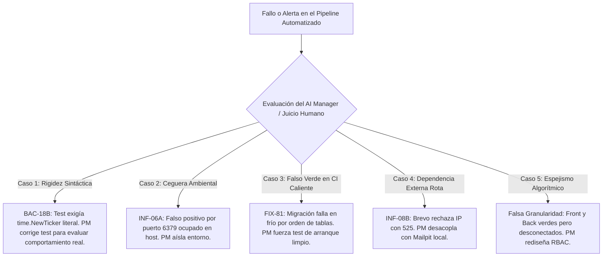

# 7. Límites de la Automatización y Superación del *Judgment Gap*: Casos Críticos

**Contexto en el Artículo:** Sección IV (*"Superación del judgment gap: liderazgo, estrategia y personas"*), Sección VI (*"Tensiones y brechas"*) y Sección VII.E (*"Reflexión final"*).

---

## 7.1. La Brecha de Juicio (*Judgment Gap*) en la Práctica Empírica

En el marco teórico del artículo, siguiendo a Herbert Simon (1978) y Antonio Nieto-Rodriguez (2026), se postula que la Inteligencia Artificial y la automatización resuelven con solvencia la **brecha analítica** (*decision gap*): procesan enormes volúmenes de código, ejecutan suites de pruebas en segundos y generan reportes detallados de cobertura.

Sin embargo, estos sistemas algorítmicos carecen de comprensión del contexto sociotécnico, comprensión de los compromisos de negocio (*trade-offs*) y discernimiento ante falsos positivos. Esta limitación constituye el **núcleo del *judgment gap***:
> *"La IA puede decir qué prueba falló, qué commit se desvió o qué tasa de cobertura se redujo; lo que la IA no puede hacer es decidir si la aserción del test era incorrecta, si el entorno de ejecución estaba viciado o si una solución arquitectónicamente superior debe ser aceptada a pesar de no coincidir con la plantilla esperada."*

El proyecto **El Centinela** documenta **5 episodios críticos** donde la automatización falló, arrojó falsos positivos o introdujo rigideces ciegas que demandaron la intervención del juicio humano de la Project Manager.

---

## 7.2. Los 5 Casos Críticos donde la Automatización Requirió Corrección Humana

---

### Caso 1: Rigidez Sintáctica y Aserción Inflexible en `BAC-18B` (Purga de Sesiones)
*   **El Fallo de la Automatización:**  
    En la suite de pruebas original en Go para verificar la purga horaria de sesiones vencidas, la prueba realizaba un análisis estático del código fuente exigiendo encontrar textualmente la llamada a `time.NewTicker(time.Hour)`.
*   **La Decisión Técnica del Desarrollador:**  
    El desarrollador de backend había implementado una solución arquitectónicamente más limpia y desacoplada: `NuevoPurgaWorker(db, 1*time.Hour)`, parametrizando el intervalo para poder inyectar lapsos de milisegundos en pruebas unitarias sin esperar una hora real.
*   **El Conflicto:**  
    La suite automática marcó la tarea como **FAIL (rechazada)**, pretendiendo forzar al desarrollador a deshacer una buena práctica de ingeniería para satisfacer la plantilla rígida del script.
*   **El Juicio del PM ([`test/back/RESULTADOS.md`](file:///home/micaela/centinela/test/back/RESULTADOS.md)):**  
    La PM intervino, detuvo la refactorización innecesaria y reescribió la suite de pruebas para evaluar el **comportamiento empírico de caja negra**: insertar sesiones vigentes y vencidas en la base de datos, reiniciar el proceso, y verificar que solo permanecieran las vigentes. El test pasó a verde respetando la abstracción superior del desarrollador.

---

### Caso 2: Ceguera de Entorno y Falsos Positivos en `INF-06A` (Colisión de Puerto 6379)
*   **El Fallo de la Automatización:**  
    Durante una corrida nocturna de integración continua en el servidor de pruebas, la suite reportó una falla crítica en `INF-06A` (almacenamiento de sesiones en Redis): el contenedor crasheaba al iniciar y los tests de login fallaban en cascada.
*   **El Diagnóstico Automático (Alucinación de Causa):**  
    El reporte automatizado atribuyó el fallo a un error de configuración en `compose.yaml` o en el driver Go de Redis.
*   **El Juicio del PM:**  
    Al inspeccionar el entorno mediante `netstat` y logs del sistema operativo, la PM constató que en la máquina host se había iniciado previamente un servicio nativo `redis-server` que ocupaba el puerto `127.0.0.1:6379`. No había ningún error de software ni regresión de código; se trataba de una colisión ambiental. La PM reconfiguró el aislamiento de puertos en Docker Compose, preservando el commit del desarrollador sin pérdida de tiempo en debugging innecesario.

---

### Caso 3: El Falso Verde en "Caliente" y el Crash en Frío (`FIX-81` / Orden de Migraciones)
*   **El Fallo de la Automatización:**  
    En los pipelines de CI donde los volúmenes de PostgreSQL se conservaban entre corridas, todos los tests de backend pasaban al 100 % en verde. El tablero marcaba el sistema como "Listo para Despliegue".
*   **La Brecha Oculta:**  
    En `backend/.../postgres/db.go`, la función `migrarUnicidadEmail` se ejecutaba antes de `migrarAuditoriaParticionada`. Como en las bases de datos de desarrollo la tabla `auditoria` ya había sido creada semanas atrás, la migración no fallaba. Sin embargo, en un despliegue en frío (`cold start`) con base de datos limpia (`docker compose down -v`), el servidor crasheaba fatalmente con:  
    `pq: relation "auditoria" does not exist`.
*   **El Juicio del PM:**  
    Consciente de que la automatización estándar no regeneraba volúmenes limpios en cada commit, la PM diseñó una prueba de arranque en frío obligatoria (`./scripts/centinela.sh reset`), detectando la condición de carrera oculta y generando de inmediato el ticket **`FIX-81`** para reordenar las migraciones antes del release.

---

### Caso 4: Bloqueo por Servicios de Terceros en `INF-08B` (Error HTTP 525 de Brevo SMTP)
*   **El Fallo de la Automatización:**  
    La suite de recuperación de contraseñas intentaba despachar correos reales mediante la API de Brevo (Sendinblue). Durante una auditoría, Brevo bloqueó la dirección IP pública del laboratorio con el código `525 Unauthorized IP`, haciendo fallar todas las pruebas del sprint.
*   **El Juicio del PM:**  
    Una gestión automatizada rígida habría paralizado las entregas culpando al equipo de backend. La PM ejerció juicio estratégico:
    1.  Dictaminó que el entorno de desarrollo y pruebas no debía depender de la conectividad ni de las políticas de firewall de un proveedor externo SaaS.
    2.  Incorporó el contenedor **Mailpit** en Docker Compose, ofreciendo un servidor SMTP local con TLS simulado e inspección de correos por API REST.
    3.  Añadió la guarda `t.Skip` en la suite de Go para omitir las llamadas externas únicamente si la IP no estaba autorizada, manteniendo el pipeline de entrega ágil y determinista.

---

### Caso 5: El "Espejismo" de la Falsa Granularidad en la Matriz de Permisos
*   **El Fallo de la Automatización:**  
    En el frontend, las pruebas unitarias de Vitest evaluaban que los checkboxes de permisos ("Ver snapshots", "Ver red") se marcaran y guardaran en el estado local. En el backend, las pruebas unitarias evaluaban que un `ADMIN` tuviera acceso a todo. Ambas suites pasaban al 100 % en verde de forma aislada.
*   **La Detección Humana:**  
    Al realizar la auditoría transversal de arquitectura ([`analisis-seguridad-vulnerabilidades-permisos.md`](file:///home/micaela/centinela/documentacion/analisis/analisis-seguridad-vulnerabilidades-permisos.md)), la PM descubrió que en la base de datos relacional no existían tablas de capacidades (`capabilities` o `roles_permissions`) ni claims de JWT granulares: el backend operaba con un modelo estrictamente binario (`ADMIN` vs `OPERATOR`).
*   **La Consecuencia:**  
    La interfaz prometía una sofisticación de control de acceso que era una ficción. La automatización no detectó el problema porque no había errores de sintaxis ni aserciones rotas; se trataba de una **inconsistencia conceptual semántica entre capas**. La PM ordenó el rediseño del modelo, impidiendo que el producto saliera al mercado con una vulnerabilidad de falsa seguridad.

---

## 7.3. Síntesis para la Sección Crítica y Conclusiones del Artículo

Estos cinco episodios enriquecen la discusión académica de las Secciones IV y VI del artículo con un mensaje contundente:
1.  **La automatización optimiza el "hacer", pero no el "comprender":** Las herramientas de CI/IA aceleran la ejecución de pruebas y la detección de divergencias mecánicas, pero son incapaces de interpretar el contexto de infraestructura o la validez de sus propias aserciones.
2.  **El valor insustituible del Human-in-the-Loop:** Cuando una prueba falla, el AI Manager no debe presionar ciegamente al equipo para que el indicador se ponga en verde; debe ejercer sentido crítico para distinguir entre un defecto real de software, un falso positivo ambiental, una rigidez del script o una brecha arquitectónica profunda.
3.  **El liderazgo en la Economía de Proyectos:** El liderazgo del software moderno no consiste en acumular métricas algorítmicas, sino en asumir la responsabilidad final sobre las decisiones técnicas y humanas que las herramientas automáticas hacen visibles.
