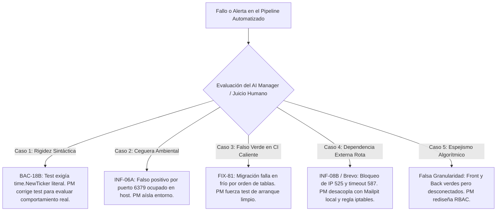

# 7. Límites de la Automatización y Superación del *Judgment Gap*: Casos Críticos

**Contexto en el Artículo:** Sección IV (*"Superación del judgment gap: liderazgo, estrategia y personas"*), Sección VI (*"Tensiones y brechas"*) y Sección VII.E (*"Reflexión final"*).

---

## 7.1. La Brecha de Juicio (*Judgment Gap*) en la Práctica Empírica

En el marco teórico del artículo, siguiendo a Herbert Simon (1978) y Antonio Nieto-Rodríguez (2026), se postula que la Inteligencia Artificial y la automatización resuelven con solvencia la **brecha de decisión** (*decision gap*): procesan grandes volúmenes de código, ejecutan suites de pruebas en segundos y generan reportes detallados de cobertura.

Sin embargo, estos sistemas algorítmicos carecen de comprensión del contexto sociotécnico, del dominio físico de la infraestructura y de discernimiento ante falsos positivos. Esta limitación constituye el **núcleo del *judgment gap***:
> *"La IA puede decir qué prueba falló, qué commit se desvió o qué umbral se superó; lo que la IA no puede hacer es decidir si la aserción del test era incorrecta, si el entorno de ejecución estaba viciado, si una regla estática contradice la física del hipervisor o si una solución arquitectónicamente superior debe ser aceptada a pesar de no coincidir con la plantilla esperada."*

El proyecto **El Centinela** documenta **8 episodios críticos** (5 en la gestión del pipeline y entorno durante las Etapas 1-2, y 3 en la lógica de dominio de virtualización durante la Etapa 3 y adaptación al servidor final) donde la automatización o las reglas estáticas fallaron y demandaron la intervención del juicio humano de la Project Manager.

---

## 7.2. Los 5 Casos Críticos de Pipeline, Entorno y Arquitectura (Etapas 1 y 2)

### Caso 1: Rigidez Sintáctica y Aserción Inflexible en `BAC-18B` (Purga de Sesiones)
*   **El Fallo de la Automatización:** En la suite de pruebas original en Go para verificar la purga horaria de sesiones vencidas, la prueba realizaba un análisis estático del código fuente exigiendo encontrar textualmente la llamada a `time.NewTicker(time.Hour)`.
*   **La Decisión Técnica del Desarrollador:** El desarrollador de backend había implementado una solución arquitectónicamente más limpia y desacoplada: `NuevoPurgaWorker(db, 1*time.Hour)`, parametrizando el intervalo para poder inyectar lapsos de milisegundos en pruebas unitarias sin esperar una hora real.
*   **El Juicio de la PM ([`test/back/RESULTADOS.md`](file:///home/micaela/centinela/test/back/RESULTADOS.md)):** La PM intervino, detuvo la refactorización innecesaria y reescribió la suite de pruebas para evaluar el **comportamiento empírico de caja negra**: insertar sesiones vigentes y vencidas en la base de datos, reiniciar el proceso, y verificar que solo permanecieran las vigentes. El test pasó a verde respetando la abstracción superior del desarrollador.

### Caso 2: Ceguera de Entorno y Falsos Positivos en `INF-06A` (Colisión de Puerto 6379)
*   **El Fallo de la Automatización:** Durante una corrida de integración continua en el servidor de pruebas, la suite reportó una falla crítica en `INF-06A` (almacenamiento de sesiones en Redis): el contenedor crasheaba al iniciar y los tests de login fallaban en cascada.
*   **El Diagnóstico Automático:** El reporte atribuyó el fallo a un error de configuración en `compose.yaml` o en el driver Go de Redis.
*   **El Juicio de la PM:** Al inspeccionar el entorno del host, la PM constató que se había iniciado previamente un servicio nativo `redis-server` que ocupaba `127.0.0.1:6379`. No había ningún error de software ni regresión de código; se trataba de una colisión ambiental.

### Caso 3: El Falso Verde en "Caliente" y el Crash en Frío (`FIX-81` / Orden de Migraciones)
*   **El Fallo de la Automatización:** En los pipelines de CI donde los volúmenes de PostgreSQL se conservaban entre corridas, todos los tests de backend pasaban al 100 % en verde.
*   **La Brecha Oculta:** En `backend/.../postgres/db.go`, la función `migrarUnicidadEmail` se ejecutaba antes de `migrarAuditoriaParticionada`. Como en las bases de datos de desarrollo la tabla `auditoria` ya existía, la migración no fallaba. Sin embargo, en un despliegue en frío (`cold start`) con base de datos limpia (`docker compose down -v`), el servidor crasheaba fatalmente con `pq: relation "auditoria" does not exist`.
*   **El Juicio de la PM:** Consciente de que la automatización estándar no regeneraba volúmenes limpios en cada commit, la PM diseñó una prueba de arranque en frío obligatoria (`TestFIX81_OrdenMigracionesBaseLimpia` y `./scripts/centinela.sh reset`), detectando la condición de carrera oculta antes del despliegue en el servidor nuevo.

### Caso 4: Bloqueo por Servicios de Terceros y Firewall en `INF-08B` y `SMTP-y-Brevo.md`
*   **El Fallo:** Primero, la API de Brevo bloqueó la IP pública con `525 Unauthorized IP` durante las pruebas de recuperación de clave; luego, en el contenedor LXC `centinela-smtp-brevo` (CT107/CT105), los correos quedaban suspendidos con `Connection timed out` hacia `smtp-relay.brevo.com:587`.
*   **El Juicio de la PM:** En lugar de culpar al backend o abrir indiscriminadamente el firewall del host a internet:
    1.  En desarrollo y CI, desacopló las pruebas incorporando **Mailpit** local en Docker Compose y exigiendo en `FIX-140` la cabecera `X-Centinela-Email-Provider: mock` cuando no hay SMTP configurado.
    2.  En el servidor físico ([`SMTP-y-Brevo.md`](file:///home/micaela/centinela/documentacion/SMTP-y-Brevo.md)), diagnosticó que las reglas de `iptables` de los puertos `587,465` habían quedado en un snapshot viejo (`/etc/iptables/rules.v4`) y aplicó reglas `MASQUERADE` y `FORWARD ACCEPT` acotadas exclusivamente al `/32` del contenedor relay antes del `DROP` general.

### Caso 5: El "Espejismo" de la Falsa Granularidad en la Matriz de Permisos (UI vs. BD)
*   **El Fallo de la Automatización:** En el frontend, las pruebas unitarias de Vitest evaluaban que los checkboxes de permisos ("Ver snapshots", "Ver red") se marcaran en el estado local. En el backend, las pruebas evaluaban que `ADMIN` tuviera acceso total y `OPERATOR` acceso por instancia. Ambas suites pasaban al 100 % en verde de forma aislada.
*   **La Detección Humana:** Al auditar la arquitectura completa ([`analisis-seguridad-vulnerabilidades-permisos.md`](file:///home/micaela/centinela/documentacion/analisis/analisis-seguridad-vulnerabilidades-permisos.md)), la PM descubrió que en la base de datos no existían tablas de capacidades (`capabilities`): el panel visual prometía una sofisticación de control de acceso que era una ficción. Ninguna aserción automática detecta una incoherencia conceptual entre capas; hace falta mirar el sistema completo.

---

## 7.3. Nuevos Casos de *Judgment Gap* en el Dominio de Virtualización (Etapa 3: `FIX-133`, `FIX-134`, `FIX-135`)

Durante la auditoría profunda de los Casos de Uso el **30/10/2026 al 03/11/2026** ([`actual.md`](file:///home/micaela/centinela/documentacion/actual.md#L377-L569)), se identificaron tres casos adicionales donde las reglas programadas por los desarrolladores y sus asistentes de IA eran **sintácticamente correctas y pasaban sus tests unitarios**, pero generaban **falsos positivos operativos o deadlocks** en un hipervisor Proxmox VE real:

### Caso 6: Falso Positivo de Cuota por Ignorar el *CPU Overcommit* (`FIX-133` — Resuelto en `fb8a41c`)
*   **La Regla Ingenua del Código:** En `cuotas_service.go`, al escalar verticalmente una instancia (`CU-10`), el código sumaba linealmente los `MaxCpu` de todas las VMs y rechazaba cualquier aumento si `deltaCores > coresDisponibles` (donde `coresDisponibles = CPUs_Nodo - coresAsignados`).
*   **Por qué falló sin juicio de dominio:** En virtualización (KVM/LXC), la sobreasignación de CPU (*CPU Overcommit*) es la norma operativa (p. ej., 24 vCPUs asignadas sobre un procesador físico de 8 núcleos), mientras que la memoria RAM sí es un recurso rígido. La regla lineal bloqueaba cualquier cambio de vCPU en producción con un falso error `409 RECURSOS_INSUFICIENTES`.
*   **El Juicio de la PM (`FIX-133`):** La PM detectó la discrepancia respecto a `RF-10` ($\Delta\text{RAM} \le 0$ debe autorizarse sin bloqueo de margen de host) y especificó el fix que fue implementado en el commit `fb8a41c` y certificado por `TestFIX133_CuotaVCPUSinOvercommit`.

### Caso 7: Deadlock Operativo ante Máquinas en Estado `paused` (`FIX-134`)
*   **La Regla Ingenua del Código:** En `instance_handler.go`, el mapa `estadosRequeridosPorAccion` exigía `"stopped"` para `start` y `delete`, y exigía estrictamente `"running"` para `stop`, `shutdown` y `reboot`.
*   **Por qué genera un bloqueo total:** En Proxmox VE, una máquina virtual puede entrar en estado `"paused"` automáticamente ante un congelamiento de I/O de almacenamiento o durante un backup en suspensión. Con la matriz binaria (`running` / `stopped`), una vez que una VM quedaba en `paused`, *El Centinela* rechazaba encenderla (`409`), rechazaba apagarla forzosamente (`409`), rechazaba eliminarla (`409`) y carecía de la acción `resume`.
*   **El Juicio de la PM (`FIX-134`):** La PM identificó este callejón sin salida operativo y diseñó la especificación `FIX-134` (auditada por `TestFIX134_InstanciasPausadas`) para admitir `stop` sobre instancias `paused` e incorporar el endpoint `/status/resume`.

### Caso 8: Falsas Alarmas Críticas `instance_down` ante Mantenimiento Directo en Proxmox (`FIX-135` y `FIX-139`)
*   **La Regla Ingenua del Código:** En `alert_evaluator_worker.go`, si una instancia pasaba de `running` a `stopped` y no existía una orden en la tabla local `tareas_asincronas` de PostgreSQL en los últimos 10 minutos, el worker disparaba inmediatamente una alerta `CRITICAL` (`instance_down`) y enviaba correos de emergencia a todos los administradores.
*   **Por qué falla en la realidad sociotécnica:** En centros de cómputos reales, los sysadmins ejecutan paradas legítimas directamente desde la consola de Proxmox (`qm stop`, `pct stop`) o tareas programadas de backup (`vzdump`). Como esas órdenes no pasan por la base de datos de *El Centinela*, el sistema acusaba falsamente una caída catastrófico del servidor. De manera análoga, si el contenedor del backend se reiniciaba mientras una tarea de Proxmox terminaba, la fila local quedaba en `RUNNING` durante 3 minutos devolviendo falsos `409 INSTANCE_BUSY` (`FIX-139`).
*   **El Juicio de la PM (`FIX-135` y `FIX-139`):** Ordenó reconciliar el estado contra el historial nativo del hipervisor (`GET /nodes/{node}/tasks?vmid=`) para clasificar las paradas externas legítimas como eventos informativos (`SYSTEM_INSTANCE_STOPPED_EXTERNALLY`) y reconciliar las tareas en curso en el segundo cero del arranque (`RecuperarYReconciliarAlArranque`).

---

## 7.4. Síntesis para la Sección Crítica y Conclusiones del Artículo

Estos ocho episodios enriquecen la discusión académica de las Secciones IV, VI y VII del artículo con tres conclusiones centrales:
1.  **La automatización optimiza el "hacer", pero no el "comprender":** Las herramientas de CI/IA aceleran la ejecución de pruebas y la generación de código, pero son incapaces de cuestionar si un modelo simplificado (como un estado binario `running/stopped` o una suma lineal de vCPUs) choca con la realidad física del sistema.
2.  **El valor insustituible del *Human-in-the-Loop*:** Cuando una prueba falla o una alerta suena, el AI Manager no presiona ciegamente al equipo para que el indicador se ponga en verde; ejerce sentido crítico (*sense-making*) para distinguir entre un defecto real de código, un falso positivo ambiental, una rigidez del test o una brecha arquitectónica profunda.
3.  **Prevención del "Liderazgo Invisible" (OIT / López Hurtado):** Al auditar activamente tanto el código como la infraestructura y asumir la autoría de las decisiones de diseño (`D1..D6`, `ADP-01..13`, `FIX-01..140`), la gestión humana evita diluir la responsabilidad en el algoritmo y demuestra que el liderazgo vive en asumir las consecuencias de las decisiones.
