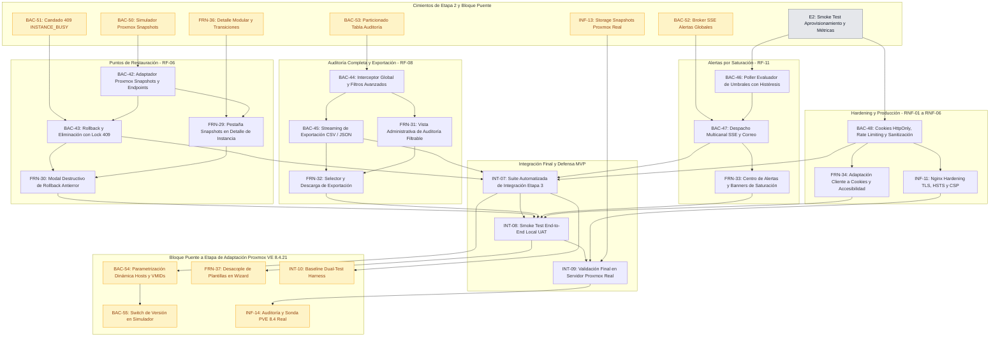

# Etapa 3: Snapshots, Auditoría Inmutable, Alertas por Saturación y Hardening Final

> **Estado:** Planificada.
> **Dependencia previa:** Cierre formal de la Etapa 2 ([`etapa2.md`](etapa2.md)), incluyendo sus tareas puente de infraestructura, concurrencia y simulador (`Bloque 8`: `BAC-50` a `BAC-53`, `FRN-36` e `INF-13`), con sus pruebas de aceptación e integración de aprovisionamiento, cuotas y telemetría en verde (`INT-04`, `INT-05` e `INT-06`).
> **Requerimientos cubiertos:** `RF-06` (Puntos de Restauración / Snapshots), `RF-08` (Audit Log inalterable y exportación), `RF-11` (Motor proactivo de alertas por saturación y despacho de correo), `RNF-01` a `RNF-06` (Seguridad, rendimiento, trazabilidad y hardening de producción).

---

## 1. Criterios de Planificación y Decisiones de Arquitectura

1. **Regla de Granularidad ($\le$ 2.5 h):** Ninguna tarea supera las 2.5 horas de estimación. Cada ítem aísla responsabilidades técnicas claras entre adaptadores de Proxmox, modelos de dominio, validaciones transaccionales y componentes de interfaz.
2. **Independencia del Hipervisor Físico en Desarrollo:** La creación, listado, rollback y borrado de snapshots se valida en primera instancia contra el simulador `backend/cmd/proxmox-simulador` y fixtures controlados. La infraestructura física de Proxmox solo interviene en la validación de entrega final (`INT-09`).
3. **Decisiones de Arquitectura para Snapshots (`RF-06`):**
   - **Ciclo Asíncrono Homogéneo:** Tanto la creación (`POST /nodes/{node}/{tipo}/{vmid}/snapshot`), reversión (`POST /nodes/{node}/{tipo}/{vmid}/snapshot/{snapname}/rollback`) como eliminación (`DELETE /nodes/{node}/{tipo}/{vmid}/snapshot/{snapname}`) devuelven un **UPID**. El backend reutiliza el worker desacoplado (`seguimiento_tareas.go`) persistiendo el estado en `tareas_asincronas`.
   - **Bloqueo Operativo Distribuido:** Mientras un snapshot o rollback está en ejecución, la instancia entra en estado de transición con bloqueo mutuo (`409 INSTANCE_BUSY`), impidiendo simultáneamente acciones de ciclo de vida (start/stop) o ediciones de configuración.
   - **Doble Confirmación Antierror:** El rollback es destructivo para los datos generados con posterioridad al punto de restauración. El frontend exige confirmación explícita escribiendo el nombre del snapshot antes de despachar la orden.
4. **Decisiones de Auditoría Inmutable y Exportación (`RF-08` / `BAC-18`):**
   - **Esquema Append-Only Particionado:** Se mantiene la tabla `auditoria` particionada trimestralmente por rango de fechas (`PARTITION BY RANGE (fecha_hora)`), sin operaciones `UPDATE` ni `DELETE` sobre registros existentes.
   - **Trazabilidad Integral de Operaciones:** Se auditan todas las operaciones de ciclo de vida, aprovisionamiento, snapshots y rollback con usuario actor, `vmid`, `upid`, estado y detalles JSONB estructurados.
   - **Streaming en Exportación:** La exportación a CSV/JSON se procesa mediante cursores de base de datos o buffers de streaming hacia la respuesta HTTP, evitando desbordamientos de memoria en el backend ante grandes volúmenes de eventos.
5. **Decisiones de Alertas por Saturación (`RF-11`):**
   - **Poller con Histéresis y Deduplicación en Redis:** Para evitar tormentas de notificaciones (flapping) cuando el consumo oscila cerca del umbral (ej. 85% de RAM), se aplica un margen de histéresis (activación al 85%, desactivación al 80%) con claves de estado en Redis (`alert:active:{recurso}:{tipo}`).
   - **Multicanal Desacoplado:** El motor emite eventos `ALERT_TRIGGERED` y `ALERT_RESOLVED` hacia el frontend a través del canal en tiempo real SSE (`/api/events`) y despacha notificaciones críticas al administrador mediante el puerto `EmailService`.
6. **Hardening de Seguridad y Despliegue (`RNF-01` a `RNF-06`):**
   - **Protección de Sesiones:** Evaluación y migración del `refreshToken` hacia cookies seguras `HttpOnly`, `Secure` y `SameSite=Strict`, mitigando riesgos de extracción por XSS.
   - **Proxy Inverso de Producción:** Configuración exhaustiva de Nginx con TLS 1.3, certificados validados, cabeceras de seguridad estrictas (HSTS, CSP, X-Frame-Options) y proxying sin cortes para WebSockets y SSE.

---

## 2. Estado del Código al Inicio de la Etapa 3 (Punto de Partida)

| Componente | Estado que deja la Etapa 2 (con Bloque Puente) | Tarea de Etapa 3 que lo evoluciona |
|---|---|---|
| Simulador de Proxmox (`backend/cmd/proxmox-simulador`) | ✅ Soporta endpoints mock de snapshots y UPIDs en memoria (`BAC-50`) | Implementación de cliente oficial y endpoints (`BAC-42`) |
| Bloqueo concurrente de instancias | ✅ Guarda `RequireInstanceIdle` con lock `409 INSTANCE_BUSY` (`BAC-51`) | Rollback y snapshots con bloqueo transitorio 409 (`BAC-43`) |
| Vista Detalle de Instancia (`/instances/:vmid`) | ✅ Layout modular y estados transitorios `SNAPSHOTTING`/`ROLLING_BACK` (`FRN-36`) | Pestaña interactiva "Snapshots" y modal destructivo (`FRN-29`, `FRN-30`) |
| Canal SSE (`/api/events`) y Pub/Sub Redis | ✅ Broker generalizado para eventos de broadcast a nivel `HOST` (`BAC-52`) | Emisión multicanal de alertas por saturación (`BAC-47`) |
| Storage en Proxmox Real | ✅ Auditado y validado con soporte nativo de snapshots (`INF-13`) | Validación y UAT sobre hardware físico (`INT-09`) |
| Tabla `auditoria` particionada | ✅ Particiones trimestrales preventivas e índices compuestos (`BAC-53`) | Consultas avanzadas y streaming de exportación (`BAC-44`, `BAC-45`) |
| Adapter de Correo (`EmailService`) | ✅ Resuelto mediante puerto hexagonal (`MockEmailService`) | Despacha correos automáticos ante alertas críticas de saturación (`BAC-47`) |
| Inmuno-seguridad en Frontend | ✅ Interceptores de error D2 y protección XSS en alertas | Incorpora soporte de cookies seguras `HttpOnly` y modales antierror (`FRN-30`, `FRN-34`) |

---

## 3. Mapa de Dependencias de la Etapa 3

---

## 4. Orden de Carga en ClickUp

| Ola | Se carga y se empieza | Condición para empezar |
|---|---|---|
| **1** | `BAC-42`, `BAC-44`, `BAC-46`, `BAC-48` | Cierre formal de la Etapa 2 (`INT-05`/`INT-06`). Desbloquea las ramas de desarrollo técnico |
| **2** | `BAC-43`, `BAC-45`, `BAC-47`, `FRN-29`, `FRN-31`, `INF-11` | Ola 1: requiere adapters de snapshots, contratos de auditoría, motor de alertas y cookies seguras |
| **3** | `FRN-30`, `FRN-32`, `FRN-33`, `FRN-34` | Ola 2: requiere endpoints de rollback, exportación, eventos de alerta y directivas Nginx |
| **4** | `INT-07` | Cierre de Ola 3 en backend y frontend. Ejecuta la suite automatizada completa de la etapa |
| **5** | `INT-08`, y después `INT-09` | `INT-07` en verde al 100%. `INT-09` valida el despliegue final contra el Proxmox real |
| **6 (Puente)** | `BAC-54`, `BAC-55`, `INF-14`, `FRN-37`, `INT-10` | Cierre de Ola 4/5 (`INT-07`/`INT-09`). Prepara submódulos, simulador y fixtures para la [Etapa de Adaptación PVE 8.4.21](etapa-adaptacion-proxmox-8.md) |

**Camino crítico:** `BAC-42` $\rightarrow$ `BAC-43` $\rightarrow$ `FRN-30` $\rightarrow$ `INT-07` $\rightarrow$ `INT-08` $\rightarrow$ `INT-09` $\rightarrow$ `Puente PVE 8.4.21`.

---

## 5. Desglose Detallado de Tareas (ClickUp)

### Bloque 1: Snapshots y Puntos de Restauración (`RF-06`)

#### `FRN-30` - Modal destructivo de Rollback y eliminación con confirmación antierror
- **Área:** Frontend
- **Asignado:** Cristian
- **Estimación:** 2.0 h
- **Depende de:** `FRN-29`, `BAC-43`.
- **Problema:** Revertir un snapshot descarta todos los cambios generados desde su captura. Un clic involuntario causaría pérdida irreparable de datos en el cliente.
- **Entregable:**
  1. Modal antierror `RollbackSnapshotModal.tsx` con advertencia en rojo: *"Esta acción restaurará la máquina al punto seleccionado. Todos los datos posteriores se perderán."*
  2. Input de seguridad que exija escribir textualmente el nombre del snapshot antes de habilitar el botón "Revertir".
  3. Modal de confirmación para eliminación de snapshots.
  4. Bloqueo de la botonera de la instancia con indicador *"Restaurando estado..."* mientras la tarea asíncrona se resuelve.
- **Criterio de éxito:** El botón de rollback solo es presionable tras tipear el nombre idéntico. Al confirmar, la interfaz entra en modo de espera y muestra un Toast al finalizar.

---

### Bloque 2: Auditoría Inmutable y Exportación (`RF-08`)

#### `FRN-32` - Componente y flujo de exportación de reportes de auditoría
- **Área:** Frontend
- **Asignada:** Luz
- **Estimación:** 1.5 h
- **Depende de:** `FRN-31`, `BAC-45`.
- **Problema:** Los operadores de cumplimiento requieren descargar los registros en archivos locales para archivo legal o análisis externo.
- **Entregable:**
  1. Botón "Exportar registros" con menú desplegable para elegir "Exportar como CSV" o "Exportar como JSON".
  2. Integración con `auditService.exportLogs(filtros, format)` transfiriendo los filtros actualmente activos en pantalla.
  3. Estado de carga en el botón durante la generación del reporte y disparo automático de la descarga nativa en el navegador.
  4. Notificación Toast al completar la descarga.
- **Criterio de éxito:** Al hacer clic en exportar, se descarga el archivo con los filtros aplicados sin recargar la página ni bloquear la UI.

---

### Bloque 3: Motor Proactivo de Alertas por Saturación (`RF-11`)

#### `BAC-47` - Despacho multicanal de alertas (SSE en tiempo real y correo estructurado)
- **Área:** Backend
- **Asignada:** Tayra
- **Estimación:** 2.0 h
- **Depende de:** `BAC-46`, `BAC-52` (`BRG-12-BAC`: broker SSE generalizado para alertas globales).
- **Problema:** Una vez detectada la saturación, todos los administradores conectados deben ser prevenidos en sus pantallas y por canal de contingencia (correo).
- **Entregable:**
  1. Emisión de eventos `ALERT_TRIGGERED` y `ALERT_RESOLVED` a través del canal `/api/events` hacia los clientes SSE.
  2. Despacho estructurado de correo electrónico a través del adaptador `EmailService`:
     - Asunto: `[ALERTA CRÍTICA] Saturación de Recursos en {Recurso}`.
     - Cuerpo con métricas exactas, fecha y recomendación operativa.
  3. Registro automático de la alerta en la tabla inmutable `auditoria`.
- **Criterio de éxito:** Al dispararse la saturación, los clientes SSE reciben el evento en menos de 1 s y el log del servidor registra el correo despachado por `EmailService`.

#### `FRN-33` - Centro de Notificaciones y banners contextuales de alerta por saturación
- **Área:** Frontend
- **Asignada:** Belinda
- **Estimación:** 2.0 h
- **Depende de:** `BAC-47`.
- **Problema:** Los administradores en el frontend necesitan identificar de un vistazo las alertas activas del sistema sin tener que revisar manualmente cada gráfica.
- **Entregable:**
  1. Campana / Centro de Notificaciones en la barra superior con contador de alertas no leídas.
  2. Banner contextual persistente de color rojo en la cabecera del Dashboard ante alertas de severidad `CRITICAL`.
  3. Badge de advertencia en la fila del inventario si una instancia específica tiene alertas de saturación activas.
  4. Sonido o feedback visual sutil al recibir un evento `ALERT_TRIGGERED` en vivo.
- **Criterio de éxito:** Al emitirse una alerta de saturación, el banner aparece automáticamente en la pantalla de los administradores sin requerir `F5`.

---

### Bloque 4: Hardening de Seguridad, Sesiones y Conectividad (`RNF-01` a `RNF-06`)

#### `BAC-48` - Hardening de autenticación: Cookies `HttpOnly`, Rate Limiting y Sanitización
- **Área:** Backend
- **Asignada:** Tayra
- **Estimación:** 2.0 h
- **Depende de:** `BAC-03`, `BAC-17B`.
- **Problema:** Almacenar tokens de larga duración en `sessionStorage` deja una ventana de exposición ante vulnerabilidades XSS. Además, los endpoints de login y recuperación requieren protección estricta contra fuerza bruta.
- **Entregable:**
  1. Modificación de `POST /api/auth/login` y `POST /api/auth/refresh`: emisión del `refreshToken` en cookie HTTP con directivas `HttpOnly`, `Secure`, `SameSite=Strict`, `Path=/api/auth`.
  2. Middleware de Rate Limiting por IP para endpoints públicos (`/auth/login`, `/auth/password/forgot`) limitando a 5 intentos por minuto con respuesta `429 Too Many Requests`.
  3. Sanitización estricta de encabezados y payloads JSON contra inyecciones de caracteres de control.
- **Criterio de éxito:** Pruebas automatizadas confirman que JavaScript no puede leer la cookie de refresh y que peticiones abusivas consecutivas reciben 429.

#### `FRN-34` - Adaptación del cliente a cookies seguras de sesión y auditoría de accesibilidad
- **Área:** Frontend
- **Asignado:** Cristian
- **Estimación:** 2.0 h
- **Depende de:** `BAC-48`.
- **Problema:** El cliente de API debe adaptarse para enviar credenciales automáticas en llamadas de refresh y la interfaz debe cumplir con estándares de accesibilidad para la entrega final.
- **Entregable:**
  1. Ajuste de `apiClient.ts` para enviar `credentials: 'include'` en peticiones al backend.
  2. Eliminación de referencias al almacenamiento manual del `refreshToken` en `sessionStorage`.
  3. Auditoría y corrección de accesibilidad (WCAG 2.1 AA) en modales, botones y selectores, garantizando navegación completa por teclado y etiquetas `aria-*`.
- **Criterio de éxito:** El flujo de rotación de tokens funciona automáticamente mediante cookies y las pruebas de accesibilidad pasan sin advertencias.

---

### Bloque 5: Integración, Smoke Test y Cierre Final (UAT)

#### `INT-07` - Suite automatizada de pruebas de integración de la Etapa 3
- **Área:** Backend / Testing
- **Asignados:** Tayra y Lisandro
- **Estimación:** 2.5 h
- **Depende de:** `BAC-43`, `BAC-45`, `BAC-47`, `BAC-48`.
- **Problema:** Se requiere una suite de aceptación automatizada integral en CI/local que verifique todo el circuito de snapshots, auditoría extendida, alertas y seguridad.
- **Entregable:**
  - Archivo de prueba `test/back/etapa3_acceptance_test.go`:
    1. Creación, listado, rollback y borrado de snapshots con validación de lock `409 INSTANCE_BUSY`.
    2. Filtrado y streaming de exportación de auditoría en CSV y JSON.
    3. Simulación de saturación de nodo y verificación de emisión de alertas en tiempo real.
    4. Comprobación de cookies `HttpOnly` y rechazo por rate limiting (429).
- **Criterio de éxito:** `go test ./test/back/etapa3_acceptance_test.go` pasa 100% en verde de forma determinística contra el simulador.

#### `INT-08` - Smoke Test End-to-End local del sistema completo (UAT pre-defensa)
- **Área:** Integración / Todo el equipo
- **Asignados:** Equipo completo
- **Estimación:** 2.0 h
- **Depende de:** `INT-07`, `FRN-30`, `FRN-32`, `FRN-33`, `FRN-34`.
- **Problema:** Ensayo general de la plataforma completa previo a la validación final en hardware físico.
- **Entregable:** Recorrido funcional interactivo en entorno local:
  1. Login de operador con 2FA y cookie segura.
  2. Monitoreo de telemetría y visualización de gráficos en vivo.
  3. Creación de snapshot sobre una máquina y posterior restauración con confirmación antierror.
  4. Generación deliberada de carga para disparar banner de alerta en tiempo real.
  5. Consulta de auditoría administrativa y descarga del reporte CSV.
- **Criterio de éxito:** Los 5 flujos completan con éxito sin errores en la consola de navegación ni anomalías de base de datos.

#### `INT-09` - Validación final en servidor de producción con Proxmox real
- **Área:** Integración / Infraestructura
- **Asignados:** Nico, Lucas y un integrante de backend
- **Estimación:** 2.0 h
- **Depende de:** `INT-08`, `INF-11`, `INF-13` (`BRG-11-INF`: storage compatible con snapshots en Proxmox real).
- **Problema:** Certificación definitiva sobre el hipervisor real a través de Tailscale y proxy inverso con certificados antes del cierre formal del proyecto.
- **Entregable:**
  1. Ejecución de snapshots y rollback sobre una instancia real en Proxmox VE.
  2. Comprobación del stream de alertas y métricas a través de HTTPS/TLS sin interrupciones.
  3. Auditoría exhaustiva del entorno, dejando únicamente las instancias autorizadas y protegidas (`100` a `105`).
  4. Acta técnica de conformidad de la entrega del MVP final.
- **Criterio de éxito:** La plataforma supera todas las validaciones sobre hardware físico cumpliendo el 100% de los requerimientos funcionales (`RF-01` a `RF-11`) y no funcionales.

---

### Bloque 6: Tareas Puente (Bridge) para la Transición a Proxmox VE 8.4.21

> [!IMPORTANT]
> **Cierre de Brechas de Entorno y Preparación (Etapa 3 $\rightarrow$ Adaptación PVE 8.4.21):**
> Al concluir las validaciones de la Etapa 3 en el entorno de desarrollo base (PVE 9.2.2), el sistema debe prepararse para su migración y despliegue sobre el servidor físico productivo que opera con **Proxmox VE 8.4.21** (detallado en [`etapa-adaptacion-proxmox-8.md`](etapa-adaptacion-proxmox-8.md)).
> Estas 5 tareas puente desacoplan configuraciones rígidas, habilitan el conmutador de perfiles de versión en el simulador, capturan la telemetría del host final y flexibilizan los contratos de interfaz y testing para permitir una adaptación inmediata sin riesgo de regresión:
> 1. `BAC-54` (`BRG-14-BAC`): Extracción y Parametrización en `.env` para Servidores Heterogéneos.
> 2. `BAC-55` (`BRG-15-SIM`): Switch de Perfil de Versión en `proxmox-simulador` (`PROXMOX_SIM_TARGET_VERSION`).
> 3. `INF-14` (`BRG-12-INF`): Auditoría Preliminar y Recolección de Telemetría Cruda en Servidor PVE 8.4.21 Físico.
> 4. `FRN-37` (`BRG-11-FRN`): Desacoplamiento de Constantes de Plantillas de SO en Asistente de Creación.
> 5. `INT-10` (`BRG-13-INT`): Baseline Dual-Test Harness para Suites de Aceptación (Tolerancia PVE 8 y PVE 9).

#### `BAC-54` (`BRG-14-BAC`) - Extracción y Parametrización en `.env` para Servidores Heterogéneos
- **Área:** Backend
- **Asignado:** Lisandro
- **Estimación:** 1.5 h
- **Depende de:** `INT-07`.
- **Problema:** En el código actual persisten suposiciones sobre el nombre de nodo (`proxmox` o `pve`) y el rango de IDs protegidos (`100-105`). En el servidor nuevo con PVE 8.4.21, el nodo y los VMIDs protegidos varían y no deben bloquear cargas del anfitrión.
- **Entregable:**
  1. Parametrización estricta en `backend/cmd/api/main.go` y `middleware/protected_instance.go`: lectura prioritaria de `PROXMOX_NODE`, `PROXMOX_URL` y `PROXMOX_PROTECTED_VMIDS`.
  2. Fallback seguro: si `PROXMOX_PROTECTED_VMIDS` viene vacío o no se define, no bloquear IDs arbitrarios ni fallar el arranque.
  3. Soporte para la bandera opcional `PROXMOX_TARGET_PVE_VERSION` (por defecto `"auto"`).
- **Criterio de éxito:** Modificar el `.env` con un nodo alternativo y VMIDs protegidos personalizados altera el comportamiento del backend sin requerir recompilación.

#### `BAC-55` (`BRG-15-SIM`) - Switch de Perfil de Versión en `proxmox-simulador` (`PROXMOX_SIM_TARGET_VERSION`)
- **Área:** Backend / Simulador
- **Asignado:** Lisandro
- **Estimación:** 2.0 h
- **Depende de:** `BAC-54`.
- **Problema:** El simulador responde únicamente con firmas de PVE 9.2.2. Se requiere que admita perfiles de versión mediante variable de entorno para poder contrastar pruebas tanto en versión 9 como en versión 8.4.21.
- **Entregable:**
  1. En `backend/cmd/proxmox-simulador/simulador.go`:
     - Incorporar lectura de `PROXMOX_SIM_TARGET_VERSION` (valores: `"9.2.2"`, `"8.4.21"`; default `"9.2.2"` para no romper Etapa 3).
  2. Implementación de respuestas condicionadas:
     - En `nodes/{node}/status`: exponer firma `pve-manager/8.4-21` y kernel `6.8` cuando la variable esté en modo 8.4.21.
     - Hook de preparación para que las tareas de adaptación (`ADP-05`, `ADP-06`) conecten sus validaciones específicas.
- **Criterio de éxito:** Ejecutar `PROXMOX_SIM_TARGET_VERSION=8.4.21 go run ./cmd/proxmox-simulador` emite la cabecera y el JSON de status del nodo correspondientes a la versión 8.4.21.

#### `INF-14` (`BRG-12-INF`) - Auditoría Preliminar y Recolección de Telemetría Cruda en Servidor PVE 8.4.21 Físico
- **Área:** Infraestructura
- **Asignado:** Nico
- **Estimación:** 2.0 h
- **Depende de:** `INT-09`.
- **Problema:** Se necesita el inventario real y las firmas JSON exactas que devuelve el nuevo servidor de producción PVE 8.4.21 para alimentar las fixtures de desarrollo y detectar posibles extensiones de storage no documentadas.
- **Entregable:**
  1. Script de recolección segura `scripts/pve8-audit-probe.sh` que consulte con token de prueba los endpoints:
     - `GET /api2/json/version`
     - `GET /api2/json/nodes/{node}/status`
     - `GET /api2/json/cluster/resources`
     - `GET /api2/json/nodes/{node}/storage`
     - `GET /api2/json/nodes/{node}/storage/{storage}/content`
  2. Archivar las capturas sanitizadas (sin tokens ni secretos) en `backend/API proxmox respuestas/pve8-capturas/`.
- **Criterio de éxito:** Carpeta de capturas creada con las respuestas reales del host físico 8.4.21 documentadas.

#### `FRN-37` (`BRG-11-FRN`) - Desacoplamiento de Constantes de Plantillas de SO en Asistente de Creación
- **Área:** Frontend
- **Asignado:** Belinda
- **Estimación:** 1.5 h
- **Depende de:** `FRN-30`.
- **Problema:** El wizard de creación (`useCreateInstanceWizard.ts` y `createInstanceOptions.ts`) contiene referencias duras a nombres de plantillas Debian 13.
- **Entregable:**
  1. Abstracción del parser de plantillas en `frontend/centinela/src/components/features/instances/data/createInstanceOptions.ts`:
     - Normalizador que clasifique cualquier plantilla devuelta por el backend según su familia (`Debian`, `Ubuntu`, `Alpine`, `Otro`) extrayendo la versión mayor dinámicamente (`debian-12`, `debian-13`, etc.).
  2. Pruebas unitarias de frontend verificando que el selector renderice correctamente plantillas Debian 12 Bookworm.
- **Criterio de éxito:** El wizard muestra la tarjeta y badge "Debian 12" al recibir `debian-12-standard...` sin depender de valores estáticos Debian 13.

#### `INT-10` (`BRG-13-INT`) - Baseline Dual-Test Harness para Suites de Aceptación (Tolerancia PVE 8 y PVE 9)
- **Área:** Testing / QA
- **Asignado:** Tayra
- **Estimación:** 1.5 h
- **Depende de:** `INT-07`.
- **Problema:** Pruebas como `TestEtapa1SimuladorProxmox` en `test/back` fallarían si el simulador o un mock responde con tipos enteros en `prefix` o `memory`.
- **Entregable:**
  1. En `test/back/`: crear helper `assertNetworkPrefix(t, val)` que valide prefijos CIDR de red representados tanto como string `"24"` como número `24`.
  2. Actualizar las aserciones de integración existentes para que sean agnósticas de la versión subyacente.
- **Criterio de éxito:** Las pruebas de aceptación corren exitosamente sin fallar ante payloads con prefijo numérico o textual.

---

## 6. Resumen de Distribución y Carga de Trabajo

| Ola | Tarea | Área | Responsable(s) | Estimación | Empieza con | Cierra con (bloqueantes) |
|---|---|---|---|---|---|---|
| 1 | `BAC-42` | Backend | Lisandro | 2.0 h | — | `BAC-30` |
| 1 | `BAC-44` | Backend | Tayra | 2.0 h | — | `BAC-41` |
| 1 | `BAC-46` | Backend | Lisandro | 2.5 h | — | `BAC-22`, `BAC-34` |
| 1 | `BAC-48` | Backend | Tayra | 2.0 h | — | `BAC-03`, `BAC-17B` |
| 2 | `BAC-43` | Backend | Tayra | 2.0 h | `BAC-42` | `BAC-42` |
| 2 | `BAC-45` | Backend | Lisandro | 2.0 h | `BAC-44` | `BAC-44` |
| 2 | `BAC-47` | Backend | Tayra | 2.0 h | `BAC-46` | `BAC-46` |
| 2 | `FRN-29` | Frontend | Luz | 2.0 h | `BAC-42` | `BAC-42`, `FRN-21` |
| 2 | `FRN-31` | Frontend | Belinda | 2.5 h | `BAC-44` | `BAC-44`, `FIX-74` |
| 2 | `INF-11` | Infraestructura | Nico | 2.0 h | `BAC-48` | `BAC-48`, `INF-04` |
| 3 | `FRN-30` | Frontend | Cristian | 2.0 h | `FRN-29` | `FRN-29`, `BAC-43` |
| 3 | `FRN-32` | Frontend | Luz | 1.5 h | `FRN-31` | `FRN-31`, `BAC-45` |
| 3 | `FRN-33` | Frontend | Belinda | 2.0 h | `BAC-47` | `BAC-47` |
| 3 | `FRN-34` | Frontend | Cristian | 2.0 h | `BAC-48` | `BAC-48` |
| 4 | `INT-07` | Testing / Back | Tayra, Lisandro | 2.5 h | — | `BAC-43`, `BAC-45`, `BAC-47`, `BAC-48` |
| 5 | `INT-08` | Integración | Equipo completo | 2.0 h | — | `INT-07`, `FRN-30`, `FRN-32`, `FRN-33`, `FRN-34` |
| 5 | `INT-09` | Integración / Infra | Nico, Lucas, Back | 2.0 h | — | `INT-08`, `INF-11` |
| 6 | `BAC-54` | Backend (Bridge) | Lisandro | 1.5 h | `INT-07` | `INT-07` |
| 6 | `BAC-55` | Backend (Bridge) | Lisandro | 2.0 h | `BAC-54` | `BAC-54` |
| 6 | `INF-14` | Infraestructura (Bridge) | Nico | 2.0 h | `INT-09` | `INT-09` |
| 6 | `FRN-37` | Frontend (Bridge) | Belinda | 1.5 h | `INT-08` | `FRN-30` |
| 6 | `INT-10` | Testing (Bridge) | Tayra | 1.5 h | `INT-07` | `INT-07` |
| | **Total** | | | **43.5 h** | | **22 tareas, promedio 1.98 h** |

---

### Carga Horaria por Integrante en la Etapa 3 (con Tareas Puente PVE 8)

| Integrante | Rol | Horas Asignadas | Tareas |
|---|---|---:|---|
| **Lisandro** | Backend | 10.0 h + `INT-07` | `BAC-42`, `BAC-45`, `BAC-46`, `BAC-54`, `BAC-55` |
| **Tayra** | Backend / Testing | 9.5 h + `INT-07` | `BAC-44`, `BAC-48`, `BAC-43`, `BAC-47`, `INT-10` |
| **Belinda** | Frontend | 6.0 h | `FRN-31`, `FRN-33`, `FRN-37` |
| **Luz** | Frontend | 3.5 h | `FRN-29`, `FRN-32` |
| **Cristian** | Frontend | 4.0 h | `FRN-30`, `FRN-34` |
| **Nico** | Infraestructura | 4.0 h + `INT-09` | `INF-11`, `INF-14` |
| **Lucas** | Infraestructura | 0.5 h + `INT-09` | Soporte en `INT-09` |
| **Equipo Completo** | Integración | 2.0 h | `INT-08` (Smoke Test End-to-End local UAT) |
| **Tayra y Lisandro** | Testing / Integración | 2.5 h | `INT-07` (Suite Automatizada Etapa 3) |
| **Nico, Lucas y Back** | Despliegue Físico | 2.0 h | `INT-09` (Validación Proxmox Real Base) |

