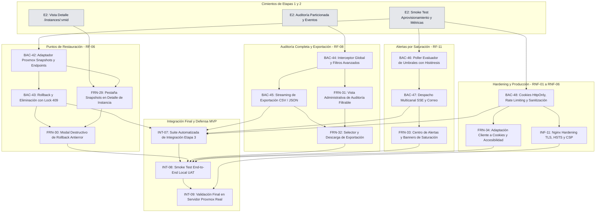

# Etapa 3: Snapshots, Auditoría Inmutable, Alertas por Saturación y Hardening Final

> **Estado:** Planificada.
> **Dependencia previa:** Cierre formal de la Etapa 2 ([`etapa2.md`](etapa2.md)), con sus pruebas de aceptación e integración de aprovisionamiento, cuotas y telemetría en verde (`INT-04`, `INT-05` e `INT-06`).
> **Requerimientos cubiertos:** `RF-06` (Puntos de Restauración / Snapshots), `RF-08` (Audit Log inalterable y exportación), `RF-11` (Motor proactivo de alertas por saturación y despacho de correo), `RNF-01` a `RNF-06` (Seguridad, rendimiento, trazabilidad y hardening de producción).

---

## 1. Criterios de Planificación y Decisiones de Arquitectura

1. **Regla de Granularidad ($\le$ 2.5 h):** Ninguna tarea supera las 2.5 horas de estimación. Cada ítem aísla responsabilidades técnicas claras entre adaptadores de Proxmox, modelos de dominio, validaciones transaccionales y componentes de interfaz.
2. **Independencia del Hipervisor Físico en Desarrollo:** La creación, listado, rollback y borrado de snapshots se valida en primera instancia contra el simulador `backend/cmd/proxmox-simulador` y fixtures controlados. La infraestructura física de Proxmox solo interviene en la validación de entrega final (`INT-09`).
3. **Decisiones de Arquitectura para Snapshots (`RF-06`):**
   - **Ciclo Asíncrono Homogéneo:** Tanto la creación (`POST /nodes/{node}/{tipo}/{vmid}/snapshot`), reversión (`POST /nodes/{node}/{tipo}/{vmid}/snapshot/{snapname}/rollback`) como eliminación (`DELETE /nodes/{node}/{tipo}/{vmid}/snapshot/{snapname}`) devuelven un **UPID**. El backend reutiliza el worker desacoplado (`seguimiento_tareas.go`) persistiendo el estado en `tareas_asincronas`.
   - **Bloqueo Operativo Distribuido:** Mientras un snapshot o rollback está en ejecución, la instancia entra en estado de transición con bloqueo mutuo (`409 INSTANCE_BUSY`), impidiendo simultáneamente acciones de ciclo de vida (start/stop) o ediciones de configuración.
   - **Doble Confirmación Antierror:** El rollback es destructivo para los datos generados con posterioridad al punto de restauración. El frontend exige confirmación explícita escribiendo el nombre del snapshot antes de despachar la orden.
4. **Decisiones de Auditoría Inmutable y Exportación (`RF-08` / `BAC-18`):**
   - **Esquema Append-Only Particionado:** Se mantiene la tabla `auditoria` particionada trimestralmente por rango de fechas (`PARTITION BY RANGE (fecha_hora)`), sin operaciones `UPDATE` ni `DELETE` sobre registros existentes.
   - **Trazabilidad Integral de Operaciones:** Se auditan todas las operaciones de ciclo de vida, aprovisionamiento, snapshots y rollback con usuario actor, `vmid`, `upid`, estado y detalles JSONB estructurados.
   - **Streaming en Exportación:** La exportación a CSV/JSON se procesa mediante cursores de base de datos o buffers de streaming hacia la respuesta HTTP, evitando desbordamientos de memoria en el backend ante grandes volúmenes de eventos.
5. **Decisiones de Alertas por Saturación (`RF-11`):**
   - **Poller con Histéresis y Deduplicación en Redis:** Para evitar tormentas de notificaciones (flapping) cuando el consumo oscila cerca del umbral (ej. 85% de RAM), se aplica un margen de histéresis (activación al 85%, desactivación al 80%) con claves de estado en Redis (`alert:active:{recurso}:{tipo}`).
   - **Multicanal Desacoplado:** El motor emite eventos `ALERT_TRIGGERED` y `ALERT_RESOLVED` hacia el frontend a través del canal en tiempo real SSE (`/api/events`) y despacha notificaciones críticas al administrador mediante el puerto `EmailService`.
6. **Hardening de Seguridad y Despliegue (`RNF-01` a `RNF-06`):**
   - **Protección de Sesiones:** Evaluación y migración del `refreshToken` hacia cookies seguras `HttpOnly`, `Secure` y `SameSite=Strict`, mitigando riesgos de extracción por XSS.
   - **Proxy Inverso de Producción:** Configuración exhaustiva de Nginx con TLS 1.3, certificados validados, cabeceras de seguridad estrictas (HSTS, CSP, X-Frame-Options) y proxying sin cortes para WebSockets y SSE.

---

## 2. Estado del Código al Inicio de la Etapa 3 (Punto de Partida)

| Componente | Estado que deja la Etapa 2 | Tarea de Etapa 3 que lo evoluciona |
|---|---|---|
| Simulador de Proxmox (`backend/cmd/proxmox-simulador`) | ✅ Soporta ciclo de vida, storages, cuotas y RRDdata | Se extiende para responder snapshots y rollback simulados (`BAC-42`) |
| Vista Detalle de Instancia (`/instances/:vmid`) | ✅ Cabecera, pestañas "General", "Métricas" y "Configuración" | Incorpora la nueva pestaña "Snapshots" (`FRN-29`) |
| Tabla `auditoria` particionada | ✅ Almacena eventos de autenticación, usuarios y aprovisionamiento | Se amplía para capturar snapshots, rollbacks y exportación (`BAC-44`, `BAC-45`) |
| Canal SSE (`/api/events`) y Pub/Sub Redis | ✅ Emite `TASK_FINISHED` con filtro por permiso | Canaliza eventos de saturación `ALERT_TRIGGERED` (`BAC-47`) |
| Adapter de Correo (`EmailService`) | ✅ Resuelto mediante puerto hexagonal (`MockEmailService`) | Despacha correos automáticos ante alertas críticas de saturación (`BAC-47`) |
| Inmuno-seguridad en Frontend | ✅ Interceptores de error D2 y protección XSS en alertas | Incorpora soporte de cookies seguras `HttpOnly` y modales antierror (`FRN-30`, `FRN-34`) |

---

## 3. Mapa de Dependencias de la Etapa 3

---

## 4. Orden de Carga en ClickUp

| Ola | Se carga y se empieza | Condición para empezar |
|---|---|---|
| **1** | `BAC-42`, `BAC-44`, `BAC-46`, `BAC-48` | Cierre formal de la Etapa 2 (`INT-05`/`INT-06`). Desbloquea las ramas de desarrollo técnico |
| **2** | `BAC-43`, `BAC-45`, `BAC-47`, `FRN-29`, `FRN-31`, `INF-11` | Ola 1: requiere adapters de snapshots, contratos de auditoría, motor de alertas y cookies seguras |
| **3** | `FRN-30`, `FRN-32`, `FRN-33`, `FRN-34` | Ola 2: requiere endpoints de rollback, exportación, eventos de alerta y directivas Nginx |
| **4** | `INT-07` | Cierre de Ola 3 en backend y frontend. Ejecuta la suite automatizada completa de la etapa |
| **5** | `INT-08`, y después `INT-09` | `INT-07` en verde al 100%. `INT-09` valida el despliegue final contra el Proxmox real |

**Camino crítico:** `BAC-42` $\rightarrow$ `BAC-43` $\rightarrow$ `FRN-30` $\rightarrow$ `INT-07` $\rightarrow$ `INT-08` $\rightarrow$ `INT-09`.

---

## 5. Desglose Detallado de Tareas (ClickUp)

### Bloque 1: Snapshots y Puntos de Restauración (`RF-06`)

#### `BAC-42` - Adaptador de Proxmox para Snapshots, endpoints de Creación y Listado
- **Área:** Backend
- **Asignado:** Lisandro
- **Estimación:** 2.0 h
- **Depende de:** `BAC-30` (extensión de endpoints de snapshot en simulador).
- **Problema:** Los usuarios autorizados necesitan registrar puntos de restauración para congelar el estado de sus máquinas antes de realizar operaciones de riesgo.
- **Entregable:**
  1. Métodos en el cliente Proxmox: `CrearSnapshot(ctx, node, tipo, vmid, snapname, descripcion)` y `ListarSnapshots(ctx, node, tipo, vmid)`.
  2. Endpoint `GET /api/instances/:vmid/snapshots` con guard de acceso `RequireInstanceAccess`.
  3. Endpoint `POST /api/instances/:vmid/snapshots` validando nombre alfanumérico (sin espacios ni caracteres especiales), captura de UPID e inserción en `tareas_asincronas` con respuesta `HTTP 202 Accepted { upid, tareaId, snapname }`.
  4. Pruebas unitarias en `snapshot_service_test.go` contra el simulador.
- **Criterio de éxito:** Un usuario con permisos crea y lista snapshots recibiendo la jerarquía temporal ordenada sin errores de serialización.

#### `BAC-43` - Reversión (Rollback) y Eliminación de Snapshots con bloqueo de concurrencia
- **Área:** Backend
- **Asignada:** Tayra
- **Estimación:** 2.0 h
- **Depende de:** `BAC-42`.
- **Problema:** La reversión o borrado de snapshots altera profundamente el almacenamiento del hipervisor. Si se ejecutan en simultáneo con órdenes de energía o creación, se corre riesgo de corrupción de datos.
- **Entregable:**
  1. Endpoint `POST /api/instances/:vmid/snapshots/:snapname/rollback` (requiere `ADMIN` o `FULL_ACCESS`).
  2. Endpoint `DELETE /api/instances/:vmid/snapshots/:snapname` (requiere `ADMIN` o `FULL_ACCESS`).
  3. Validación de estado: si la instancia tiene una tarea activa (`activeTask != nil`), rechazar inmediatamente con `HTTP 409 Conflict` (`INSTANCE_BUSY`).
  4. Al despachar la reversión, marcar la máquina en estado transitorio `ROLLING_BACK` y emitir `TASK_FINISHED` al concluir el UPID.
- **Criterio de éxito:** Intentos de revertir snapshots mientras otra tarea está en curso responden 409. Al completar el rollback, la máquina regresa al estado anterior y se liberan los bloqueos.

#### `FRN-29` - Pestaña "Snapshots" en Detalle de Instancia y formulario de nuevo snapshot
- **Área:** Frontend
- **Asignada:** Luz
- **Estimación:** 2.0 h
- **Depende de:** `BAC-42`, `FRN-21` (página de detalle).
- **Problema:** La vista de detalle no cuenta con una interfaz visual para inspeccionar los puntos de restauración existentes ni disparar un nuevo guardado.
- **Entregable:**
  1. Pestaña "Snapshots" dentro de `InstanceDetailPage.tsx`.
  2. Línea de tiempo o tabla interactiva de snapshots con nombre, descripción, fecha de creación y badge de estado.
  3. Botón "Crear Snapshot" que despliegue un modal sencillo solicitando nombre (validado contra `/^[a-zA-Z0-9_\-]+$/`) y descripción opcional.
  4. Feedback inmediato con spinner de carga durante la creación.
- **Criterio de éxito:** El usuario visualiza la lista de snapshots y puede crear uno nuevo viendo la lista actualizada reactivamente.

#### `FRN-30` - Modal destructivo de Rollback y eliminación con confirmación antierror
- **Área:** Frontend
- **Asignado:** Cristian
- **Estimación:** 2.0 h
- **Depende de:** `FRN-29`, `BAC-43`.
- **Problema:** Revertir un snapshot descarta todos los cambios generados desde su captura. Un clic involuntario causaría pérdida irreparable de datos en el cliente.
- **Entregable:**
  1. Modal antierror `RollbackSnapshotModal.tsx` con advertencia en rojo: *"Esta acción restaurará la máquina al punto seleccionado. Todos los datos posteriores se perderán."*
  2. Input de seguridad que exija escribir textualmente el nombre del snapshot antes de habilitar el botón "Revertir".
  3. Modal de confirmación para eliminación de snapshots.
  4. Bloqueo de la botonera de la instancia con indicador *"Restaurando estado..."* mientras la tarea asíncrona se resuelve.
- **Criterio de éxito:** El botón de rollback solo es presionable tras tipear el nombre idéntico. Al confirmar, la interfaz entra en modo de espera y muestra un Toast al finalizar.

---

### Bloque 2: Auditoría Inmutable y Exportación (`RF-08`)

#### `BAC-44` - Interceptor global y consultas complejas sobre auditoría particionada
- **Área:** Backend
- **Asignada:** Tayra
- **Estimación:** 2.0 h
- **Depende de:** `BAC-41` (auditoría de Etapa 2).
- **Problema:** La auditoría debe consolidar eventos de todas las etapas con filtros combinados eficientes (por usuario, rango de fechas, tipo de recurso, acción y severidad) aprovechando las particiones de PostgreSQL.
- **Entregable:**
  1. Extensión del interceptor de auditoría para registrar: `SNAPSHOT_CREATE`, `SNAPSHOT_ROLLBACK`, `SNAPSHOT_DELETE`, `ALERT_TRIGGERED` y `CONFIG_UPDATED`.
  2. Endpoint `GET /api/admin/audit` con parámetros de consulta: `?desde=...&hasta=...&usuarioId=...&accion=...&recursoTipo=...&recursoId=...&page=1&limit=25`.
  3. Optimización de consulta SQL utilizando exclusión de particiones (`partition pruning`) por `fecha_hora`.
- **Criterio de éxito:** Consultas sobre millones de registros históricos responden en menos de 150 ms sin realizar escaneos completos de tablas.

#### `BAC-45` - Streaming de exportación estructurada de auditoría a CSV y JSON
- **Área:** Backend
- **Asignado:** Lisandro
- **Estimación:** 2.0 h
- **Depende de:** `BAC-44`.
- **Problema:** Exportar reportes de auditoría extensos cargando todos los registros en memoria del servidor puede provocar caídas por `Out of Memory` (OOM).
- **Entregable:**
  1. Endpoint `GET /api/admin/audit/export` accesible solo para usuarios con rol `ADMIN`.
  2. Parámetro `format=csv|json`, respetando exactamente los mismos filtros aplicados en la vista.
  3. Implementación de streaming HTTP: lectura en lotes con cursores de base de datos (`pgx` / `gorm.Rows`) y escritura inmediata en el stream de respuesta.
  4. Cabeceras HTTP apropiadas: `Content-Disposition: attachment; filename="auditoria_centinela_YYYYMMDD.csv"`.
- **Criterio de éxito:** Exportaciones de más de 50.000 filas se descargan fluidamente en el navegador sin picos de consumo de RAM en el contenedor backend.

#### `FRN-31` - Vista administrativa de Auditoría con filtros reactivos completos
- **Área:** Frontend
- **Asignada:** Belinda
- **Estimación:** 2.5 h
- **Depende de:** `BAC-44`, `FIX-74`.
- **Problema:** Los administradores necesitan auditar la actividad institucional de forma ágil, buscando incidentes o filtrando anomalías operativas.
- **Entregable:**
  1. Rediseño funcional de `Auditoria.tsx`:
     - Rango de fechas con controles accesibles (`aria-label="Desde"` y `aria-label="Hasta"`).
     - Desplegables con autocompletado para tipo de acción, usuario y tipo de recurso.
     - Indicador visual de severidad (Badge verde = `SUCCESS`, rojo = `FAILED`, amarillo = `WARNING`).
  2. Tabla paginada con controles de avance/retroceso y selector de elementos por página.
  3. Modal para inspeccionar el payload JSON completo (`detalles`) de un evento seleccionado.
- **Criterio de éxito:** Los cambios en los filtros actualizan reactivamente la tabla vía query parameters cumpliendo con todas las aserciones de accesibilidad.

#### `FRN-32` - Componente y flujo de exportación de reportes de auditoría
- **Área:** Frontend
- **Asignada:** Luz
- **Estimación:** 1.5 h
- **Depende de:** `FRN-31`, `BAC-45`.
- **Problema:** Los operadores de cumplimiento requieren descargar los registros en archivos locales para archivo legal o análisis externo.
- **Entregable:**
  1. Botón "Exportar registros" con menú desplegable para elegir "Exportar como CSV" o "Exportar como JSON".
  2. Integración con `auditService.exportLogs(filtros, format)` transfiriendo los filtros actualmente activos en pantalla.
  3. Estado de carga en el botón durante la generación del reporte y disparo automático de la descarga nativa en el navegador.
  4. Notificación Toast al completar la descarga.
- **Criterio de éxito:** Al hacer clic en exportar, se descarga el archivo con los filtros aplicados sin recargar la página ni bloquear la UI.

---

### Bloque 3: Motor Proactivo de Alertas por Saturación (`RF-11`)

#### `BAC-46` - Background worker evaluador de umbrales con histéresis y deduplicación
- **Área:** Backend
- **Asignado:** Lisandro
- **Estimación:** 2.5 h
- **Depende de:** `BAC-22` (telemetría de nodo) y `BAC-34` (telemetría de instancias).
- **Problema:** La saturación prolongada de CPU, RAM o almacenamiento en el host o en las máquinas críticas puede degradar los servicios. Se requiere detección proactiva antes de que ocurra una caída.
- **Entregable:**
  1. Worker periódico de evaluación configurable (`ALERT_POLL_INTERVAL`, por defecto 30 s).
  2. Verificación de umbrales críticos:
     - Host: RAM $\ge 85\%$, CPU $\ge 90\%$, Almacenamiento $\ge 90\%$.
     - Instancias: Memoria asignada saturada o estado inaccesible.
  3. Algoritmo de histéresis en Redis: marcar alerta activa en clave con TTL; solo disparar evento si la condición persiste durante 2 ciclos consecutivos y resolverla cuando caiga por debajo del 80%.
- **Criterio de éxito:** No se emiten alertas espurias por picos momentáneos de 1 segundo. Al sostenerse la saturación, se genera el estado de alarma de forma determinística.

#### `BAC-47` - Despacho multicanal de alertas (SSE en tiempo real y correo estructurado)
- **Área:** Backend
- **Asignada:** Tayra
- **Estimación:** 2.0 h
- **Depende de:** `BAC-46`.
- **Problema:** Una vez detectada la saturación, todos los administradores conectados deben ser prevenidos en sus pantallas y por canal de contingencia (correo).
- **Entregable:**
  1. Emisión de eventos `ALERT_TRIGGERED` y `ALERT_RESOLVED` a través del canal `/api/events` hacia los clientes SSE.
  2. Despacho estructurado de correo electrónico a través del adaptador `EmailService`:
     - Asunto: `[ALERTA CRÍTICA] Saturación de Recursos en {Recurso}`.
     - Cuerpo con métricas exactas, fecha y recomendación operativa.
  3. Registro automático de la alerta en la tabla inmutable `auditoria`.
- **Criterio de éxito:** Al dispararse la saturación, los clientes SSE reciben el evento en menos de 1 s y el log del servidor registra el correo despachado por `EmailService`.

#### `FRN-33` - Centro de Notificaciones y banners contextuales de alerta por saturación
- **Área:** Frontend
- **Asignada:** Belinda
- **Estimación:** 2.0 h
- **Depende de:** `BAC-47`.
- **Problema:** Los administradores en el frontend necesitan identificar de un vistazo las alertas activas del sistema sin tener que revisar manualmente cada gráfica.
- **Entregable:**
  1. Campana / Centro de Notificaciones en la barra superior con contador de alertas no leídas.
  2. Banner contextual persistente de color rojo en la cabecera del Dashboard ante alertas de severidad `CRITICAL`.
  3. Badge de advertencia en la fila del inventario si una instancia específica tiene alertas de saturación activas.
  4. Sonido o feedback visual sutil al recibir un evento `ALERT_TRIGGERED` en vivo.
- **Criterio de éxito:** Al emitirse una alerta de saturación, el banner aparece automáticamente en la pantalla de los administradores sin requerir `F5`.

---

### Bloque 4: Hardening de Seguridad, Sesiones y Conectividad (`RNF-01` a `RNF-06`)

#### `BAC-48` - Hardening de autenticación: Cookies `HttpOnly`, Rate Limiting y Sanitización
- **Área:** Backend
- **Asignada:** Tayra
- **Estimación:** 2.0 h
- **Depende de:** `BAC-03`, `BAC-17B`.
- **Problema:** Almacenar tokens de larga duración en `sessionStorage` deja una ventana de exposición ante vulnerabilidades XSS. Además, los endpoints de login y recuperación requieren protección estricta contra fuerza bruta.
- **Entregable:**
  1. Modificación de `POST /api/auth/login` y `POST /api/auth/refresh`: emisión del `refreshToken` en cookie HTTP con directivas `HttpOnly`, `Secure`, `SameSite=Strict`, `Path=/api/auth`.
  2. Middleware de Rate Limiting por IP para endpoints públicos (`/auth/login`, `/auth/password/forgot`) limitando a 5 intentos por minuto con respuesta `429 Too Many Requests`.
  3. Sanitización estricta de encabezados y payloads JSON contra inyecciones de caracteres de control.
- **Criterio de éxito:** Pruebas automatizadas confirman que JavaScript no puede leer la cookie de refresh y que peticiones abusivas consecutivas reciben 429.

#### `INF-11` - Configuración de producción en Nginx: TLS 1.3, HSTS, CSP y WSS
- **Área:** Infraestructura
- **Asignado:** Nico
- **Estimación:** 2.0 h
- **Depende de:** `INF-04`, `INF-09`.
- **Problema:** El entorno de producción final requiere estándares estrictos de cifrado, mitigación de ataques web y estabilidad total en canales bidireccionales.
- **Entregable:**
  1. Configuración de Nginx en el servidor de producción con protocolos modernos (TLS 1.2 y TLS 1.3 exclusivamente).
  2. Inyección de encabezados de seguridad:
     - `Strict-Transport-Security: max-age=31536000; includeSubDomains`
     - `X-Content-Type-Options: nosniff`
     - `X-Frame-Options: DENY`
     - `Content-Security-Policy` ajustada para WebSockets y fuentes locales.
  3. Verificación de proxying sin caídas de sesión ni timeout en WebSockets `/api/ws/*` y eventos SSE `/api/events`.
- **Criterio de éxito:** Análisis SSL Labs o verificación con curl reporta calificación A/A+ con todos los encabezados de seguridad presentes.

#### `FRN-34` - Adaptación del cliente a cookies seguras de sesión y auditoría de accesibilidad
- **Área:** Frontend
- **Asignado:** Cristian
- **Estimación:** 2.0 h
- **Depende de:** `BAC-48`.
- **Problema:** El cliente de API debe adaptarse para enviar credenciales automáticas en llamadas de refresh y la interfaz debe cumplir con estándares de accesibilidad para la entrega final.
- **Entregable:**
  1. Ajuste de `apiClient.ts` para enviar `credentials: 'include'` en peticiones al backend.
  2. Eliminación de referencias al almacenamiento manual del `refreshToken` en `sessionStorage`.
  3. Auditoría y corrección de accesibilidad (WCAG 2.1 AA) en modales, botones y selectores, garantizando navegación completa por teclado y etiquetas `aria-*`.
- **Criterio de éxito:** El flujo de rotación de tokens funciona automáticamente mediante cookies y las pruebas de accesibilidad pasan sin advertencias.

---

### Bloque 5: Integración, Smoke Test y Cierre Final (UAT)

#### `INT-07` - Suite automatizada de pruebas de integración de la Etapa 3
- **Área:** Backend / Testing
- **Asignados:** Tayra y Lisandro
- **Estimación:** 2.5 h
- **Depende de:** `BAC-43`, `BAC-45`, `BAC-47`, `BAC-48`.
- **Problema:** Se requiere una suite de aceptación automatizada integral en CI/local que verifique todo el circuito de snapshots, auditoría extendida, alertas y seguridad.
- **Entregable:**
  - Archivo de prueba `test/back/etapa3_acceptance_test.go`:
    1. Creación, listado, rollback y borrado de snapshots con validación de lock `409 INSTANCE_BUSY`.
    2. Filtrado y streaming de exportación de auditoría en CSV y JSON.
    3. Simulación de saturación de nodo y verificación de emisión de alertas en tiempo real.
    4. Comprobación de cookies `HttpOnly` y rechazo por rate limiting (429).
- **Criterio de éxito:** `go test ./test/back/etapa3_acceptance_test.go` pasa 100% en verde de forma determinística contra el simulador.

#### `INT-08` - Smoke Test End-to-End local del sistema completo (UAT pre-defensa)
- **Área:** Integración / Todo el equipo
- **Asignados:** Equipo completo
- **Estimación:** 2.0 h
- **Depende de:** `INT-07`, `FRN-30`, `FRN-32`, `FRN-33`, `FRN-34`.
- **Problema:** Ensayo general de la plataforma completa previo a la validación final en hardware físico.
- **Entregable:** Recorrido funcional interactivo en entorno local:
  1. Login de operador con 2FA y cookie segura.
  2. Monitoreo de telemetría y visualización de gráficos en vivo.
  3. Creación de snapshot sobre una máquina y posterior restauración con confirmación antierror.
  4. Generación deliberada de carga para disparar banner de alerta en tiempo real.
  5. Consulta de auditoría administrativa y descarga del reporte CSV.
- **Criterio de éxito:** Los 5 flujos completan con éxito sin errores en la consola de navegación ni anomalías de base de datos.

#### `INT-09` - Validación final en servidor de producción con Proxmox real
- **Área:** Integración / Infraestructura
- **Asignados:** Nico, Lucas y un integrante de backend
- **Estimación:** 2.0 h
- **Depende de:** `INT-08`, `INF-11`.
- **Problema:** Certificación definitiva sobre el hipervisor real a través de Tailscale y proxy inverso con certificados antes del cierre formal del proyecto.
- **Entregable:**
  1. Ejecución de snapshots y rollback sobre una instancia real en Proxmox VE.
  2. Comprobación del stream de alertas y métricas a través de HTTPS/TLS sin interrupciones.
  3. Auditoría exhaustiva del entorno, dejando únicamente las instancias autorizadas y protegidas (`100` a `105`).
  4. Acta técnica de conformidad de la entrega del MVP final.
- **Criterio de éxito:** La plataforma supera todas las validaciones sobre hardware físico cumpliendo el 100% de los requerimientos funcionales (`RF-01` a `RF-11`) y no funcionales.

---

## 6. Resumen de Distribución y Carga de Trabajo

| Ola | Tarea | Área | Responsable(s) | Estimación | Empieza con | Cierra con (bloqueantes) |
|---|---|---|---|---|---|---|
| 1 | `BAC-42` | Backend | Lisandro | 2.0 h | — | `BAC-30` |
| 1 | `BAC-44` | Backend | Tayra | 2.0 h | — | `BAC-41` |
| 1 | `BAC-46` | Backend | Lisandro | 2.5 h | — | `BAC-22`, `BAC-34` |
| 1 | `BAC-48` | Backend | Tayra | 2.0 h | — | `BAC-03`, `BAC-17B` |
| 2 | `BAC-43` | Backend | Tayra | 2.0 h | `BAC-42` | `BAC-42` |
| 2 | `BAC-45` | Backend | Lisandro | 2.0 h | `BAC-44` | `BAC-44` |
| 2 | `BAC-47` | Backend | Tayra | 2.0 h | `BAC-46` | `BAC-46` |
| 2 | `FRN-29` | Frontend | Luz | 2.0 h | `BAC-42` | `BAC-42`, `FRN-21` |
| 2 | `FRN-31` | Frontend | Belinda | 2.5 h | `BAC-44` | `BAC-44`, `FIX-74` |
| 2 | `INF-11` | Infraestructura | Nico | 2.0 h | `BAC-48` | `BAC-48`, `INF-04` |
| 3 | `FRN-30` | Frontend | Cristian | 2.0 h | `FRN-29` | `FRN-29`, `BAC-43` |
| 3 | `FRN-32` | Frontend | Luz | 1.5 h | `FRN-31` | `FRN-31`, `BAC-45` |
| 3 | `FRN-33` | Frontend | Belinda | 2.0 h | `BAC-47` | `BAC-47` |
| 3 | `FRN-34` | Frontend | Cristian | 2.0 h | `BAC-48` | `BAC-48` |
| 4 | `INT-07` | Testing / Back | Tayra, Lisandro | 2.5 h | — | `BAC-43`, `BAC-45`, `BAC-47`, `BAC-48` |
| 5 | `INT-08` | Integración | Equipo completo | 2.0 h | — | `INT-07`, `FRN-30`, `FRN-32`, `FRN-33`, `FRN-34` |
| 5 | `INT-09` | Integración / Infra | Nico, Lucas, Back | 2.0 h | — | `INT-08`, `INF-11` |
| | **Total** | | | **35.0 h** | | **17 tareas, promedio 2.06 h** |

---

### Carga Horaria por Integrante en la Etapa 3

| Integrante | Rol | Horas Asignadas | Tareas |
|---|---|---:|---|
| **Lisandro** | Backend | 6.5 h + `INT-07` | `BAC-42`, `BAC-45`, `BAC-46` |
| **Tayra** | Backend | 8.0 h + `INT-07` | `BAC-44`, `BAC-48`, `BAC-43`, `BAC-47` |
| **Belinda** | Frontend | 4.5 h | `FRN-31`, `FRN-33` |
| **Luz** | Frontend | 3.5 h | `FRN-29`, `FRN-32` |
| **Cristian** | Frontend | 4.0 h | `FRN-30`, `FRN-34` |
| **Nico** | Infraestructura | 2.0 h + `INT-09` | `INF-11` |
| **Lucas** | Infraestructura | 0.5 h + `INT-09` | Soporte en `INT-09` |
| **Equipo Completo** | Integración | 2.0 h | `INT-08` (Smoke Test End-to-End local UAT) |

