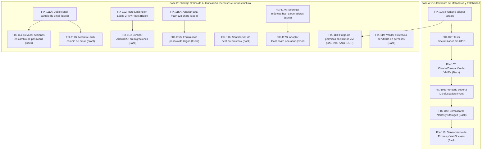

# Etapa 2: correcciones pendientes (FIX)

Acá se listan los fixes y mejoras de seguridad correspondientes a las tareas implementadas para la Etapa 2 y la protección integral del sistema contra fugas de información interna de infraestructura.

---

## 🛡️ Análisis de Seguridad y Modelo de Amenazas (19/10/2026)

### Diagnóstico de Vulnerabilidad de Infraestructura
En sistemas que gestionan hipervisores de virtualización como **Proxmox VE**, exponer identificadores crudos hacia el cliente web representa una vulnerabilidad de **Information Disclosure (CWE-200)** y facilita ataques de **IDOR / Enumeración Secuencial (CWE-639)**:

1. **UPID de Proxmox (`UPID:<node>:<pid>:<pstart>:<starttime>:<type>:<vmid>:<user>:<comment>`):**
   - **Riesgo:** Expone directamente el nombre del nodo host del servidor, el PID del proceso en el kernel de Linux del hipervisor, el identificador hexadecimal del inicio del proceso y el usuario interno del sistema operativo (`root@pam` o API tokens).
   - **Decisión arquitectónica (Opción A):** El uso de un **Identificador Opaco (`tareaId` UUIDv4)** es el estándar de máxima seguridad (*Air-Gap de metadatos*). El cliente solo conoce un UUID aleatorio que no tiene relación matemática con Proxmox. El mapeo real reside en la base de datos interna (`tareas_asincronas.upid_proxmox`). Si el frontend es interceptado, el atacante no obtiene ninguna información del servidor subyacente.

2. **VMID de Instancia (`vmid`: 100, 101, 102...):**
   - **Riesgo:** Los números enteros secuenciales permiten a un atacante adivinar la existencia de otras máquinas, estimar la cantidad de cargas de trabajo y ejecutar ataques de fuerza bruta en rutas REST (`/instances/102`, etc.) si un guard de autorización presentara una falla lógica.
   - **Remediación:** Cifrado / Ofuscación reversible de IDs (mediante algoritmo simétrico o Hashids con salt criptográfico en backend) para que el frontend maneje tokens opacos (`inst_9kX2mB`) y no números enteros predecibles.

3. **Topología de Nodos y Almacenamiento:**
   - **Riesgo:** Exponer nombres reales de host (`pve-01`, `proxmox`) y pools de disco (`local-lvm`, rutas `/dev/...`) revela la arquitectura de red y almacenamiento del host anfitrión.

---

## 🛠️ Plan de Fixes Atómicos (Desglose Paso a Paso)

A continuación se detallan los fixes ordenados de forma secuencial y atómica para implementarse uno a la vez sin romper la integración:

---

### `FIX-107` - Cifrado y ofuscación reversible de VMIDs de Proxmox contra IDOR y enumeración de hipervisor (Backend)

- **Área:** Backend
- **Asignado:** Tayra
- **Estimación:** 2,5 h
- **Depende de:** `FIX-106`.
- **Problema técnico detallado:**
  En la implementación actual, los identificadores de máquinas virtuales y contenedores se exponen como números enteros secuenciales (`100`, `101`, `110`, etc.) tanto en las rutas HTTP (`/instances/:vmid`, `/instances/:vmid/status/:action`) como en los payloads de respuesta (`InstanciaInventarioResponse.id`).
  Esto permite a un usuario o atacante externo:
  1. Conocer cuántas máquinas existen en el hipervisor físico y cómo se van creando secuencialmente.
  2. Intentar ataques de enumeración (IDOR) sobre otros VMIDs adyacentes para explorar posibles fallos de autorización en otros tenants o instancias protegidas.
- **Qué debe hacer el equipo de backend:**
  1. En `internal/infrastructure/crypto`:
     - Crear un servicio utilitario de ofuscación/cifrado bidireccional de IDs enteros (por ejemplo mediante **Hashids / Sqids** o cifrado simétrico ligero tipo Skip32/AES con clave secreta en variable de entorno `INSTANCE_ID_SALT`).
     - Proveer las funciones:
       - `OfuscarVMID(vmid int) (string, error)` (ej. `101` $\to$ `"inst_k8Pq2v"`).
       - `DesofuscarVMID(hash string) (int, error)` (ej. `"inst_k8Pq2v"` $\to$ `101`).
  2. En la capa de transporte HTTP (`internal/adapters/primary/http`):
     - Incorporar un middleware o helper de resolución en los handlers de instancias para que las rutas acepten el identificador ofuscado `:instanceRef` y lo traduzcan al `vmid` numérico interno antes de consultar la lógica de dominio o el cliente de Proxmox.
     - En `InstanciaInventarioResponse`, exponer el campo `id` como el string ofuscado (o proveer `instanceRef` como identificador público principal), garantizando retrocompatibilidad durante la transición.
  3. Asegurar que las respuestas de error ante identificadores inválidos o inexistentes no distingan entre un error de descifrado y un 404 para evitar ataques de oráculo de padding.
- **Criterio de éxito:**
  - El endpoint `/api/instances` devuelve instancias identificadas por tokens opacos no predecibles.
  - Las acciones operativas en `/api/instances/:instanceRef/start` aceptan el token ofuscado, lo resuelven internamente y operan la máquina correcta sin exponer números de VMID en la red.
  - Pruebas unitarias de cifrado/descifrado en `internal/infrastructure/crypto` al 100% en verde.

---

### `FIX-108` - Adaptación del Frontend para consumo de identificadores de instancia ofuscados (Frontend)

- **Área:** Frontend
- **Asignado:** Belinda / Cristian
- **Estimación:** 1,5 h
- **Depende de:** `FIX-107`.
- **Problema técnico detallado:**
  Actualmente, el frontend modela el identificador de instancia estrictamente como un número entero (`vmid: number` y `id: number` en `InventoryInstance`), validándolo con `Number.isSafeInteger(vmid) && vmid > 0` en `validateInstanceVmid`.
  Al migrar el backend hacia identificadores opacos/cifrados no secuenciales (ej. `"inst_k8Pq2v"`), el frontend rechazaría las respuestas con errores de validación de esquema en `instanceService.ts`.
- **Qué debe hacer el equipo de frontend:**
  1. En `frontend/centinela/src/components/features/instances/types/instance.ts`:
     - Actualizar el tipo `InventoryInstance`:
       ```typescript
       export interface InventoryInstance {
         id: string | number; // Soporta el identificador opaco público
         name: string;
         type: 'VM' | 'LXC';
         ...
       }
       ```
  2. En `instanceService.ts`:
     - Flexibilizar `validateInstanceVmid` o renombrarlo a `validateInstanceId(id: string | number): string` para admitir tanto cadenas alfanuméricas ofuscadas como enteros legados, sanitizando que no contengan caracteres especiales ni inyecciones.
     - Actualizar las URLs de invocación (`/instances/${validId}/${action}`) para enviar el string del identificador público.
  3. En las rutas de la aplicación (`src/routes` o componentes con parámetros de URL `/instances/:id`):
     - Asegurar que los componentes de detalle de instancia y modales de acción reciban y operen con el identificador en formato string sin forzar conversiones numéricas destructivas (`parseInt` o `Number(...)`).
- **Criterio de éxito:**
  - La tabla de instancias renderiza correctamente el listado proveniente del backend con IDs ofuscados.
  - Los botones de acción de ciclo de vida (iniciar, apagar, ver métricas) operan de manera transparente utilizando el identificador opaco en las URLs del navegador.

---

### `FIX-109` - Enmascaramiento de nombres de host, nodos y pools de almacenamiento (Host Topography Leak) (Backend)

- **Área:** Backend
- **Asignado:** Lisandro / Tayra
- **Estimación:** 2,0 h
- **Depende de:** `FIX-107`.
- **Problema técnico detallado:**
  En varios endpoints públicos de inventario y métricas (ej. `InstanciaInventarioResponse.node`, `GET /nodes/:node`, y en el asistente de aprovisionamiento con `storageId: "local-lvm"`), el backend expone el nombre de red real del servidor físico (`"proxmox"`, `"pve-01"`) y los nombres de los volúmenes de almacenamiento locales del hipervisor.
  Si un atacante analiza el tráfico, obtiene información concreta de la infraestructura:
  - Topología de la red interna (nombres DNS o hostnames de los hipervisores).
  - Esquema de storage (`local-lvm`, `ceph`, `zfs`), lo que permite focalizar exploits específicos del sistema de archivos o del almacenamiento subyacente.
- **Qué debe hacer el equipo de backend:**
  1. En el servicio de inventario y catálogo de nodos:
     - Implementar un diccionario de aliases lógicos (o ofuscación basada en hash):
       - Mapear el nodo real `proxmox` o `pve-01` a un nombre lógico seguro hacia el cliente, por ejemplo `"nodo-principal"` o `"cluster-node-1"`.
       - Mapear storages técnicos (`local-lvm`, `zfs-pool`) a etiquetas descriptivas (`"Almacenamiento Local Rápido"`, `"Storage Estándar"`).
  2. En los handlers de entrada (ej. creación de instancia y métricas de nodo):
     - Resolver el alias recibido hacia el identificador físico interno antes de despachar las llamadas al cliente Proxmox.
  3. Garantizar que solo los usuarios con rol `ADMIN` (en vistas explícitas de diagnóstico de infraestructura) puedan ver metadatos técnicos si fuese estrictamente necesario, ocultándolo para operadores estándar.
- **Criterio de éxito:**
  - El frontend nunca recibe nombres de hostnames reales del sistema operativo anfitrión ni rutas físicas de disco en los JSONs de respuesta.
  - Pruebas unitarias de mapeo de nodos y storages validan la traducción transparente hacia Proxmox.

---

### `FIX-110` - Saneamiento estricto de mensajes de error y canales en tiempo real (InfoSec Sanitization) (Backend)

- **Área:** Backend
- **Asignado:** Tayra
- **Estimación:** 1,5 h
- **Depende de:** `FIX-105`, `FIX-106`.
- **Problema técnico detallado:**
  Cuando Proxmox rechaza una operación o experimenta una falla interna (códigos 500, 502, 504), la función `mapearErrorProxmox` en `instance_handler.go` o las respuestas de la API pueden incluir fragmentos crudos del error retornado por el API client de Proxmox (por ejemplo: `unable to create VM 115: storage 'local-lvm' does not exist at /usr/share/perl5/PVE/API2/Qemu.pm line 450`).
  Esto expone:
  - Rutas absolutas del código fuente de Proxmox en el servidor (`/usr/share/perl5/...`).
  - Nombres de módulos del sistema operativo y líneas de ejecución interna.
  - Eventuales datos sensibles contenidos en la traza de error.
- **Qué debe hacer el equipo de backend:**
  1. En `internal/adapters/primary/http/error_response.go` y `mapearErrorProxmox`:
     - Sanitizar exhaustivamente todos los mensajes de error salientes:
       - Registrar el error crudo únicamente en los logs del servidor (`log.Printf` interno con nivel WARN/ERROR).
       - Enviar al cliente un mensaje seguro y canonizado (ej. `"No se pudo completar la operación en el hipervisor. Contacte al administrador."` con código `PROXMOX_ERROR` o `PROXMOX_UNAVAILABLE`).
  2. En el canal Server-Sent Events (`/api/events`) y WebSockets (`/api/ws/instances/.../metrics`):
     - Validar que los payloads transmitidos en eventos `TASK_FINISHED` o paquetes de métricas nunca incluyan el campo `upid`, trazas de error de Perl/Linux ni sockets UNIX del host.
- **Criterio de éxito:**
  - Ningún error 4xx o 5xx generado por la API de Centinela contiene rutas de archivos del sistema operativo, nombres de librerías Perl o identificadores internos de Proxmox.
  - Las pruebas de seguridad automatizadas validan que los payloads salientes cumplan la política de cero filtración de infraestructura.

---

## 🔐 Blindaje de Seguridad, Control de Acceso y Hardening de Autenticación (Fixes de Auditoría)

Las siguientes tareas corrigen de forma estructurada las vulnerabilidades de autorización, persistencia de permisos, secuestro de cuentas, inyección de configuración y fuerza bruta identificadas en la auditoría de seguridad del código.

---

### `FIX-111A` - Blindaje contra secuestro de cuenta (Account Takeover) en cambio de email (`PUT /api/account/profile`) (Backend)

- **Área:** Backend
- **Asignado:** Lisandro
- **Estimación:** 1,5 h
- **Importancia:** 🔴 **CRÍTICA** (CWE-284, CWE-306, OWASP A01:2021 — Broken Access Control).
- **Vulnerabilidad y Modelo de Amenaza:**
  En `backend/internal/adapters/primary/http/account_handler.go:66` y `backend/internal/core/services/user_service.go:404` (`ActualizarPerfil`), un usuario autenticado puede modificar directamente su propio campo `emailUsuario` enviando `{"emailUsuario": "nuevo@correo.com"}`.
  El backend actualiza de inmediato la base de datos **sin requerir la contraseña actual, sin solicitar el código 2FA / TOTP y sin enviar un correo de confirmación al nuevo destino**. Además, `ActualizarPerfil` **omite por completo el registro en la tabla `auditoria`** (a diferencia de la edición administrativa).
  **Vector de ataque:** Si un atacante intercepta temporalmente un access token (ej. robo de sesión en red compartida, puesto desatendido o XSS residual), invoca `PUT /api/account/profile` con su propia casilla de correo. Como el cambio no exige contraseña ni 2FA, el email se modifica al instante sin dejar rastro en auditoría. A continuación, el atacante ejecuta `POST /api/auth/password/forgot`, recibe el código de recuperación en su correo, restablece la contraseña y secuestra la cuenta de forma definitiva e irreversible, expulsando al usuario legítimo.
- **Qué debe hacer el equipo de backend:**
  1. En `ports/user_port.go` y `account_handler.go`:
     - Modificar `ports.ActualizarPerfilInput` para exigir obligatoriamente los campos `contrasenaActual` y `codigo2fa` si la petición intenta modificar el `emailUsuario`.
     - Si se envía `emailUsuario`, validar la contraseña actual con `crypto.VerificarContrasena` y el código TOTP con `crypto.ValidarCodigo`.
     - **Flujo de verificación de doble canal:** No aplicar el cambio de correo inmediatamente en la fila del usuario. Generar un token criptográfico de confirmación de 32 bytes con expiración de 15 minutos almacenado en Redis (`auth:email_change:<token>`) y despachar un correo con enlace/código de verificación a la nueva dirección. El correo en la base de datos solo muta cuando el usuario hace clic o ingresa el código de confirmación.
     - Registrar obligatoriamente el evento en la tabla `auditoria` con `accion: "UPDATE_PROFILE_EMAIL_REQUESTED"` y `"UPDATE_PROFILE_EMAIL_CONFIRMED"` registrando actor y dirección IP.
     - Enviar simultáneamente una alerta de seguridad al correo anterior notificando la solicitud de cambio de dirección.
- **Criterio de éxito:**
  - Intentar modificar el correo electrónico sin contraseña actual o sin código TOTP responde `400 INVALID_REQUEST` o `401 UNAUTHORIZED`.
  - El correo no muta en la base de datos hasta que se valida la confirmación.
  - La acción genera un registro inmutable en `auditoria`.
  - Un atacante con un access token robado no puede secuestrar la cuenta.

---

### `FIX-111B` - Modal de confirmación con re-autenticación (Password + 2FA) en cambio de email (Frontend)

- **Área:** Frontend
- **Asignado:** Cristian
- **Estimación:** 1,0 h
- **Depende de:** `FIX-111A`.
- **Importancia:** 🔴 **CRÍTICA** (Mitigación UI contra secuestro de cuenta).
- **Problema técnico detallado:**
  Actualmente los componentes de visualización y edición del perfil de usuario permiten editar el input de email y enviar directamente el payload `PUT /api/account/profile` sin requerir credenciales de confirmación. Con la implementación del backend seguro en `FIX-111A`, cualquier intento de actualización de email sin los parámetros de re-autenticación será rechazado con error 400/401.
- **Qué debe hacer el equipo de frontend:**
  1. En `frontend/centinela/src/components/features/users/components/informationOfUser.tsx` y `DetailsUserPage.tsx`:
     - Al detectar una edición en el campo de correo electrónico, interceptar el guardado y desplegar un modal de confirmación de seguridad.
     - El modal debe solicitar la contraseña actual del usuario y el código de seis dígitos de su aplicación autenticadora (TOTP 2FA).
     - Despachar la solicitud `PUT /api/account/profile` adjuntando `contrasenaActual` y `codigo2fa`.
     - Presentar al usuario un banner o notificación de feedback indicando que se ha enviado un correo de confirmación a la nueva dirección para activar el cambio.
- **Criterio de éxito:**
  - La interfaz gráfica no permite enviar el cambio de correo sin solicitar contraseña actual y código 2FA.
  - El usuario recibe retroalimentación visual clara sobre el flujo de confirmación por doble canal.

---

### `FIX-112` - Middleware de Rate Limiting y protección contra fuerza bruta en autenticación (Login, 2FA y Recuperación)

- **Área:** Backend
- **Asignado:** Lisandro / Nico
- **Estimación:** 2,5 h
- **Importancia:** 🔴 **CRÍTICA** (CWE-307: Improper Restriction of Excessive Authentication Attempts, OWASP A07:2021 — Identification and Authentication Failures).
- **Vulnerabilidad y Modelo de Amenaza:**
  El servidor carece por completo de mecanismos de limitación de tasa (*Rate Limiting*) en sus rutas de autenticación:
  1. `POST /api/auth/login`: Un atacante puede ejecutar ataques de diccionario y fuerza bruta masiva contra las cuentas sin ningún tipo de retardo, bloqueo por IP o bloqueo de usuario.
  2. `POST /api/auth/2fa/verify`: El token temporal `pre-auth` tiene una vigencia de 5 minutos. Con la tolerancia de desfase de reloj (±1 período de 30 s), hay 3 códigos TOTP válidos en cualquier momento sobre un espacio de 1.000.000 de combinaciones (probabilidad de acierto ~1 en 333.333 por intento). Al no existir un contador de fallos ni bloqueo por intentos erróneos, un atacante con el token temporal puede emitir miles de peticiones paralelas en su ventana de 5 minutos para vulnerar el segundo factor.
  3. `POST /api/auth/password/forgot`: Al responder siempre 200 OK para evitar enumeración, un atacante puede automatizar millones de peticiones para saturar el servicio de correo SMTP (Denegación de Servicio económica o técnica) o bombardear las casillas de usuarios legítimos (Spam / Mail Bombing).
  4. `POST /api/auth/password/reset`: La comprobación de `usuario.IntentosRecuperacion` se lee en memoria sin bloqueo transaccional (`SELECT FOR UPDATE`), lo que permite que peticiones concurrentes simultáneas intenten múltiples códigos saltándose la cota de 3 intentos fallidos por condición de carrera.
- **Qué debe hacer el equipo de desarrollo:**
  1. En `internal/adapters/primary/http/middleware`:
     - Desarrollar el middleware `RateLimiter(kvStore, clave, maxIntentos, ventana)` utilizando Redis con el algoritmo *Sliding Window Counter* o *Token Bucket*.
     - Aplicar reglas específicas:
       - En `/api/auth/login`: Máximo 5 intentos fallidos por cada par (IP, Email) en una ventana de 15 minutos. Al superarse, responder `HTTP 429 Too Many Requests` con la cabecera estándar `Retry-After: 900`.
       - En `/api/auth/2fa/verify`: Máximo 3 intentos fallidos por `jtiTemporal`. Al tercer fallo consecutivo, revocar y eliminar de inmediato la sesión temporal de Redis (`auth:pre2fa:<jti>`), destruyendo el token pre-auth y obligando al usuario a re-ingresar usuario y contraseña.
       - En `/api/auth/password/forgot`: Máximo 3 solicitudes por dirección de correo y por IP cada 60 minutos.
  2. En `auth_service.go` (`ConfirmarRecuperacionContrasena`):
     - Encapsular la lectura, validación e incremento de `IntentosRecuperacion` dentro de una transacción en PostgreSQL con bloqueo pesimista de fila (`FOR UPDATE`) para neutralizar carreras concurrentes.
- **Criterio de éxito:**
  - El sexto intento fallido consecutivo de login desde la misma IP o hacia la misma cuenta es bloqueado con HTTP 429.
  - El cuarto intento fallido de ingreso de código TOTP es rechazado con `401 TOKEN_REVOKED`, requiriendo un nuevo inicio de sesión.
  - Pruebas automatizadas en `test/back` certifican los umbrales de rate limit.

---

### `FIX-113` - Purga transaccional de permisos huérfanos al eliminar instancias Proxmox (`BAC-24C` / Mitigación de IDOR por reciclaje de VMID)

- **Área:** Backend
- **Asignado:** Tayra / Lisandro
- **Estimación:** 1,5 h
- **Importancia:** 🔴 **ALTA** (CWE-284: Improper Access Control, CWE-639: Authorization Bypass Through User-Controlled Key).
- **Vulnerabilidad y Modelo de Amenaza:**
  En `instance_handler.go:EliminarInstancia`, cuando un administrador borra una máquina virtual o contenedor (`DELETE /api/instances/:vmid`), la orden se despacha a Proxmox y se sigue el UPID de borrado (`qmdestroy` o `vzdestroy`). Sin embargo, **las filas de dicha máquina en la tabla `permisos_instancia` nunca se eliminan**.
  Proxmox VE recicla agresivamente los identificadores de máquinas: al invocar `/cluster/nextid` para aprovisionar un nuevo servidor, el hipervisor devuelve el identificador más bajo que se encuentre libre.
  **Impacto:** Si la máquina `110` pertenecía a un área de pruebas y un operador tenía asignado permiso sobre ella, al eliminarse la `110` y crearse posteriormente una nueva máquina (que vuelve a recibir el ID `110`, por ejemplo un servidor de base de datos o producción), **el operador hereda automáticamente acceso `FULL_ACCESS` sobre la nueva máquina sin ninguna autorización administrativa**.
- **Qué se debe hacer:**
  1. En `internal/core/services/seguimiento_tareas.go`:
     - Al detectar que una tarea de eliminación (`AccionProxmoxEliminarVM` o `AccionProxmoxEliminarLXC`) finaliza con estado exitoso (`exitstatus: "OK"` o `COMPLETED`):
       - Ejecutar una transacción en PostgreSQL que elimine atómicamente todas las filas en `permisos_instancia WHERE vmid_proxmox = :vmid`.
       - Registrar en la tabla `auditoria` la acción `INSTANCE_PERMISSIONS_PURGED`, incluyendo en el campo `detalles` el `vmid` y el array con los `usuario_id` que tenían acceso previo a esa máquina.
       - Notificar el evento `TASK_FINISHED` por el canal SSE `/api/events` antes o durante la purga de permisos para que el frontend de los operadores afectados desmonte la tarjeta/fila de la máquina.
  2. Si la tarea de borrado falla o es cancelada en Proxmox (`exitstatus != "OK"`), abortar la purga y preservar la integridad de los permisos.
- **Criterio de éxito:**
  - Tras la eliminación confirmada de la instancia 110, `GET /api/admin/users/:id/permissions` para cualquier operador que la tenía asignada devuelve un arreglo que ya no incluye el VMID 110.
  - Al crearse una nueva instancia con VMID 110, ningún usuario operador posee acceso a ella hasta que un administrador se lo conceda explícitamente.
  - La prueba de integración `TestINT01` (paso 6) pasa al 100% en verde.

---

### `FIX-114` - Revocación obligatoria de sesiones activas en cambio voluntario de contraseña (`PUT /api/account/password`)

- **Área:** Backend
- **Asignado:** Lisandro
- **Estimación:** 1,0 h
- **Importancia:** 🟠 **ALTA** (CWE-613: Insufficient Session Expiration, OWASP A07:2021).
- **Vulnerabilidad y Modelo de Amenaza:**
  En `backend/internal/core/services/user_service.go:443` (`CambiarContrasena`), cuando un usuario cambia voluntariamente su contraseña a través de `PUT /api/account/password`, el servicio verifica la contraseña actual, valida la complejidad de la nueva, actualiza el hash en la base de datos y audita la acción. **Sin embargo, no invoca `revocarSesionesDeUsuario`**.
  A diferencia del reseteo administrativo (`BAC-15`) o la recuperación por correo (`BAC-20`), en este flujo las sesiones existentes en la tabla `sesiones_activas` y en Redis no se invalidan.
  **Impacto:** Si un usuario detecta actividad sospechosa y cambia su contraseña para protegerse, **todas las sesiones y JWTs que el atacante tenga abiertos en otros navegadores o dispositivos continúan siendo plenamente válidos** durante horas (el access token vive hasta 8 horas y el refresh token 30 días), permitiendo al intruso seguir operando sin impedimento.
- **Qué se debe hacer:**
  1. En `backend/internal/core/services/user_service.go`:
     - En `CambiarContrasena`, una vez actualizado el hash en la base de datos:
       - Extraer el identificador de la sesión actual (`sesionID`, proveniente del claim `sid` del JWT inyectado por `RequireAuth`).
       - Invocar una rutina de revocación que marque como inactivas en `sesiones_activas` y elimine de Redis todas las sesiones del usuario **a excepción de la sesión que originó la petición** (o revocar todas y forzar un nuevo inicio de sesión con la clave nueva).
       - Despachar por el bus de eventos el mensaje `MensajeSesionesRevocadas` para cortar las conexiones WebSocket y SSE abiertas en las sesiones desvinculadas.
  2. Registrar en `auditoria` con `resultado: "SUCCESS"` y detalle `sesiones_revocadas: true`.
- **Criterio de éxito:**
  - Tras cambiar la contraseña, cualquier petición emitida desde otra sesión o navegador con un token anterior recibe inmediatamente `401 TOKEN_REVOKED`.
  - La sesión del navegador donde se realizó el cambio continúa operativa (o solicita re-login seguro).

---

### `FIX-115A` - Ampliación de cota máxima de contraseñas a 128 caracteres en Backend y DTOs (NIST SP 800-63B) (Backend)

- **Área:** Backend
- **Asignado:** Lisandro
- **Estimación:** 0,5 h
- **Importancia:** 🟠 **MEDIA / ALTA** (CWE-521: Weak Password Requirements).
- **Vulnerabilidad y Modelo de Amenaza:**
  En `backend/internal/infrastructure/crypto/password.go:93`, la función de validación de contraseñas contiene:
  ```go
  if len(contrasena) > 12 {
      return fmt.Errorf("la contraseña no puede superar los 12 caracteres")
  }
  ```
  Esta misma cota se exige en los esquemas de validación de Gin (`binding:"required,min=8,max=12"` en `auth_handler.go`, `user_port.go`).
  Limitar las contraseñas a un máximo de 12 caracteres:
  1. Impide que los usuarios utilicen frases de contraseña (*passphrases*) seguras de varias palabras.
  2. Impide el uso de contraseñas de alta entropía generadas automáticamente por gestores de contraseñas estándares (1Password, Bitwarden, KeePass, etc., que típicamente generan cadenas de 16 a 64 caracteres).
  3. Contraviene frontalmente las recomendaciones de **NIST SP 800-63B (Sección 5.1.1.2)**, que estipulan que los sistemas deben aceptar contraseñas de al menos 64 caracteres de longitud y no truncar contraseñas largas.
- **Qué se debe hacer:**
  1. En `backend/internal/infrastructure/crypto/password.go`:
     - Modificar `ValidarComplejidadContrasena` para ampliar la cota superior a 128 caracteres (`if len(contrasena) > 128`).
     - Conservar la cota mínima de 8 caracteres y los requisitos de mayúscula, número y símbolo.
  2. En los handlers y DTOs de backend (`auth_handler.go`, `user_handler.go`, `account_handler.go`, `user_port.go`):
     - Modificar los tags de validación de struct de `max=12` a `max=128`.
- **Criterio de éxito:**
  - El sistema acepta contraseñas de 20, 32 y 64 caracteres sin rechazo de validación.
  - Las contraseñas de más de 128 caracteres son rechazadas para prevenir ataques DoS por sobrecarga de hashing en bcrypt.

---

### `FIX-115B` - Actualización de validación y formularios de contraseñas de alta longitud en Frontend (Frontend)

- **Área:** Frontend
- **Asignado:** Luz
- **Estimación:** 0,5 h
- **Depende de:** `FIX-115A`.
- **Importancia:** 🟠 **MEDIA / ALTA** (Experiencia de usuario y seguridad NIST SP 800-63B).
- **Problema técnico detallado:**
  En el frontend, la función de utilidad `validatePasswordComplexity.ts` y las reglas de validación en formularios de cambio y reseteo restringen la entrada a un máximo de 12 caracteres, impidiendo al usuario pegar o escribir contraseñas robustas generadas por administradores de contraseñas.
- **Qué se debe hacer:**
  1. En `frontend/centinela/src/components/features/auth/utils/validatePasswordComplexity.ts`:
     - Actualizar la regla de longitud máxima para admitir hasta 128 caracteres (`password.length <= 128`).
  2. En los formularios de cambio y reseteo de contraseña (`ChangePassword.tsx`, `RecoverPassword.tsx`):
     - Modificar los inputs para permitir hasta 128 caracteres (`maxLength={128}`).
     - Actualizar los textos de ayuda y mensajes de validación eliminando la mención restrictiva de 12 caracteres.
- **Criterio de éxito:**
  - El frontend valida correctamente contraseñas largas de hasta 128 caracteres sin bloquear el botón de envío ni mostrar mensajes de error espurios.
  - Los formularios permiten pegar credenciales generadas por administradores de contraseñas estándares.

---

### `FIX-116` - Sanitización estricta y prevención de inyección de parámetros en Proxmox (`net0` y configuración)

- **Área:** Backend
- **Asignado:** Lisandro / Tayra
- **Estimación:** 2,0 h
- **Importancia:** 🟠 **MEDIA** (CWE-88: Improper Neutralization of Argument Delimiters in a Command, CWE-20: Improper Input Validation).
- **Vulnerabilidad y Modelo de Amenaza:**
  En `backend/internal/adapters/secondary/proxmox/client.go:240-249` (`parametrosCreacion`), los parámetros de red y hardware se concatenan en cadenas con formato clave-valor delimitadas por comas que Proxmox interpreta internamente:
  ```go
  net0 := fmt.Sprintf("name=eth0,bridge=%s,firewall=%s", input.Bridge, firewall)
  ```
  La API REST de Proxmox utiliza la coma (`,`) como separador de directivas de hardware para QEMU y LXC.
  Si un administrador o una petición manipulada envía un valor en `Bridge` que contenga comas o caracteres de escape (por ejemplo: `vmbr0,rate=100,tag=20` o directivas avanzadas de red no autorizadas), Proxmox deserializa esos valores como opciones adicionales del dispositivo sin pasar por la validación del esquema de la API Centinela. Lo mismo aplica para hostnames de contenedores LXC y nombres de bridges.
- **Qué se debe hacer:**
  1. En `backend/internal/adapters/primary/http/instance_handler.go` (`validarCreacionNormalizada`):
     - Validar que `input.Bridge` coincida estrictamente con una expresión regular para nombres de interfaces de red de Linux: `^[a-zA-Z0-9_.-]+$` (rechazando de inmediato comas, espacios, comillas o saltos de línea).
     - Validar que `input.Nombre` para LXC y QEMU cumpla estrictamente con la convención de hostnames RFC 1123 (`^[a-zA-Z0-9]([a-zA-Z0-9-]{0,61}[a-zA-Z0-9])?$`).
     - Validar que `input.StorageID` y `input.TemplateID` no contengan comas ni caracteres de control.
  2. En `client.go`:
     - Implementar un validador defensivo previo que verifique que ningún parámetro que se concatene en cadenas delimitadas por comas contenga el carácter `,`.
- **Criterio de éxito:**
  - Valores con comas en el campo de bridge o caracteres no permitidos en el hostname son rechazados con `400 INVALID_REQUEST` antes de enviar tráfico al hipervisor.
  - No es posible inyectar parámetros de hardware no declarados en el esquema de Proxmox.

---

### `FIX-117A` - Restricción de acceso y segregación de telemetría global del host para operadores (Information Disclosure) (Backend)

- **Área:** Backend
- **Asignado:** Tayra
- **Estimación:** 1,5 h
- **Importancia:** 🟡 **MEDIA** (CWE-200: Exposure of Sensitive Information to an Unauthorized Actor).
- **Vulnerabilidad y Modelo de Amenaza:**
  En `backend/cmd/api/main.go:292-295`, las rutas `GET /api/node/status` y `GET /api/node/history` están protegidas únicamente con `RequireAuth`, permitiendo el acceso indistinto de usuarios con rol `ADMIN` y `OPERATOR`.
  La respuesta entrega:
  - Uso total de CPU y memoria RAM física de todo el servidor anfitrión.
  - Almacenamiento total y libre de los discos del hipervisor (`Storage`).
  - `instancesSummary`: la cantidad total y exacta de todas las VMs y contenedores existentes en el clúster, con su estado de energía (running, stopped, paused).
  **Impacto:** Un usuario con rol `OPERATOR` que solo tiene asignada una máquina virtual de desarrollo puede monitorear en todo momento la carga global del hipervisor físico de la empresa, saber cuántas otras máquinas existen y deducir patrones de actividad o picos de carga de otros departamentos o clientes.
- **Qué se debe hacer:**
  1. En `backend/internal/adapters/primary/http/node_handler.go` y `internal/core/services/nodo_service.go`:
     - Identificar el rol del usuario autenticado a través del contexto (`ContextKeyRol`):
       - Si el rol es `ADMIN`: retornar la respuesta global completa con telemetría del host, storages y `instancesSummary` del clúster.
       - Si el rol es `OPERATOR`:
         - Omitir `instancesSummary` global del clúster (o reemplazarlo por el conteo acotado **únicamente a las instancias asignadas al operador en `permisos_instancia`**).
         - Omitir la capacidad de almacenamiento global del nodo (`storage` raíz y allocations).
- **Criterio de éxito:**
  - Una petición con Bearer de un usuario `OPERATOR` a `/node/status` no expone el inventario global de máquinas del hipervisor ni la capacidad de los discos del host.

---

### `FIX-117B` - Adaptación del Dashboard de operador ante segregación de métricas globales (Frontend)

- **Área:** Frontend
- **Asignado:** Belinda / Cristian
- **Estimación:** 1,0 h
- **Depende de:** `FIX-117A`.
- **Importancia:** 🟡 **MEDIA** (Resiliencia UI y prevención de errores por campos omitidos).
- **Problema técnico detallado:**
  Al implementarse `FIX-117A`, el backend dejará de enviar métricas globales del host (`instancesSummary`, almacenamiento global) cuando quien consulta sea un usuario con rol `OPERATOR`. Los componentes del Dashboard principal que asuman la presencia incondicional de estos objetos podrían arrojar excepciones en tiempo de ejecución (`TypeError: undefined reading ...`) o renderizar valores vacíos/NaN.
- **Qué se debe hacer:**
  1. En los componentes de Dashboard y resumen de métricas del frontend:
     - Condicionar la visualización de tarjetas de métricas globales de hardware y almacenamiento según el rol del usuario autenticado (`user.rol === 'ADMIN'`).
     - Para usuarios con rol `OPERATOR`, renderizar un resumen enfocado exclusivamente a las instancias asignadas y accesibles, sin intentar acceder a las propiedades omitidas por el backend.
- **Criterio de éxito:**
  - El Dashboard de un operador renderiza limpiamente sin advertencias ni errores de consola ante la respuesta acotada de `/node/status`.

---

### `FIX-118` - Eliminación de credenciales por defecto hardcodeadas en migraciones de base de datos

- **Área:** Backend
- **Asignado:** Lisandro
- **Estimación:** 1,0 h
- **Importancia:** 🟡 **MEDIA / BAJA** (CWE-798: Use of Hard-coded Credentials).
- **Vulnerabilidad y Modelo de Amenaza:**
  En `backend/internal/adapters/secondary/postgres/db.go:434-480` (`seedAdminPorDefecto`), si la base de datos se inicia vacía, el código genera automáticamente un usuario:
  `Email: admin@elcentinela.com` con `Password: Admin123!` y lo imprime en texto plano en los logs de la consola del servidor.
  Si un despliegue en un entorno real o de staging arranca una base de datos limpia sin ejecutar el script de seed interactivo (`cmd/seed/main.go`), el sistema queda publicado con una cuenta de superusuario con credenciales conocidas públicamente en el repositorio.
- **Qué se debe hacer:**
  1. En `db.go`:
     - Condicionar `seedAdminPorDefecto` para que **NUNCA se ejecute cuando `APP_ENV=production`**.
     - En entornos de desarrollo/pruebas, si se genera el administrador por defecto, generar una contraseña temporal aleatoria con `crypto.GenerarContrasenaTemp()` en lugar de la cadena estática `"Admin123!"`.
     - Si se requiere un administrador inicial desatendido en producción, exigir su parametrización estricta vía variables de entorno (`INITIAL_ADMIN_EMAIL`, `INITIAL_ADMIN_PASSWORD`), abortando el arranque si la base está vacía y dichas variables no están configuradas.
- **Criterio de éxito:**
  - Una instalación limpia en producción nunca inserta la contraseña predecible `Admin123!`.
  - La inicialización de usuarios se gestiona mediante variables secretas o a través del script interactivo seguro `cmd/seed`.

---

### `FIX-119` - Validación de existencia de VMIDs y bloqueo de instancias protegidas en asignación de permisos (`AsignarPermisos`)

- **Área:** Backend
- **Asignado:** Lisandro / Tayra
- **Estimación:** 1,5 h
- **Importancia:** 🟡 **MEDIA** (CWE-20: Improper Input Validation).
- **Vulnerabilidad y Modelo de Amenaza:**
  En `backend/internal/adapters/primary/http/user_handler.go:285` y `backend/internal/core/services/user_service.go:268` (`AsignarPermisos`), el endpoint `PUT /api/admin/users/:id/permissions` recibe un array de `{ "vmid": int, "nivelAcceso": string }` y lo inserta en la base de datos sin validar:
  1. Si los números de VMID recibidos corresponden a máquinas que realmente existen en el clúster de Proxmox.
  2. Si alguno de los VMIDs coincide con un recurso de la infraestructura interna de Centinela protegido contra manipulación (`PROXMOX_PROTECTED_VMIDS`, ej. 100, 101, 102).
  Aunque el middleware de ciclo de vida (`RejectProtectedInstance`) rechace las órdenes de `start` y `stop` sobre VMIDs protegidos, la asignación permite que un operador descubra la máquina en su listado de instancias, consulte su estado y se conecte a su WebSocket de métricas en vivo.
- **Qué se debe hacer:**
  1. En `backend/internal/core/services/user_service.go`:
     - En `AsignarPermisos`, inyectar `ports.ProxmoxPort` o `ports.InventarioService`.
     - Obtener el catálogo de instancias actuales del clúster antes de persistir los permisos.
     - Validar que cada `vmid` provisto exista en el inventario real de Proxmox. Si no existe, responder `400 INVALID_REQUEST` indicando el VMID inexistente.
     - Validar que ningún `vmid` pertenezca a la lista de `PROXMOX_PROTECTED_VMIDS`. Si un administrador intenta asignarlo a un operador, rechazar con `403 PROTECTED_INSTANCE_CANNOT_BE_ASSIGNED`.
- **Criterio de éxito:**
  - Intentar asignar instancias inexistentes o VMIDs de infraestructura protegida a un operador es bloqueado en la API con un mensaje de error descriptivo.
  - La tabla `permisos_instancia` solo almacena máquinas válidas y operables por usuarios finales.

---

## 📋 Resumen del Flujo de Ejecución Recomendado



