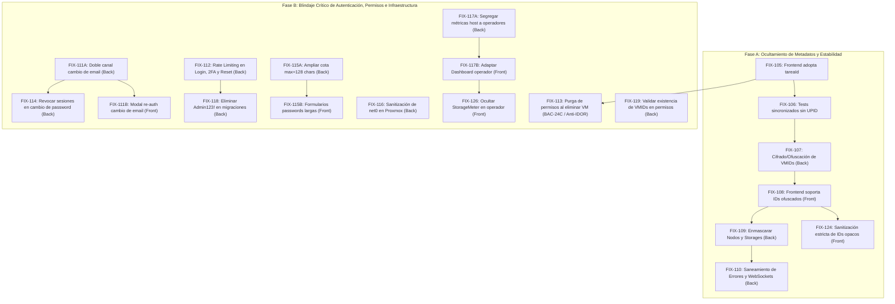

# Etapa 2: correcciones pendientes (FIX)

Acá se listan los fixes y mejoras de seguridad correspondientes a las tareas implementadas para la Etapa 2 y la protección integral del sistema contra fugas de información interna de infraestructura.

---

## 🛡️ Análisis de Seguridad y Modelo de Amenazas (19/10/2026)

### Diagnóstico de Vulnerabilidad de Infraestructura
En sistemas que gestionan hipervisores de virtualización como **Proxmox VE**, exponer identificadores crudos hacia el cliente web representa una vulnerabilidad de **Information Disclosure (CWE-200)** y facilita ataques de **IDOR / Enumeración Secuencial (CWE-639)**:

1. **UPID de Proxmox (`UPID:<node>:<pid>:<pstart>:<starttime>:<type>:<vmid>:<user>:<comment>`):**
   - **Riesgo:** Expone directamente el nombre del nodo host del servidor, el PID del proceso en el kernel de Linux del hipervisor, el identificador hexadecimal del inicio del proceso y el usuario interno del sistema operativo (`root@pam` o API tokens).
   - **Decisión arquitectónica (Opción A):** El uso de un **Identificador Opaco (`tareaId` UUIDv4)** es el estándar de máxima seguridad (*Air-Gap de metadatos*). El cliente solo conoce un UUID aleatorio que no tiene relación matemática con Proxmox. El mapeo real reside en la base de datos interna (`tareas_asincronas.upid_proxmox`). Si el frontend es interceptado, el atacante no obtiene ninguna información del servidor subyacente.

2. **VMID de Instancia (`vmid`: 100, 101, 102...):**
   - **Riesgo:** Los números enteros secuenciales permiten a un atacante adivinar la existencia de otras máquinas, estimar la cantidad de cargas de trabajo y ejecutar ataques de fuerza bruta en rutas REST (`/instances/102`, etc.) si un guard de autorización presentara una falla lógica.
   - **Remediación:** Cifrado / Ofuscación reversible de IDs (mediante algoritmo simétrico o Hashids con salt criptográfico en backend) para que el frontend maneje tokens opacos (`inst_9kX2mB`) y no números enteros predecibles.

3. **Topología de Nodos y Almacenamiento:**
   - **Riesgo:** Exponer nombres reales de host (`pve-01`, `proxmox`) y pools de disco (`local-lvm`, rutas `/dev/...`) revela la arquitectura de red y almacenamiento del host anfitrión.

---

## 🛠️ Plan de Fixes Atómicos (Desglose Paso a Paso)

A continuación se detallan los fixes ordenados de forma secuencial y atómica para implementarse uno a la vez sin romper la integración:

---

---

## 🔐 Blindaje de Seguridad, Control de Acceso y Hardening de Autenticación (Fixes de Auditoría)

Las siguientes tareas corrigen de forma estructurada las vulnerabilidades de autorización, persistencia de permisos, secuestro de cuentas, inyección de configuración y fuerza bruta identificadas en la auditoría de seguridad del código.

---

## 🛠️ Fixes detectados en la verificación del 21/10/2026 (Etapa 2)

Verificados contra frontend `b0a7105` y backend `a25d1b3`.

---

> [!NOTE]
> **Verificación del 22/10/2026 — retirados de este listado:** `FIX-120` y `FIX-121` no eran defectos del
> submódulo `frontend`, sino expectativas desactualizadas de `test/front/frn-24-25-create-wizard.test.tsx`:
> - El wizard implementado tiene **5 pasos** (`General`, `Recursos`, `Red`, `Sistema operativo`, `Resumen`)
>   y exige nombre en el paso 1; la prueba asumía 4 pasos y no completaba el nombre, por lo que nunca
>   llegaba al paso de recursos.
> - Los mocks simulaban las respuestas **crudas de Proxmox** (`{ storage, avail, content }`,
>   `{ volid, content }`), pero el contrato real de `GET /api/node/storages` y `GET /api/node/templates`
>   responde `[{ name, type, freeBytes, totalBytes, contentTypes }]` y
>   `[{ id, name, type: ISO|LXC_TEMPLATE, sizeBytes }]` respectivamente.
>
> La implementación ya cumple los criterios: medidores reactivos de cuota, bloqueo del avance al superar
> el 100%, selección de storage, filtrado estricto ISO vs `vztmpl`, validación de red estática y habilitación
> de "Crear Instancia" solo con confirmación. La prueba se reescribió sobre el contrato y el flujo reales
> (11/11 en verde). `FIX-123` permanece por ser una tarea de infraestructura sobre Proxmox físico.

---

## 📋 Resumen del Flujo de Ejecución Recomendado

