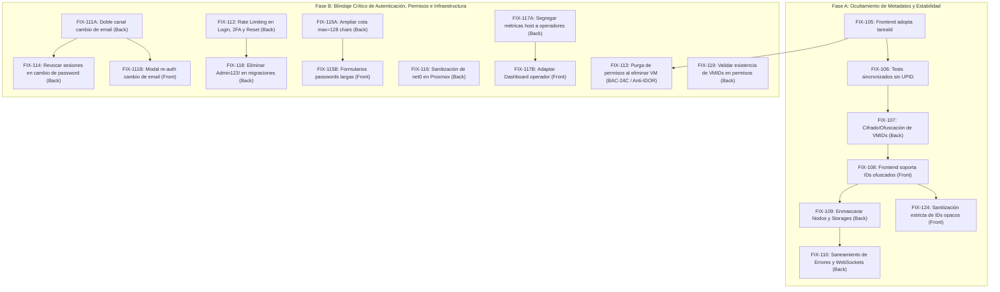

# Etapa 2: correcciones pendientes (FIX)

Acá se listan los fixes y mejoras de seguridad correspondientes a las tareas implementadas para la Etapa 2 y la protección integral del sistema contra fugas de información interna de infraestructura.

---

## 🛡️ Análisis de Seguridad y Modelo de Amenazas (19/10/2026)

### Diagnóstico de Vulnerabilidad de Infraestructura
En sistemas que gestionan hipervisores de virtualización como **Proxmox VE**, exponer identificadores crudos hacia el cliente web representa una vulnerabilidad de **Information Disclosure (CWE-200)** y facilita ataques de **IDOR / Enumeración Secuencial (CWE-639)**:

1. **UPID de Proxmox (`UPID:<node>:<pid>:<pstart>:<starttime>:<type>:<vmid>:<user>:<comment>`):**
   - **Riesgo:** Expone directamente el nombre del nodo host del servidor, el PID del proceso en el kernel de Linux del hipervisor, el identificador hexadecimal del inicio del proceso y el usuario interno del sistema operativo (`root@pam` o API tokens).
   - **Decisión arquitectónica (Opción A):** El uso de un **Identificador Opaco (`tareaId` UUIDv4)** es el estándar de máxima seguridad (*Air-Gap de metadatos*). El cliente solo conoce un UUID aleatorio que no tiene relación matemática con Proxmox. El mapeo real reside en la base de datos interna (`tareas_asincronas.upid_proxmox`). Si el frontend es interceptado, el atacante no obtiene ninguna información del servidor subyacente.

2. **VMID de Instancia (`vmid`: 100, 101, 102...):**
   - **Riesgo:** Los números enteros secuenciales permiten a un atacante adivinar la existencia de otras máquinas, estimar la cantidad de cargas de trabajo y ejecutar ataques de fuerza bruta en rutas REST (`/instances/102`, etc.) si un guard de autorización presentara una falla lógica.
   - **Remediación:** Cifrado / Ofuscación reversible de IDs (mediante algoritmo simétrico o Hashids con salt criptográfico en backend) para que el frontend maneje tokens opacos (`inst_9kX2mB`) y no números enteros predecibles.

3. **Topología de Nodos y Almacenamiento:**
   - **Riesgo:** Exponer nombres reales de host (`pve-01`, `proxmox`) y pools de disco (`local-lvm`, rutas `/dev/...`) revela la arquitectura de red y almacenamiento del host anfitrión.

---

## 🛠️ Plan de Fixes Atómicos (Desglose Paso a Paso)

A continuación se detallan los fixes ordenados de forma secuencial y atómica para implementarse uno a la vez sin romper la integración:

---


---

## 🔐 Blindaje de Seguridad, Control de Acceso y Hardening de Autenticación (Fixes de Auditoría)

Las siguientes tareas corrigen de forma estructurada las vulnerabilidades de autorización, persistencia de permisos, secuestro de cuentas, inyección de configuración y fuerza bruta identificadas en la auditoría de seguridad del código.

---

## 🛠️ Fixes detectados en la verificación del 21/10/2026 (Etapa 2)

Verificados contra frontend `b0a7105` y backend `a25d1b3`.

---

> [!NOTE]
> **Verificación del 22/10/2026 — retirados de este listado:** `FIX-120` y `FIX-121` no eran defectos del
> submódulo `frontend`, sino expectativas desactualizadas de `test/front/frn-24-25-create-wizard.test.tsx`:
> - El wizard implementado tiene **5 pasos** (`General`, `Recursos`, `Red`, `Sistema operativo`, `Resumen`)
>   y exige nombre en el paso 1; la prueba asumía 4 pasos y no completaba el nombre, por lo que nunca
>   llegaba al paso de recursos.
> - Los mocks simulaban las respuestas **crudas de Proxmox** (`{ storage, avail, content }`,
>   `{ volid, content }`), pero el contrato real de `GET /api/node/storages` y `GET /api/node/templates`
>   responde `[{ name, type, freeBytes, totalBytes, contentTypes }]` y
>   `[{ id, name, type: ISO|LXC_TEMPLATE, sizeBytes }]` respectivamente.
>
> La implementación ya cumple los criterios: medidores reactivos de cuota, bloqueo del avance al superar
> el 100%, selección de storage, filtrado estricto ISO vs `vztmpl`, validación de red estática y habilitación
> de "Crear Instancia" solo con confirmación. La prueba se reescribió sobre el contrato y el flujo reales
> (11/11 en verde). `FIX-123` permanece por ser una tarea de infraestructura sobre Proxmox físico.


### `FIX-123` - Descarga y verificación de disponibilidad de plantillas LXC e ISOs en Proxmox físico (`INF-10`) (Infraestructura)

- **Área:** Infraestructura
- **Asignado:** Nico / Lucas
- **Estimación:** 1.5 h
- **Depende de:** `INF-10` (en `terminado2.md`).
- **Problema técnico detallado:**
  El servidor Proxmox VE real requiere la presencia verificada de imágenes base en los almacenamientos `local:vztmpl` (ej. Alpine/Debian) y `local:iso` con permisos de lectura en el API Token para que el aprovisionamiento de máquinas virtuales y contenedores opere sin errores de almacenamiento inexistente.
- **Qué debe hacer el equipo de infraestructura:**
  1. Descargar o verificar la plantilla LXC liviana oficial en `local:vztmpl`.
  2. Verificar una imagen ISO en `local:iso`.
  3. Comprobar que `GET /storage/{storage}/content` con el API Token liste ambos recursos.
- **Criterio de éxito:** `GET /api/node/templates` responde con el catálogo real sin errores de permisos.


### `FIX-124` - Sanitización estricta de identificadores opacos de instancia en Frontend (FIX-108) (Frontend)

- **Área:** Frontend
- **Asignado:** Belinda / Cristian
- **Estimación:** 1.0 h
- **Depende de:** `FIX-108` (en `terminado2.md`).
- **Problema técnico detallado:**
  En la implementación de `FIX-108` (frontend `d4e99b2`), la función `validateInstanceRef` en `src/components/features/instances/services/instanceService.ts:12-16` solo ejecuta un recorte de espacios en blanco (`ref.trim()`) cuando recibe un `string`, omitiendo validar contra la expresión regular de identificadores seguros `/^[a-zA-Z0-9_-]+$/`. Como consecuencia, permite entradas hostiles como secuencias de path traversal (`../admin/users`), inyección de parámetros (`?force=1`), separadores de ruta (`inst/1`), punto y coma (`inst_1;rm`), espacios internos (`inst abc`) o saltos de línea (`inst_1\nX`). Adicionalmente, en `src/pages/InstanceDetailPage.tsx:18` persiste una conversión residual `Number(instanceReference)` que infringe la restricción de manipular identificadores opacos exclusivamente como cadenas de texto.
- **Qué debe hacer el equipo de frontend:**
  1. En `src/components/features/instances/services/instanceService.ts`:
     - Restringir la validación de referencias de instancia en `validateInstanceRef` contra `/^[a-zA-Z0-9_-]+$/`:
       ```typescript
       const OPAQUE_ID_REGEX = /^[a-zA-Z0-9_-]+$/;
       function validateInstanceRef(ref: unknown): InstanceRef {
         if (typeof ref === 'string') {
           const trimmed = ref.trim();
           if (trimmed && OPAQUE_ID_REGEX.test(trimmed)) return trimmed;
         }
         if (typeof ref === 'number' && Number.isSafeInteger(ref) && ref > 0) return ref;
         throw new ApiRequestError('La instancia no tiene una referencia válida.');
       }
       ```
  2. En `src/pages/InstanceDetailPage.tsx`:
     - Eliminar la conversión residual `Number(instanceReference)` y validar la referencia directamente sin forzar conversiones numéricas con `Number(...)` o `parseInt(...)` sobre parámetros de ruta.
  3. Ejecutar y certificar la suite de pruebas `test/front/fix-108-ids-ofuscados.test.tsx`.
- **Criterio de éxito:**
  - Todas las entradas maliciosas o malformadas son rechazadas localmente en `instanceService.ts` antes de despachar solicitudes de red.
  - La suite `test/front/fix-108-ids-ofuscados.test.tsx` pasa 11 de 11 pruebas en verde (100% ✅).


### `FIX-108` - Adaptación del Frontend para consumo de identificadores de instancia ofuscados (Frontend)

> [!WARNING]
> **Estado verificado (24/10/2026, frontend `d4e99b2`): implementada con fallas de validación de entrada.** El frontend adoptó el identificador de instancia como `string | number` (`id: string | number`), y los servicios y rutas despachan hacia `/instances/:instanceRef`. Sin embargo, `validateInstanceRef` en `instanceService.ts` solo realiza un recorte de espacios (`ref.trim()`) y no valida contra `/^[a-zA-Z0-9_-]+$/`, permitiendo path traversal, caracteres hostiles y espacios. Corrección y seguimiento abierto en **`FIX-124`** ([futuro2.md](futuro2.md)). La suite `test/front/fix-108-ids-ofuscados.test.tsx` pasa 5 de 11 pruebas (6 fallidas).

- **Área:** Frontend
- **Asignado:** Belinda / Cristian
- **Estimación:** 1,5 h
- **Depende de:** `FIX-107`.
- **Problema:** El frontend modelaba el identificador de instancia estrictamente como un número entero (`vmid: number` e `id: number` en `InventoryInstance`), validándolo con `Number.isSafeInteger(vmid) && vmid > 0`. Al migrar el backend hacia identificadores opacos/cifrados no secuenciales (ej. `"inst_k8Pq2v"`), el frontend rechazaba las respuestas con errores de validación de esquema en `instanceService.ts`.
- **Entregables:**
  1. En `instance.ts`: actualizar `InventoryInstance` para que `id` admita `string | number` y definir el tipo `InstanceRef`.
  2. En `instanceService.ts`: flexibilizar la validación para admitir identificadores de instancia alfanuméricos y enteros legados.
  3. En rutas y componentes: asegurar navegación `/instances/:instanceRef` sin conversiones destructivas a entero.
- **Criterio de éxito:** La tabla de instancias renderiza identificadores opacos y las operaciones de ciclo de vida despachan la referencia en la URL sin conversiones numéricas destructivas. Los defectos de sanitización estricta quedan derivados a `FIX-124`.

---

## 📋 Resumen del Flujo de Ejecución Recomendado



