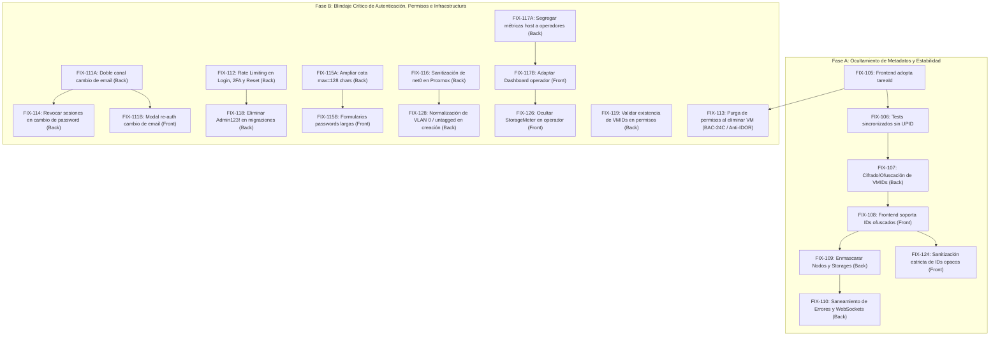

# Etapa 2: correcciones pendientes (FIX)

Acá se listan los fixes y mejoras de seguridad correspondientes a las tareas implementadas para la Etapa 2 y la protección integral del sistema contra fugas de información interna de infraestructura.

---

## 🛡️ Análisis de Seguridad y Modelo de Amenazas (19/10/2026)

### Diagnóstico de Vulnerabilidad de Infraestructura
En sistemas que gestionan hipervisores de virtualización como **Proxmox VE**, exponer identificadores crudos hacia el cliente web representa una vulnerabilidad de **Information Disclosure (CWE-200)** y facilita ataques de **IDOR / Enumeración Secuencial (CWE-639)**:

1. **UPID de Proxmox (`UPID:<node>:<pid>:<pstart>:<starttime>:<type>:<vmid>:<user>:<comment>`):**
   - **Riesgo:** Expone directamente el nombre del nodo host del servidor, el PID del proceso en el kernel de Linux del hipervisor, el identificador hexadecimal del inicio del proceso y el usuario interno del sistema operativo (`root@pam` o API tokens).
   - **Decisión arquitectónica (Opción A):** El uso de un **Identificador Opaco (`tareaId` UUIDv4)** es el estándar de máxima seguridad (*Air-Gap de metadatos*). El cliente solo conoce un UUID aleatorio que no tiene relación matemática con Proxmox. El mapeo real reside en la base de datos interna (`tareas_asincronas.upid_proxmox`). Si el frontend es interceptado, el atacante no obtiene ninguna información del servidor subyacente.

2. **VMID de Instancia (`vmid`: 100, 101, 102...):**
   - **Riesgo:** Los números enteros secuenciales permiten a un atacante adivinar la existencia de otras máquinas, estimar la cantidad de cargas de trabajo y ejecutar ataques de fuerza bruta en rutas REST (`/instances/102`, etc.) si un guard de autorización presentara una falla lógica.
   - **Remediación:** Cifrado / Ofuscación reversible de IDs (mediante algoritmo simétrico o Hashids con salt criptográfico en backend) para que el frontend maneje tokens opacos (`inst_9kX2mB`) y no números enteros predecibles.

3. **Topología de Nodos y Almacenamiento:**
   - **Riesgo:** Exponer nombres reales de host (`pve-01`, `proxmox`) y pools de disco (`local-lvm`, rutas `/dev/...`) revela la arquitectura de red y almacenamiento del host anfitrión.

---

## 🛠️ Plan de Fixes Atómicos (Desglose Paso a Paso)

A continuación se detallan los fixes ordenados de forma secuencial y atómica para implementarse uno a la vez sin romper la integración:

---


---

## 🔐 Blindaje de Seguridad, Control de Acceso y Hardening de Autenticación (Fixes de Auditoría)

Las siguientes tareas corrigen de forma estructurada las vulnerabilidades de autorización, persistencia de permisos, secuestro de cuentas, inyección de configuración y fuerza bruta identificadas en la auditoría de seguridad del código.

---

## 🛠️ Fixes detectados en la verificación del 21/10/2026 (Etapa 2)

Verificados contra frontend `b0a7105` y backend `a25d1b3`.

---

> [!NOTE]
> **Verificación del 22/10/2026 — retirados de este listado:** `FIX-120` y `FIX-121` no eran defectos del
> submódulo `frontend`, sino expectativas desactualizadas de `test/front/frn-24-25-create-wizard.test.tsx`:
> - El wizard implementado tiene **5 pasos** (`General`, `Recursos`, `Red`, `Sistema operativo`, `Resumen`)
>   y exige nombre en el paso 1; la prueba asumía 4 pasos y no completaba el nombre, por lo que nunca
>   llegaba al paso de recursos.
> - Los mocks simulaban las respuestas **crudas de Proxmox** (`{ storage, avail, content }`,
>   `{ volid, content }`), pero el contrato real de `GET /api/node/storages` y `GET /api/node/templates`
>   responde `[{ name, type, freeBytes, totalBytes, contentTypes }]` y
>   `[{ id, name, type: ISO|LXC_TEMPLATE, sizeBytes }]` respectivamente.
>
> La implementación ya cumple los criterios: medidores reactivos de cuota, bloqueo del avance al superar
> el 100%, selección de storage, filtrado estricto ISO vs `vztmpl`, validación de red estática y habilitación
> de "Crear Instancia" solo con confirmación. La prueba se reescribió sobre el contrato y el flujo reales
> (11/11 en verde). `FIX-123` permanece por ser una tarea de infraestructura sobre Proxmox físico.


---

## 📋 Resumen del Flujo de Ejecución Recomendado



---

## 🛠️ Especificación Detallada de Fixes Pendientes (Etapa 2)

---

### `FIX-141` - Actualización de mocks de `@/context/EventsContext` (`useOptionalEventsContext`) en tests unitarios internos del submódulo `frontend` (`FIX-127`) (Testing Frontend)

- **Área:** Frontend (Tests internos del submódulo)
- **Asignado:** Cristian / Luz
- **Estimación:** 0.25 h
- **Depende de:** `FIX-127`, `FRN-29`.
- **Nota de diagnóstico:** La implementación de producto de `FIX-127` en `EventsContext.tsx`, `SnapshotsTabContent.tsx` e `InstanceDetailPage.tsx` **está bien implementada** y pasa las pruebas de aceptación (`test/front/etapa3-pendientes.test.tsx` 3/3 ✅ y `test/front/instance-detail.test.tsx` 3/3 ✅). El fallo ocurre únicamente en 2 archivos de test internos del submódulo `frontend/centinela/src/test/`.
- **Tests internos del submódulo que fallan actualmente:**
  - `frontend/centinela/src/test/snapshots.test.tsx` (4/4 fallan con `Error: [vitest] No "useOptionalEventsContext" export is defined on the "@/context/EventsContext" mock`)
  - `frontend/centinela/src/test/instance-transient-states.test.tsx` (1/5 falla con `Error: [vitest] No "useOptionalEventsContext" export is defined on the "@/context/EventsContext" mock`)
- **Problema técnico detallado (Por qué fallan los tests del submódulo):**
  En el commit `14db393` (`FIX-127`), `frontend/centinela/src/components/features/instances/components/detail/SnapshotsTabContent.tsx:69` reemplazó `useEventsContext()` por `useOptionalEventsContext()`. Sin embargo, los mocks manuales `vi.mock('@/context/EventsContext', ...)` definidos en `frontend/centinela/src/test/snapshots.test.tsx:15-17` y `frontend/centinela/src/test/instance-transient-states.test.tsx:15-18` quedaron con la exportación vieja (`useEventsContext`) sin exportar `useOptionalEventsContext`.
- **Solución técnica paso a paso:**
  En `frontend/centinela/src/test/snapshots.test.tsx:15-17` y `frontend/centinela/src/test/instance-transient-states.test.tsx:15-18`, agregar `useOptionalEventsContext` al objeto devuelto por `vi.mock('@/context/EventsContext')`:
  ```ts
  vi.mock('@/context/EventsContext', () => ({
      useEventsContext: () => ({ ultimoMensaje: null }),
      useOptionalEventsContext: () => ({ ultimoMensaje: null }),
      useEventSubscription: () => {},
  }));
  ```
- **Criterio de éxito:**
  - `frontend/centinela/src/test/snapshots.test.tsx` (4/4) y `frontend/centinela/src/test/instance-transient-states.test.tsx` (5/5) pasan al 100% en verde.

---

### `FIX-142` - Restauración de `FRN-22` (`useInstanceMetrics`, `getWsTicket`, `metricsWebSocket`) revertida en `4f743e4` e integración de pestaña `"Métricas"`, modo `"En vivo"` y gráfico de Red en `FRN-23` (Frontend)

- **Área:** Frontend
- **Asignado:** Luz / Cristian / Belinda
- **Estimación:** 2.5 h
- **Depende de:** `FRN-21`, `FRN-22`, `FRN-23`, `BAC-35`, `BAC-36`.
- **Tests que fallan actualmente:**
  - `test/front/frn-22-use-instance-metrics.test.tsx` (5/5 fallan: `no hay un servicio exportado getWsTicket() en el frontend`, `no existe el hook useInstanceMetrics en el frontend (FRN-22)`)
  - `test/front/frn-23-metrics-charts.test.tsx` (7/7 fallan: `la vista de detalle no tiene la pestaña "Métricas"`)
- **Problema técnico detallado (Por qué fallan los tests):**
  1. **Reversión de `FRN-22` en `origin/main` (`4f743e4`):** La tarea `FRN-22` fue implementada originalmente en el commit `60833b3` (`🌱 feat(instances):se implementa telemetría en tiempo real de instancias.`) y pasada a `terminado2.md`. Sin embargo, en el commit `4f743e4` (`Revert "🌱 feat(instances):se implementa telemetría en tiempo real de instancias."`) se eliminaron por completo del árbol `src/` los 5 archivos de la tarea:
     - `src/components/features/instances/metrics/metrics.types.ts`
     - `src/components/features/instances/metrics/metricsService.ts` (`getWsTicket()`)
     - `src/components/features/instances/metrics/metricsWebSocket.ts`
     - `src/components/features/instances/metrics/useInstanceMetrics.ts` (`useInstanceMetrics(vmid)`)
     - `src/test/instance-metrics.test.tsx`
     Como consecuencia, `useInstanceMetrics` y `getWsTicket` no existen actualmente en `origin/main` (`877eddd`).
  2. **Incumplimiento de entregables de `FRN-23` en `InstanceDetailContent.tsx` e `InstanceResourceUsage.tsx`:**
     - En `frontend/centinela/src/components/features/instances/components/detail/InstanceDetailContent.tsx:116-120`, las pestañas se nombraron `"Resumen"`, `"Recursos"`, `"Red"` y `"Snapshots"`, omitiendo la pestaña **`"Métricas"`** exigida por `FRN-21` y `FRN-23` (`test/front/frn-23-metrics-charts.test.tsx:118`).
     - En `frontend/centinela/src/components/features/instances/components/detail/InstanceResourceUsage.tsx:19-22`, el selector de rango (`timeframeOptions`) solo ofrece `'2h'` (`"Últimas 2 horas"`) y `'24h'` (`"Últimas 24 horas"`), omitiendo la opción **`"En vivo"`** conectada al WebSocket de `useInstanceMetrics` (`FRN-23` entregable 2).
     - En `InstanceResourceUsage.tsx:28-57`, solo se grafican 3 métricas (`CPU`, `Memoria`, `Disco`), omitiendo el gráfico de **Tráfico de Red (`netInBps` / `netOutBps`)** (`FRN-23` entregable 1 y `FIX-131`).
     - Cuando la instancia está detenida (`detail.status === 'stopped'` o muestras con `cpuPercent: null` y `ramUsedBytes: null`), `InstanceResourceUsage.tsx` no muestra el estado vacío explícito **`"Instancia detenida"`** (`FRN-23` entregable 5).
- **Solución técnica paso a paso:**
  1. Restaurar desde el commit `60833b3` (o `01c1567`) los módulos `metrics.types.ts`, `metricsService.ts` (exportando `getWsTicket()` que invoca `POST /auth/ws-ticket`), `metricsWebSocket.ts`, `useInstanceMetrics.ts` y `src/test/instance-metrics.test.tsx`, adaptándolos para aceptar `InstanceRef` (`string | number`) sin convertir IDs opacos a `Number`.
  2. En `InstanceDetailContent.tsx:116-120`, exponer la pestaña `"Métricas"` (o incluir `"Métricas"` en el nombre accesible / pestaña dedicada que renderice `InstanceResourceUsage`).
  3. En `InstanceResourceUsage.tsx` y `useInstanceDetail.ts`:
     - Añadir la opción `{ value: 'live', label: 'En vivo' }` en `timeframeOptions`, consumiendo `useInstanceMetrics(detail.reference)` cuando `timeframe === 'live'` y `GET /api/instances/:ref/metrics?timeframe=2h|24h` en los modos históricos.
     - Incorporar la 4.ª tarjeta/gráfico de **Tráfico de red** (`netInBps` / `netOutBps` formateados en `KB/s` o `MB/s`).
     - Mostrar el aviso `"Instancia detenida"` cuando `detail.status === 'stopped'` o todos los puntos de CPU/RAM sean `null`, sin producir `NaN` ni invocar `.toFixed()` sobre `null`.
- **Criterio de éxito:**
  - `test/front/frn-22-use-instance-metrics.test.tsx` (5/5) pasa al 100% en verde.
  - `test/front/frn-23-metrics-charts.test.tsx` (7/7) pasa al 100% en verde.

