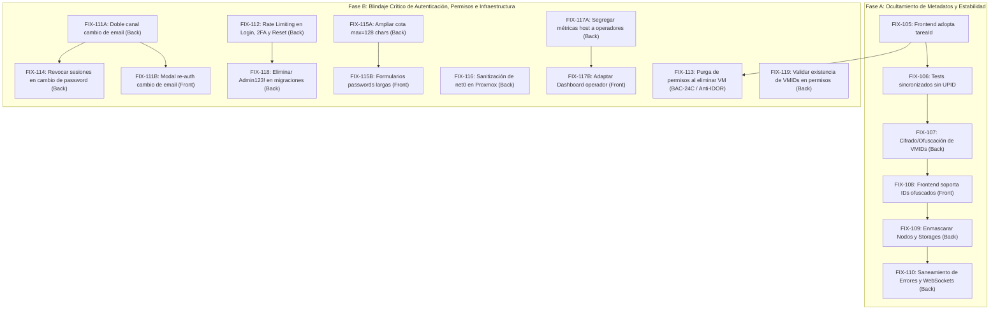

# Etapa 2: correcciones pendientes (FIX)

Acá se listan los fixes y mejoras de seguridad correspondientes a las tareas implementadas para la Etapa 2 y la protección integral del sistema contra fugas de información interna de infraestructura.

---

## 🛡️ Análisis de Seguridad y Modelo de Amenazas (19/10/2026)

### Diagnóstico de Vulnerabilidad de Infraestructura
En sistemas que gestionan hipervisores de virtualización como **Proxmox VE**, exponer identificadores crudos hacia el cliente web representa una vulnerabilidad de **Information Disclosure (CWE-200)** y facilita ataques de **IDOR / Enumeración Secuencial (CWE-639)**:

1. **UPID de Proxmox (`UPID:<node>:<pid>:<pstart>:<starttime>:<type>:<vmid>:<user>:<comment>`):**
   - **Riesgo:** Expone directamente el nombre del nodo host del servidor, el PID del proceso en el kernel de Linux del hipervisor, el identificador hexadecimal del inicio del proceso y el usuario interno del sistema operativo (`root@pam` o API tokens).
   - **Decisión arquitectónica (Opción A):** El uso de un **Identificador Opaco (`tareaId` UUIDv4)** es el estándar de máxima seguridad (*Air-Gap de metadatos*). El cliente solo conoce un UUID aleatorio que no tiene relación matemática con Proxmox. El mapeo real reside en la base de datos interna (`tareas_asincronas.upid_proxmox`). Si el frontend es interceptado, el atacante no obtiene ninguna información del servidor subyacente.

2. **VMID de Instancia (`vmid`: 100, 101, 102...):**
   - **Riesgo:** Los números enteros secuenciales permiten a un atacante adivinar la existencia de otras máquinas, estimar la cantidad de cargas de trabajo y ejecutar ataques de fuerza bruta en rutas REST (`/instances/102`, etc.) si un guard de autorización presentara una falla lógica.
   - **Remediación:** Cifrado / Ofuscación reversible de IDs (mediante algoritmo simétrico o Hashids con salt criptográfico en backend) para que el frontend maneje tokens opacos (`inst_9kX2mB`) y no números enteros predecibles.

3. **Topología de Nodos y Almacenamiento:**
   - **Riesgo:** Exponer nombres reales de host (`pve-01`, `proxmox`) y pools de disco (`local-lvm`, rutas `/dev/...`) revela la arquitectura de red y almacenamiento del host anfitrión.

---

## 🛠️ Plan de Fixes Atómicos (Desglose Paso a Paso)

A continuación se detallan los fixes ordenados de forma secuencial y atómica para implementarse uno a la vez sin romper la integración:

---

---

## 🔐 Blindaje de Seguridad, Control de Acceso y Hardening de Autenticación (Fixes de Auditoría)

Las siguientes tareas corrigen de forma estructurada las vulnerabilidades de autorización, persistencia de permisos, secuestro de cuentas, inyección de configuración y fuerza bruta identificadas en la auditoría de seguridad del código.

---

## 🛠️ Fixes detectados en la verificación del 21/10/2026 (Etapa 2)

Verificados contra frontend `b0a7105` y backend `a25d1b3`.

---

### `FIX-120` - Corrección de controles de recursos y medidor reactivo de cuotas en Wizard (`FRN-24`) (Frontend)

- **Área:** Frontend
- **Asignado:** Belinda
- **Estimación:** 1.5 h
- **Depende de:** `FRN-24` (en `terminado2.md`).
- **Problema técnico detallado:**
  En los componentes de `createNewInstances` (`configureInstanceResources.tsx`), los sliders de vCPU, RAM y disco no sincronizan adecuadamente las restricciones con la capacidad libre del nodo ni bloquean el botón "Siguiente" hacia el Paso 3 cuando el valor solicitado excede el almacenamiento o la memoria disponible, provocando fallos en la suite `test/front/frn-24-25-create-wizard.test.tsx`.
- **Qué debe hacer el equipo de frontend:**
  1. En `configureInstanceResources.tsx`, vincular los límites y la barra reactiva de cuotas contra los valores de memoria libre y almacenamiento libre de `useCreationNodeStatus`.
  2. Deshabilitar el avance al Paso 3 si la memoria o el disco exceden la capacidad disponible.
  3. Asegurar que las tarjetas de Máquina Virtual (QEMU) y Contenedor (LXC) del Paso 1 expongan sus atributos y roles accesibles esperados.
- **Criterio de éxito:** `test/front/frn-24-25-create-wizard.test.tsx` pasa las pruebas correspondientes a `FRN-24` al 100% en verde.

### `FIX-121` - Corrección de selección de Storages, Templates/ISOs y ficha de Resumen en Wizard (`FRN-25`) (Frontend)

- **Área:** Frontend
- **Asignado:** Luz
- **Estimación:** 1.5 h
- **Depende de:** `FRN-25` (en `terminado2.md`).
- **Problema técnico detallado:**
  En `selectInstanceOperatingSystem.tsx` y `reviewInstanceConfiguration.tsx`, el selector de plantillas e ISOs no filtra correctamente según el tipo de instancia (ISOs para VM vs plantillas LXC `vztmpl` para contenedores) con los selectores accesibles esperados, y el switch de red IP fija / DHCP no valida el conjunto completo de IP, máscara y gateway antes de habilitar el botón "Crear Instancia".
- **Qué debe hacer el equipo de frontend:**
  1. En `selectInstanceOperatingSystem.tsx`, filtrar estrictamente `content === 'vztmpl'` para LXC y `content === 'iso'` para VMs desde `GET /api/node/templates`.
  2. En la configuración de red, validar formato CIDR y gateway válido ante IP estática.
  3. En `reviewInstanceConfiguration.tsx`, habilitar el botón "Crear Instancia" únicamente con todos los parámetros validados.
- **Criterio de éxito:** `test/front/frn-24-25-create-wizard.test.tsx` pasa las pruebas correspondientes a `FRN-25` al 100% en verde.

### `FIX-123` - Descarga y verificación de disponibilidad de plantillas LXC e ISOs en Proxmox físico (`INF-10`) (Infraestructura)

- **Área:** Infraestructura
- **Asignado:** Nico / Lucas
- **Estimación:** 1.5 h
- **Depende de:** `INF-10` (en `terminado2.md`).
- **Problema técnico detallado:**
  El servidor Proxmox VE real requiere la presencia verificada de imágenes base en los almacenamientos `local:vztmpl` (ej. Alpine/Debian) y `local:iso` con permisos de lectura en el API Token para que el aprovisionamiento de máquinas virtuales y contenedores opere sin errores de almacenamiento inexistente.
- **Qué debe hacer el equipo de infraestructura:**
  1. Descargar o verificar la plantilla LXC liviana oficial en `local:vztmpl`.
  2. Verificar una imagen ISO en `local:iso`.
  3. Comprobar que `GET /storage/{storage}/content` con el API Token liste ambos recursos.
- **Criterio de éxito:** `GET /api/node/templates` responde con el catálogo real sin errores de permisos.

---

## 📋 Resumen del Flujo de Ejecución Recomendado

