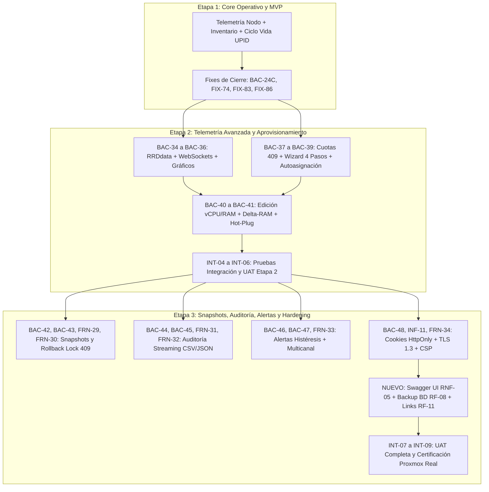

# Plan Maestro: Siguientes Etapas y Mapa de Cobertura de Requerimientos

> **Documento rector del roadmap:** Este archivo consolida la planificación ejecutiva de las etapas operativas, sincronizado con las especificaciones técnicas detalladas de [`etapa1.md`](etapa1.md), [`etapa2.md`](etapa2.md) y [`etapa3.md`](etapa3.md), y auditado contra los requerimientos formales de [`requerimientos.md`](requerimientos.md) y [`centinela.md`](centinela.md).

---

## 1. Matriz Integral de Cobertura del Proyecto

Evaluación del 100% de los requerimientos funcionales y no funcionales frente al estado histórico (`terminado.md`, `terminado-1.md`), el trabajo en curso (`actual.md`, `etapa1.md`, `etapa2.md`) y el backlog planificado (`siguientesetapas.md`, `etapa3.md`):

| Requerimiento | Descripción | Estado de Cobertura | Ubicación / Tareas Clave |
|---|---|:---:|---|
| **RF-01** | Autenticación y Control de Acceso (JWT, RBAC `ADMIN`/`OPERATOR`, 2FA TOTP con QR y secreto manual) | ✅ **100% Cubierto** | `terminado.md` (`BAC-01` a `BAC-04`, `BAC-08` a `BAC-10`, `LOGIN-01` a `LOGIN-04`). Revinculación/reset de 2FA asistido por Admin (`BAC-13`, `FIX-19`). Hardening con cookies `HttpOnly` en `etapa3.md` (`BAC-48`, `FRN-34`). |
| **RF-02** | Dashboard de Estado del Nodo Host (CPU %, núcleos, RAM, Disco, Uptime, conteo VMs/LXC, semáforo, caché Redis) | ✅ **100% Cubierto** | `terminado-1.md` (`BAC-22`, `FRN-19A`), `actual.md` (`FRN-19C`, `FIX-78`, `FIX-83`), `etapa1.md`. |
| **RF-03** | Inventario Unificado de Instancias (VMs/LXC, IP QEMU Agent, CPU/RAM, filtros dinámicos, RBAC estricto) | ✅ **100% Cubierto** | `terminado-1.md` (`BAC-23A`, `FRN-20A`), `actual.md` (`FRN-20C`, `FIX-43`, `FIX-63`), `etapa1.md`. |
| **RF-04** | Ciclo de Vida de Instancias (Start, Shutdown, Stop, Reboot, Delete, modales antierror, worker UPID, bloqueo mutuo) | ✅ **100% Cubierto** | `terminado-1.md` (`BAC-25A`, `BAC-29`), `actual.md` (`BAC-24C`, `FRN-15`, `FRN-16`, `FRN-17B`), `etapa1.md`. |
| **RF-05** | Monitor de Métricas por Instancia (WebSocket en vivo, RRDdata, CPU/RAM/Red/Disco, histórico 2h/24h) | ✅ **100% Cubierto** | `actual.md` (`BAC-34`, `BAC-35`), `etapa2.md` (`BAC-36`, `FRN-22`, `FRN-23`). |
| **RF-06** | Gestión de Snapshots (Crear, listar, eliminar, rollback destructivo con tipeo de seguridad, lock `409 INSTANCE_BUSY`) | ✅ **100% Cubierto** | `etapa3.md` (`BAC-42`, `BAC-43`, `FRN-29`, `FRN-30`). |
| **RF-07** | Asistente de Creación de Instancias (Wizard 4 pasos VM/LXC, validación transaccional de cuotas, error 409, autoasignación) | ✅ **100% Cubierto** | `actual.md` (`BAC-33`, `BAC-37`, `BAC-38`, `INF-10`), `etapa2.md` (`BAC-39`, `FRN-24` a `FRN-26`). |
| **RF-08** | Registro de Auditoría Inmutable (Append-only en `auditoria`, particionado por fecha, filtros combinados, exportación streaming CSV/JSON) | ✅ **100% Cubierto** | `terminado.md` (`BAC-18`), `etapa2.md` (`BAC-41`), `etapa3.md` (`BAC-44`, `BAC-45`, `FRN-31`, `FRN-32`). |
| **RF-09** | Gestión de Usuarios y Permisos (CRUD usuarios, roles, permisos por instancia `FULL_ACCESS`/`READ_ONLY`, clave temporal y reset) | ✅ **100% Cubierto** | `terminado.md` (`BAC-06`, `BAC-07`, `BAC-10`, `BAC-15`, `FRN-05` a `FRN-07`, `SEC-04`). |
| **RF-10** | Edición Dinámica de Recursos (vCPU y RAM, cálculo diferencial $\Delta\text{RAM}$, hot-plug vs reinicio) | ✅ **100% Cubierto** | `etapa2.md` (`BAC-40`, `FRN-27`, `FRN-28`). |
| **RF-11** | Notificaciones y Alertas (Toasts reactivos, `TASK_FINISHED`, alertas por saturación con histéresis, correo y enlace a `/instances/:vmid`) | ✅ **100% Cubierto** | `terminado.md`, `actual.md` (`BAC-26`, `FRN-21`), `etapa3.md` (`BAC-46`, `BAC-47`, `FRN-33`). |
| **RF-12** | Gestión de Organizaciones (Multi-tenant) | ⚠️ **Descartado del MVP** | Descarte formal acordado por el equipo (`futuro.md`). El sistema opera como **mono-organización**. |
| **RF-13** | Recuperación de Contraseña por Usuario (OTP de 6 dígitos al correo, validación con expiración e invalidación) | ✅ **100% Cubierto** | `terminado.md` (`BAC-16`, `BAC-17`, `FRN-12`, `FRN-13`). |
| **RNF-01** | Seguridad (Mínimo privilegio API Proxmox, bcrypt, cifrado AES-256 de secretos TOTP, cookies HttpOnly, Rate Limiting, TLS) | ✅ **100% Cubierto** | `terminado.md` (`BAC-02`, `BAC-10`), `etapa3.md` (`BAC-48`, `INF-11`). |
| **RNF-02** | Rendimiento (Respuestas $\le$ 5s, Go concurrente, caché Redis de telemetría y tickets, streaming HTTP en exportación) | ✅ **100% Cubierto** | `terminado-1.md` (`BAC-22`), `etapa2.md`, `etapa3.md` (`BAC-45`). |
| **RNF-03** | Usabilidad (UI moderna, abstracción de complejidad de Proxmox, catálogo D2 de errores amigables, modales antierror) | ✅ **100% Cubierto** | `terminado.md` (`FIX-08`), `actual.md` (`FIX-77`, `FIX-86`), `etapa2.md`, `etapa3.md`. |
| **RNF-04** | Confiabilidad (Tolerancia a caídas, UPID worker asíncrono, timeout 504 vs caído 502, auto-restart en Compose) | ✅ **100% Cubierto** | `terminado.md` (`FIX-40`), `terminado-1.md` (`BAC-25A`), `etapa1.md`, `etapa3.md`. |
| **RNF-05** | Mantenibilidad (Arquitectura hexagonal, código testeable, **Documentación interactiva Swagger UI / OpenAPI**) | 🔄 **Incorporado a Etapa 3** | Arquitectura cubierta; se formaliza la tarea de publicación interactiva de Swagger UI (`BAC-49` / `INF-12`). |
| **RNF-06** | Compatibilidad (Navegadores modernos, CORS restringido, proxy Nginx con upgrades WSS y SSE) | ✅ **100% Cubierto** | `terminado.md`, `etapa1.md` (`FIX-31`), `etapa3.md` (`INF-11`). |
| **RNF-07** | Escalabilidad (Soporte multi-nodo Proxmox) | ⚠️ **Postergado post-MVP** | Alcance del MVP limitado a un **nodo físico único** (`PROXMOX_NODE`). No bloquea la entrega. |
| **Exclusión** | Consola Remota Web (noVNC / xterm.js / SSH en navegador) | 🚫 **Exclusión de Seguridad** | Excluida formalmente en `requerimientos.md` y `centinela.md` para evitar vectores de ejecución remota. |

---

## 2. Decisiones de Alcance y Correcciones Arquitectónicas Clave

1. **Alineación del Servidor SMTP Real (`INF-08` / `BAC-16B` / `BAC-47`):**
   - Se revierte la mención obsoleta que descartaba SMTP. La entrega de correos opera mediante el puerto hexagonal `EmailService`.
   - En desarrollo/CI se utiliza `MockEmailService` (salida sanitizada por consola) para no depender de red externa.
   - En producción y etapa final se activa el adaptador real `SmtpEmailService` para credenciales temporales, recuperación de contraseñas (`RF-13`) y alertas críticas de saturación (`RF-11`).
2. **Modelo de Datos Definitivo (Sin Tablas Paralelas):**
   - La tabla oficial de auditoría es **`auditoria`**, estructurada como *append-only* y particionada trimestralmente por rango de fechas (`PARTITION BY RANGE (fecha_hora)`). No se debe crear ni referenciar `audit_logs`.
   - La tabla de asignación de instancias es **`permisos_instancia`** con los niveles `FULL_ACCESS` y `READ_ONLY`. No se debe crear ni referenciar `user_instances`.
   - Las tareas en segundo plano se registran exclusivamente en **`tareas_asincronas`**.
3. **Flujo de Revinculación de 2FA (`RF-01`):**
   - La recuperación o reseteo de 2FA ante pérdida del dispositivo autenticador se gestiona **exclusivamente mediante reseteo administrativo** (`POST /api/admin/users/:id/2fa/reset`), evitando endpoints públicos de auto-desvinculación que abrirían vectores de bypass de segundo factor.
4. **Navegación Contextual desde Alertas (`RF-11` / `FRN-21`):**
   - Todas las notificaciones en interfaz (Toasts de finalización de tareas, banners y centro de alertas) deben enlazar directamente a `/instances/:vmid`, permitiendo al operador auditar la máquina afectada con un solo clic.

---

## 3. Hoja de Ruta Consolidada: De la Etapa 1 al Cierre Final

---

### 🚀 ETAPA 1: Core Operativo de Proxmox y MVP (En fase de cierre)
*Detalle completo en [`etapa1.md`](etapa1.md) y seguimiento en [`actual.md`](actual.md).*

- **Requerimientos cubiertos:** `RF-02` (Dashboard Host), `RF-03` (Inventario completo), `RF-04` (Ciclo de Vida con UPID) y `RF-11` (parcial: `TASK_FINISHED`).
- **Estado:** Criterios principales validados en `terminado-1.md`. Se completan en `actual.md`:
  - `BAC-24C`: Purga de filas en `permisos_instancia` al eliminar máquinas para evitar herencia por reuso de VMID.
  - `BAC-26`: Validación exhaustiva del contrato de eventos para las 5 acciones de energía.
  - Cierre de fixes de UI y sincronización de tests (`FIX-74`, `FIX-76`, `FIX-79`, `FIX-81`, `FIX-83`, `FIX-85`, `FIX-86`, `FIX-87`).

---

### 📈 ETAPA 2: Telemetría Avanzada, Aprovisionamiento y Edición Dinámica
*Detalle completo en [`etapa2.md`](etapa2.md) y primeras tareas en [`actual.md`](actual.md).*

- **Requerimientos cubiertos:** `RF-05` (Telemetría e histórico), `RF-07` (Wizard de creación y cuotas), `RF-10` (Edición de recursos), `RF-08` (Auditoría de cambios).
- **Entregables Backend:**
  - `BAC-34`: Adaptador RRDdata de Proxmox para series temporales de vCPU, RAM, red (I/O) y disco.
  - `BAC-35`: Canal WebSocket `/api/ws/metrics/:vmid` con autenticación mediante tickets efímeros en Redis.
  - `BAC-36`: Endpoint REST `GET /api/instances/:vmid/metrics?timeframe=2h|24h`.
  - `BAC-33` y `BAC-37`: Servicio de cuotas asignables del host con validación atómica y rechazo `HTTP 409 Conflict` ante sobreaprovisionamiento o condiciones de carrera.
  - `BAC-38` y `BAC-39`: Endpoint `POST /api/instances`, worker de seguimiento de aprovisionamiento y autoasignación de permisos en `permisos_instancia`.
  - `BAC-40`: Endpoint `PUT /api/instances/:vmid/config` con cálculo de $\Delta\text{RAM}$ y detección de hot-plug.
  - `BAC-41`: Interceptor de auditoría para eventos `INSTANCE_CREATED`, `INSTANCE_CONFIG_UPDATED`.
- **Entregables Frontend:**
  - `FRN-21` / `FIX-95`: Vista Detalle de Instancia (`/instances/:vmid`) con pestañas General, Métricas y Configuración.
  - `FRN-22` y `FRN-23`: Hook `useInstanceMetrics`, cliente WebSocket y gráficas de rendimiento interactivo con selector temporal.
  - `FRN-24`, `FRN-25` y `FRN-26`: Wizard multipaso (Tipo $\rightarrow$ Recursos y Cuotas en vivo $\rightarrow$ Almacenamiento/ISO/Red $\rightarrow$ Resumen) y gestión del error 409.
  - `FRN-27` y `FRN-28`: Modal de edición de recursos con advertencias visuales de reinicio.
- **Entregables Infraestructura y Testing:**
  - `INF-10`: Disponibilidad de plantillas LXC base (Debian/Alpine) e imágenes ISO en storages de Proxmox.
  - `INT-04`, `INT-05`, `INT-06`: Suites de integración, smoke test local y validación contra hardware real.

---

### 🛡️ ETAPA 3: Snapshots, Auditoría Extendida, Alertas, Hardening y Gaps Finales
*Detalle completo en [`etapa3.md`](etapa3.md).*

- **Requerimientos cubiertos:** `RF-06` (Snapshots), `RF-08` (Auditoría completa), `RF-11` (Alertas proactivas y correo), `RNF-01` a `RNF-06` (Hardening y producción).
- **Entregables Base de Etapa 3:**
  - **Snapshots (`RF-06`):** Endpoints `GET`/`POST /api/instances/:vmid/snapshots`, rollback destructivo `POST .../rollback` y borrado `DELETE`, con bloqueo mutuo `409 INSTANCE_BUSY` (`BAC-42`, `BAC-43`). Pestaña "Snapshots" y modal antierror por tipeo obligatorio de nombre (`FRN-29`, `FRN-30`).
  - **Auditoría Extendida y Exportación (`RF-08`):** Interceptor universal para todo el ciclo operativo, consultas SQL con exclusión de particiones (`BAC-44`), endpoint streaming HTTP `GET /api/admin/audit/export?format=csv|json` para grandes volúmenes (`BAC-45`), vista administrativa con filtros avanzados y selector de descarga nativa (`FRN-31`, `FRN-32`).
  - **Alertas Proactivas de Saturación (`RF-11`):** Worker evaluador de umbrales en host e instancias (RAM $\ge 85\%$, CPU $\ge 90\%$) con histéresis y deduplicación en Redis (`BAC-46`), despacho multicanal por SSE (`ALERT_TRIGGERED`) y correo electrónico crítico (`BAC-47`), centro de notificaciones superior y banners contextuales (`FRN-33`).
  - **Hardening y Producción (`RNF-01` a `RNF-06`):** Emisión de `refreshToken` en cookie `HttpOnly`, `Secure` y `SameSite=Strict`, Rate Limiting de 5 req/min en endpoints públicos (`BAC-48`, `FRN-34`), proxy Nginx de producción con TLS 1.3, HSTS y CSP (`INF-11`).

---

## 4. Tareas Agregadas para Cubrir el 100% de la Información del Sistema

A partir de la auditoría minuciosa contra `requerimientos.md` y `centinela.md`, se incorporan formalmente al backlog de cierre las siguientes tareas que completan los requerimientos no funcionales y operativos que no tenían una tarea explícita asignada:

### `BAC-49` - Publicación y Automatización de Swagger UI / OpenAPI Interactivo (`RNF-05`)
- **Área:** Backend
- **Asignado:** Lisandro
- **Estimación:** 2.0 h
- **Depende de:** `BAC-45`, `BAC-48`.
- **Requerimiento:** `RNF-05` Backend (*"Configurar la generación automática de documentación interactiva de la API"*).
- **Problema:** Existen esquemas Swagger desarticulados de etapas tempranas. Se requiere una interfaz interactiva Swagger UI unificada y accesible que exponga todos los contratos oficiales (Auth, Nodo, Instancias, Métricas, Creación, Snapshots, Auditoría y Eventos) con sus esquemas D2 de error.
- **Entregable:**
  1. Integración de `httpSwagger` / `swagger-ui` embebido en el router de Fiber/Gin bajo `/api/docs` o `/swagger/*`.
  2. Regeneración automatizada de las anotaciones OpenAPI para los endpoints de las Etapas 1, 2 y 3.
  3. Soporte para probar peticiones autenticadas inyectando el Bearer Token o validando cookies en la interfaz interactiva.
- **Criterio de éxito:** Cualquier desarrollador o evaluador accede a `/api/docs`, visualiza la totalidad de endpoints del sistema con sus modelos de entrada/salida y ejecuta pruebas en vivo contra el backend.

### `INF-12` - Automatización de Respaldos Periódicos de Base de Datos y Políticas de Retención (`RF-08` / `RNF-04`)
- **Área:** Infraestructura
- **Asignado:** Nico
- **Estimación:** 1.5 h
- **Depende de:** `INF-03`, `INF-11`.
- **Requerimiento:** `RF-08` Infraestructura (*"Garantizar la persistencia segura y los respaldos periódicos de la base de datos"*).
- **Problema:** La base de datos almacena cuentas, asignaciones de permisos y auditoría append-only particionada. Un fallo de volumen sin política de respaldo automatizada arriesga la integridad operativa.
- **Entregable:**
  1. Contenedor o cron job automatizado de respaldo (`centinela-db-backup`) ejecutando `pg_dump` comprimido en frío/caliente hacia un volumen persistente o storage externo.
  2. Política de retención: respaldos diarios con rotación a 7 días y respaldo semanal.
  3. Script de prueba de restauración documentado `scripts/restore-db.sh`.
- **Criterio de éxito:** El script genera volcados íntegros y la ejecución de `restore-db.sh` en un contenedor limpio recupera todas las tablas (incluidas las particiones de `auditoria`) sin pérdida de datos.

### `FRN-35` - Enlace Contextual Universal desde Notificaciones hacia el Detalle de Instancia (`RF-11`)
- **Área:** Frontend
- **Asignada:** Belinda
- **Estimación:** 1.0 h
- **Depende de:** `FRN-21`, `FRN-33`.
- **Requerimiento:** `RF-11` Frontend (*"Cada notificación relacionada con una VM o LXC debe incluir un enlace hacia el detalle de la instancia y sus acciones disponibles"*).
- **Problema:** Los Toasts de finalización de tareas y los banners de saturación emiten información de la máquina pero carecen de una vía de navegación directa con un clic.
- **Entregable:**
  1. Adaptación del componente Toast y de los ítems del Centro de Notificaciones para incluir una acción clickable `"Ver Instancia"` cuando `recursoId` esté presente.
  2. Redirección automática hacia `/instances/:vmid` seleccionando la pestaña pertinente (por ejemplo, pestaña "Snapshots" si la tarea fue un rollback, o pestaña "Métricas" si fue una alerta de RAM).
- **Criterio de éxito:** Al hacer clic sobre cualquier notificación vinculada a una máquina, la aplicación navega sin recargar a la vista de detalle correspondiente.

---

## 5. Cuadro Resumen de Carga Final para ClickUp

| Etapa | Foco Funcional y Requerimientos | Backlog Backend | Backlog Frontend | Infraestructura y QA |
|---|---|---|---|---|
| **Etapa 1** *(Cierre)* | **Core Operativo y MVP** `RF-02`, `RF-03`, `RF-04`, `RF-11` (parcial) | `BAC-24C`, `BAC-26` | `FRN-15`, `FRN-16`, `FRN-17B`, `FRN-19C`, `FRN-20C`, `FIX-74` a `FIX-89` | `FIX-31` (Nginx edge versionado), validación `INT-01` a `INT-03` |
| **Etapa 2** | **Telemetría, Cuotas y Aprovisionamiento** `RF-05`, `RF-07`, `RF-10`, `RF-08` (parcial) | `BAC-33` a `BAC-41` (RRDdata, WS métricas, cuotas transaccionales, create instance, delta-RAM config) | `FRN-21` a `FRN-28` (Detalle `/instances/:vmid`, Chart.js WebSocket, Wizard 4 pasos, modal edición) | `INF-10` (Templates ISO/LXC), suites de integración `INT-04` a `INT-06` |
| **Etapa 3** | **Snapshots, Auditoría, Alertas, Hardening y Cierre** `RF-06`, `RF-08`, `RF-11`, `RNF-01` a `RNF-06` | `BAC-42` a `BAC-48` (Snapshots UPID, streaming CSV/JSON, histéresis alertas, cookies HttpOnly), **`BAC-49` (Swagger UI interactivo)** | `FRN-29` a `FRN-34` (Pestaña snapshots, confirmación rollback, visor auditoría, centro alertas, a11y), **`FRN-35` (Links universales en notificaciones)** | `INF-11` (Nginx TLS 1.3 / CSP), **`INF-12` (Backup automatizado BD)**, validaciones finales `INT-07` a `INT-09` |